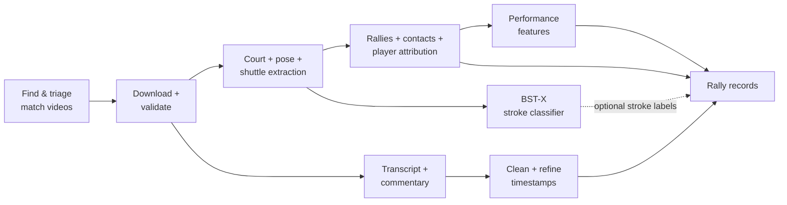

# Badminton CV Annotator

We've turned badminton broadcasts into structured evidence about **how each player is actually playing**.

We couldn't find a large existing dataset built around individual badminton performance, so we made one. We also built the systems you'd need to make a similar dataset from any collection of badminton videos.

If you're looking to build your own dataset or analyse your own games, the two most interesting sub-systems are:
- The auto-annotator. It takes a raw badminton video, extracts all the motion data, and marks up the rally boundaries and hit times. That lets you go straight to the important bits of a long, uncut video.
- The court detector. Give it a video, or even a still image, and it will find your badminton court.

Our pipeline runs end-to-end. It finds and filters match videos, downloads them, extracts court geometry, player pose and shuttle tracks, detects rallies and hits, works out who made each hit, cleans and aligns commentary, and turns the whole lot into a research-backed featureset.



Our models extract pose, court position, shuttle tracks, rally spans and hit times from each video. We turn these into research-backed measurements like posture variability, recovery behaviour, movement and timing. Our aim is to give a future weakly-supervised model enough information to learn meaningful dimensions of player performance, rather than just predicting match outcomes or stroke labels.

We've also extracted 6,254 commentary passages, so a future team can try training an auto-grader with commentary as weak labels [(Rai & Kovashka, 2026)](https://arxiv.org/html/2602.08996v1). We clean each transcript, align it to the video (WhisperX), and link it to the rally it describes.

At this stage we've built a proof-of-concept dataset from [ShuttleSet](https://arxiv.org/abs/2306.04948) (KDD 2023) and ShuttleSet22, both released by the [CoachAI group](https://github.com/wywyWang/CoachAI-Projects/tree/main/ShuttleSet). We took the hit times, hitters and shot types from those datasets' existing labels, and everything else comes from our pipeline. Our auto-annotator's shot classifications, hit timings and attributions are highly accurate, but its rallies still need some manual review, and we wanted research-grade labels throughout.

## Auto-annotator


*GIF at half speed; detected court in red*

We use physical rules to find the court, skip replays and other broadcast events, split the video into rallies, spot candidate hits and assign each hit to a player. Three gradient-boosted tree models then pick each rally's real hits and score each finished rally for confidence.

We benchmarked our annotator against [MonoTrack](https://cs.stanford.edu/people/paulliu/files/cvpr-2022.pdf) (CVPR 2022, 130k parameters), training both on the same 32 ShuttleSet videos, and testing on the separate ShuttleSet22 dataset.


*MonoTrack needs rally boundaries provided*

Our model, unlike most systems, can reliably discover its own rally boundaries to automate annotation of a raw video (bottom row).

It also gives each rally a confidence score, so you can trade recall for less manual review:

| Confidence threshold | Rallies kept / 3,327 | Right start and end | Need no fixes |
| ---: | ---: | ---: | ---: |
| 0.675 | 926 | 99.0% | 80.5% |
| 0.50 | 1,558 | 98.0% | 73.3% |

*Most fixes are a single contact per rally.*

Read the full [benchmark report](experiments/annotator/monotrack_benchmark/annotator_monotrack_own_weights_compared_writeup_v5.md), or [get started](docs/annotator/quickstart.md) with the annotator.

## Court detector

The court detector returns the four outer corners of the court in an image or video, from arbitrary camera angles and even when parts of the court are hidden. It matches line and person detections to the layout of a standard court (configurable). In video, it also checks where the players stand, which helps it reject lines that belong to another court or to nothing at all. Once the annotator knows where the court is, it can tell when the camera is showing play and convert positions to court coordinates. The detector is optimised for parallel computation, batching and GPU-acceleration.

| Court detector | Median corner error | Rallies within 5 px |
| --- | ---: | ---: |
| Ours | 3.8 px | 85.8% |
| MonoTrack's | 6.5 px | 17.2% |

*Errors are in 1920×1080 video pixels.*

We've released [court detections for all 86 ShuttleSet and ShuttleSet22 videos](data/court_detections/sset_and_sset22/extractions_20261003/README.md), covering 44,810 scenes. For 85 of the 86 videos, the main-camera court is within 5 px of the reference corners.

Read the [overview](docs/court_detector/README.md) for how it works, or the [usage guide](docs/court_detector/usage.md) to run it.

## The dataset

The dataset has 6,833 rallies from 86 professional singles matches, with 43 players: 3,182 rallies from 40 ShuttleSet videos and 3,651 from 46 ShuttleSet22 videos. Each rally comes with player pose, court position, shuttle tracks and performance measures, alongside 6,254 timestamped commentary passages.


You can see how each player moves, stands, recovers and picks their shots, rally by rally.

### Dataset handover

Download the dataset from the [v2 release](https://github.com/ahalp90/badminton_cv_annotator/releases/tag/dataset-v2). The optional supporting extracts are on [Google Drive](https://drive.google.com/drive/folders/1BnkYZrfo1KfIXe4aK7PSRtrEirVhWHP1).

| Download | Contents |
| --- | --- |
| `cosc595-dataset-main.zip` (141 MB) | Rallies, hits, per-player features and match trends, commentary, court-position and posture arrays, the schema and a loading helper |
| Supporting extracts | Optional saved pose, shuttle, court and filtering outputs |

## Earlier work: BST-X

This project grew out of our earlier stroke classifier, **BST-X**. It classifies a single stroke from pose and shuttle data around the hit. On ShuttleSet's original 25 stroke classes it beat the published BST and TemPose models, with our best run reaching about **0.830 macro-F1**, or **0.865** on the ShuttleSet authors' 10 broader stroke types.


We've largely finished that work and moved on from single strokes to whole rallies and, eventually, player performance.

## Running it

You'll need Python 3.12+, [uv](https://docs.astral.sh/uv/), FFmpeg, and a CUDA GPU for the full vision pipeline. If you only want to use the dataset, Python with pandas and numpy is enough.

Install the base dependencies and dev tools, then run the checks:

```bash
git clone https://github.com/ahalp90/badminton_cv_annotator.git
cd badminton_cv_annotator
uv sync --extra dev

uv run ruff check .
uv run pyrefly check
uv run pytest
```

For the full test suite, add `--extra bst-x-runtime` for the classifier modules and install `safetensors` for the court models. You'll find the other extras in [`pyproject.toml`](pyproject.toml).

To build a dataset, run the pipeline:

```bash
PYTHONPATH=src uv run python -m dataset_builder run \
  --config configs/dataset_builder/trial.toml \
  --run-dir /absolute/path/to/run
```

With the trial config, it also finds videos online and processes commentary. If you re-run it against the same folder, it checks and reuses the stages it's already finished instead of redoing the expensive vision work.

Before a full run:

- Put the TrackNet, InpaintNet and court model weights at the paths in [`trial.toml`](configs/dataset_builder/trial.toml), or change the paths to match.
- Point `BADMINTON_TRACKNET_PYTHON`, `BADMINTON_POSE_PYTHON` and `BADMINTON_COURT_PYTHON` at the Python each extraction stage should use. All three can be the project's `.venv/bin/python`.
- Set `GEMINI_API_KEY` for the commentary stage.
- Pose extraction and court detection both run in the root environment. For their CUDA setup, see the [court usage guide](docs/court_detector/usage.md#cuda-pose-inference).

To rebuild the dataset, run the pipeline above, then write the tables with `python -m dataset_builder export-v1` for ShuttleSet and `export-v1-shuttleset22` for ShuttleSet22. Add `--help` to either to see its inputs.

## Project

Capstone project at the University of New England (Australia). Ongoing research and maintenance by Ariel Halperin.

| Stage | Contributors |
| --- | --- |
| Ongoing | **Ariel Halperin** |
| COSC595 | **Ariel Halperin** (machine learning); **Curtis Martin** (dataset) |
| COSC594/COSC320 | **Ariel Halperin** (BST-X); **Scott Bailey** (BRIC stroke classifier); front end led by **Curtis Martin**, with Scott Bailey, Kiri Lefebvre, Isiah Darcy, Ethan McDonough and Jared Pitman |

Licensed under the **GNU Lesser General Public License v3.0 or later**. See [COPYING.LESSER](COPYING.LESSER), [COPYING](COPYING), and [`data/ATTRIBUTION.md`](data/ATTRIBUTION.md) for third-party and dataset attribution.
