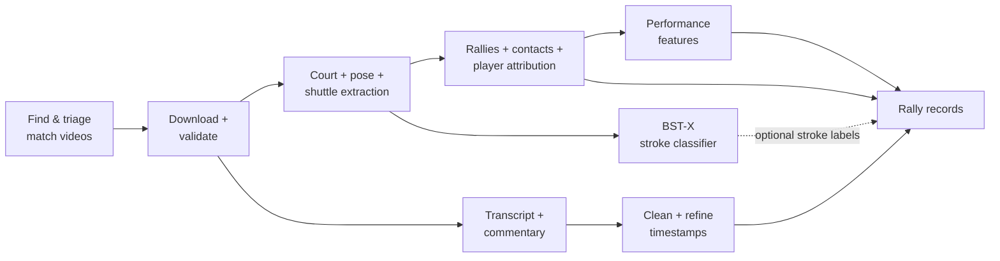
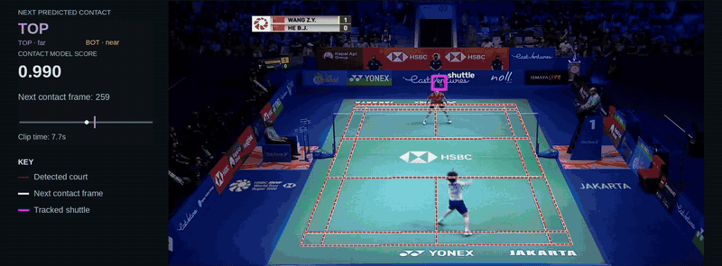
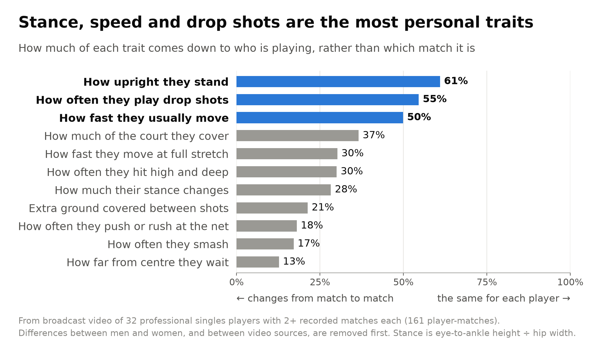

# Badminton Computer Vision Annotator

Our code turns badminton video into rallies, hit times and measures of how each player moves. We used it to build a dataset for assessing badminton players, adding pose, court position, performance measures and commentary to 6,833 rallies from 86 professional matches.

If you're looking to build your own dataset or analyse your own games, the two most interesting sub-systems are:
- The auto-annotator. It takes a raw badminton video, extracts all the motion data, and marks up the rally boundaries and hit times. This allows you to get straight to evaluating rally play in a long, uncut video.
- The court detector. Give it a video, or even a still image, and it will find your badminton court.

Our pipeline runs end-to-end. It finds and filters match videos, downloads them, extracts court geometry, player pose and shuttle tracks, detects rallies and hits, works out who made each hit, and processes the commentary.



## Auto-annotator



*GIF at half speed; detected court in red*

We use physical rules to find the court, skip replays and other broadcast events, split the video into rallies, spot candidate hits and assign each hit to a player. Rallies are then refined and assigned confidence scores by three gradient-boosted tree models (XGBoost).

We benchmarked our annotator against [MonoTrack](https://cs.stanford.edu/people/paulliu/files/cvpr-2022.pdf) (CVPR 2022, 130k parameters), training both on the same 32 [ShuttleSet](https://arxiv.org/abs/2306.04948) (KDD 2023) videos, and testing on the separate ShuttleSet22 dataset ([CoachAI](https://github.com/wywyWang/CoachAI-Projects/tree/main/ShuttleSet)).


*MonoTrack needs rally boundaries provided*

Our annotator can discover rally boundaries in a raw video (figure above,
bottom row). Each rally gets a confidence score, so you can trade recall for
less manual review:

| Confidence threshold | Found rallies kept | Found TP rallies kept | Right start and end | Fully correct rallies |
| ---: | ---: | ---: | ---: | ---: |
| 0.50 | 1,589 | 1,364 | 85.8% | 73.7% |
| 0.70 | 821 | 734 | 89.4% | 80.9% |
| 0.80 | 265 | 247 | 93.0% | 87.5% |

*TP = correct rally boundaries. Test set: 3,327 labelled rallies; ~3,663 detections
before filtering. Five-seed averages. “Right start and end” allows up to
2 seconds early or 10 frames late for the first contact,
and 10 frames early or 3 seconds late for the last contact (at 30 fps). These
buffers match our dataset format and give useful context.*

Read the full [benchmark report](experiments/annotator/monotrack_benchmark/annotator_monotrack_own_weights_compared_writeup_v7.md), or [get started](docs/annotator/quickstart.md) with the annotator.

## Court detector

The court detector returns the four outer corners of the court in an image or video, from arbitrary camera angles and even when parts of the court are hidden. It matches line and person detections to the layout of a standard court (configurable). In video, it also checks where the players stand, which helps it reject lines that belong to another court or to nothing at all. Once the annotator knows where the court is, it can tell when the camera is showing play and convert positions to court coordinates. The detector is optimised for parallel computation, batching and GPU-acceleration.

| Court detector | Median corner error | Rallies within 5 px |
| --- | ---: | ---: |
| Ours | 3.8 px | 85.8% |
| MonoTrack's | 6.5 px | 17.2% |

*Errors are in 1920×1080 video pixels*

We've released [court detections for all 86 ShuttleSet and ShuttleSet22 videos](data/court_detections/sset_and_sset22/extractions_20261003/README.md), covering 44,810 scenes. For 85 of the 86 videos, the main-camera court is within 5 px of the reference corners.

Read the [overview](docs/court_detector/README.md) for how it works, or the [usage guide](docs/court_detector/usage.md) to run it.

## The dataset

We built the dataset from the videos and contact records of ShuttleSet and ShuttleSet22; the pose, court positions, shuttle tracks, performance measurements and commentary come from our pipeline. It has 6,833 rallies from 86 professional singles matches, with 43 players: 3,182 rallies from 40 ShuttleSet videos and 3,651 from 46 ShuttleSet22 videos. Our annotator's rallies still need some manual review, and we wanted research-grade labels throughout.



You can follow each player rally by rally, with research-backed measurements of posture variability, recovery behaviour, movement, shot preference and timing, and see how they trend across a match.

We've also collected 6,254 commentary passages. Transcripts are cleaned, their timestamps aligned (WhisperX) and linked to the rallies they describe.

Our aim is to give a future weakly-supervised model enough information to learn meaningful dimensions of player performance, with the commentary as weak labels [(Rai & Kovashka, 2026)](https://arxiv.org/html/2602.08996v1).

Download the dataset from the [v2 release](https://github.com/ahalp90/badminton_cv_annotator/releases/tag/dataset-v2). The optional supporting extracts are on [Google Drive](https://drive.google.com/drive/folders/1BnkYZrfo1KfIXe4aK7PSRtrEirVhWHP1).

| Download | Contents |
| --- | --- |
| `cosc595-dataset-main.zip` (141 MB) | Rallies, hits, per-player features and match trends, commentary, court-position and posture arrays, the schema and a loading helper |
| Supporting extracts | Optional saved pose, shuttle, court and filtering outputs |

## Earlier work: BST-X

This project grew out of our earlier stroke classifier, **BST-X**, which identifies each shot from player pose and shuttle movement. On ShuttleSet's 25 stroke classes it beat the published BST and TemPose models, reaching **0.830 macro-F1**, or **0.865** on the ShuttleSet authors' 10 broader stroke types.


## Running it

You'll need Python 3.12+, [uv](https://docs.astral.sh/uv/) and FFmpeg. If you only want to use the dataset, Python with pandas and numpy is enough.

Install the dev tools, then run the checks:

```bash
git clone https://github.com/ahalp90/badminton_cv_annotator.git
cd badminton_cv_annotator
uv sync --extra dev

uv run ruff check .
uv run pyrefly check
uv run pytest
```

You'll find the other extras in [`pyproject.toml`](pyproject.toml).

### Build your own dataset

You can build a dataset from any YouTube searches you like. You'll also need a CUDA GPU and a C++ compiler.

1. Install the dataset builder. YouTube keeps blocking older yt-dlp releases, so upgrade yt-dlp and its PO-token plugin straight after syncing. Last tested with yt-dlp 2026.08.19, Deno 2.9.7 and bgutil 1.3.1.

   ```bash
   uv sync --extra builder
   uv pip install --upgrade "yt-dlp[default,deno]" bgutil-ytdlp-pot-provider
   ```

2. Set up CUDA pose inference with the steps in the [court usage guide](docs/court_detector/usage.md#cuda-pose-inference).

3. Get the model weights. Put the TrackNet and InpaintNet weights where the [TrackNet guide](src/shared/tracknetv3/README.md#pretrained-weights) says. Then clone [DeepLSD](https://github.com/cvg/DeepLSD) at the commit we ran and download its weights:

   ```bash
   git clone https://github.com/cvg/DeepLSD.git runtime/checkpoints/deeplsd/DeepLSD
   git -C runtime/checkpoints/deeplsd/DeepLSD checkout f7d9d62
   mkdir -p runtime/checkpoints/deeplsd/DeepLSD/weights
   wget https://cvg-data.inf.ethz.ch/DeepLSD/deeplsd_md.tar -O runtime/checkpoints/deeplsd/DeepLSD/weights/deeplsd_md.tar
   ```

   Skip DeepLSD's own install script. Its relevant packages were installed at step 1.

4. Start the [bgutil PO-token server](https://github.com/Brainicism/bgutil-ytdlp-pot-provider#1-set-up-the-provider) so YouTube doesn't block your downloads. With Docker:

   ```bash
   docker run --name bgutil-provider -d --init -p 127.0.0.1:4416:4416 brainicism/bgutil-ytdlp-pot-provider
   ```

5. Copy the trial config and set your own searches in the copy. The dataset builder only runs from a clean checkout, so leave the tracked configs unchanged.

   ```bash
   cp configs/dataset_builder/trial.toml my_dataset.toml
   ```

   ```toml
   [search.terms]
   match = ["BWF World Tour women's singles final"]
   ```

6. Run it. Use `--no-sync` so uv doesn't undo your GPU setup from step 2:

   ```bash
   export BADMINTON_TRACKNET_PYTHON="$PWD/.venv/bin/python"
   export BADMINTON_POSE_PYTHON="$PWD/.venv/bin/python"
   export BADMINTON_COURT_PYTHON="$PWD/.venv/bin/python"
   export GEMINI_API_KEY=your-key
   PYTHONPATH=src uv run --no-sync python -m dataset_builder run \
     --config my_dataset.toml \
     --run-dir /absolute/path/to/run
   ```

If you re-run it against the same folder, it checks and reuses the stages it's already finished instead of redoing the expensive vision work.

The dataset builder uses Gemini to pick and clean commentary. WhisperX needs its own venv, because it pins an older torch. Without it, commentary keeps YouTube's caption timing.

## Project

Capstone project at the University of New England (Australia). Ongoing research and maintenance by Ariel Halperin.

| Stage | Contributors |
| --- | --- |
| Ongoing | Ariel Halperin |
| COSC595 | Ariel Halperin (machine learning); Curtis Martin (dataset) |
| COSC594/COSC320 | Ariel Halperin (BST-X); Scott Bailey (BRIC stroke classifier); front end led by Curtis Martin, with Scott Bailey, Kiri Lefebvre, Isiah Darcy, Ethan McDonough and Jared Pitman |

Licensed under the **GNU Lesser General Public License v3.0 or later**. See [COPYING.LESSER](COPYING.LESSER), [COPYING](COPYING), and [`data/ATTRIBUTION.md`](data/ATTRIBUTION.md) for third-party and dataset attribution.
