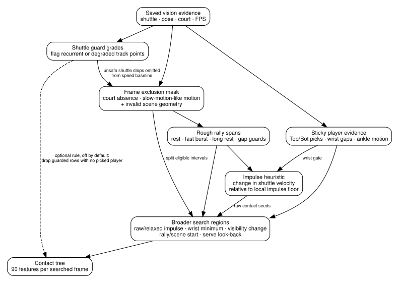

# Fixed heuristics before the trees

Before the fitted models score possible hits, rules select usable evidence,
find rough rally boundaries and track a player on each court half. They narrow
the timeline to places where a contact looks plausible. The trees then make
the contact choices from those candidates.

These rules shape what the models learn from and what they see during
annotation. A substantial change to the rules therefore usually requires a
new model fit.

**Contents**

| Evidence quality | Rally and contact search | Model inputs and code |
| --- | --- | --- |
| [Exclusions and shuttle flags](#frame-exclusions-and-shuttle-flags) | [Frame-rate scaling](#frame-rate-scaling) | [Contact search regions](#contact-search-regions) |
| [Frame exclusion mask](#frame-exclusion-mask) | [Sticky player evidence](#sticky-player-evidence) | [Contact-tree features](#what-reaches-the-contact-tree) |
| [Shuttle guard grades](#shuttle-guard-grades) | [Rough rally spans](#rough-rally-spans) | [Rule locations](#where-the-main-rules-live) |
|  | [Impulse contact heuristic](#the-impulse-contact-heuristic) |  |



## Frame exclusions and shuttle flags

Some footage, such as a replay, is unsuitable for finding live-play contacts.
Other frames are usable but have an unreliable shuttle position. The frame
exclusion mask handles the first case; shuttle guard grades handle the second.

### Frame exclusion mask

The exclusion mask removes whole frames from normal rally and contact evidence.

In the dataset-builder path, the first mask combines two signals:

- **Sustained court absence.** A missing court for at least 15 frames at 30 FPS marks that whole run as excluded. The duration scales with frame rate.
- **Slow-motion-like shuttle movement.** The shuttle is still moving, but its rolling median speed has fallen below 15% of the video's normal rally speed. Genuine rest is not classified as slow motion.

Short exclusion runs are removed unless they last at least 15 frames at 30 FPS. Full annotation then excludes frames that sit outside available court-scene geometry. The dataset-builder path also treats court-invalid frames as excluded.

The purpose is to keep replay, slow motion, prolonged non-court footage and unusable camera sections from looking like normal live-play motion. Otherwise they can create false rally boundaries, false contact evidence or misleading player geometry.

A camera angle change alone does not establish replay. The code can measure perspective shift, but the current replay mask does not reject a frame only because the court is viewed from a different angle.

Relevant code: `excluded_frames/replay.py`, `prepare_annotation_inputs.py`.

### Shuttle guard grades

Shuttle guard grades apply to the shuttle track itself rather than to the whole frame.

`excluded_frames/shuttle_hallucination.py` looks for exact coordinate sequences that recur far more often than ordinary shuttle motion should. The default pattern width is 16 frames. Repeated moving patterns are strong evidence that an inpainting or tracking stage has fallen into a fabricated loop. Repeated flat positions are suspicious but less conclusive because a real shuttle can remain still.

The current codes are:

| Code | Meaning | Current treatment |
| ---: | --- | --- |
| `0` (`UNFLAGGED`) | no repeat detected | usable |
| `1` (`REPEATED_MOVING_PATTERN`) | repeated moving pattern | flagged as unreliable |
| `2` (`REPEATED_STATIONARY_POSITION`) | repeated stationary position | flagged as unreliable |
| `3` (`REPEATED_PATTERN_HALO`) | frame in the surrounding halo | flagged as unreliable |
| `4` (`MATCHES_ANY_PATTERN_POS`) | exact position match elsewhere | flagged as unreliable |

The halo extends three frames before and after repeated runs by default. A position
match needs only one matching `(x, y)`, not the whole repeated sequence. Outside
the repeated runs, an exact position match takes precedence over the halo.

`BaseAnnotatorConfig.rejected_grades` currently contains `{1, 2, 3, 4}`.
`annotate_video()` marks positions with those grades in a boolean frame mask, which
the code calls `rejected_shuttle_frames`. Each stage uses that mask
differently, as described below.

The guard matters because fabricated shuttle coordinates can create convincing but false movement. A repeated or inpainted track can produce a sharp change in velocity, an apparent contact, or a plausible landing even when the shuttle was not really observed there.

Flagged shuttle positions affect three stages:

- **Slow-motion detection.** Speed steps that touch a flagged position are left out when the detector estimates normal rally speed.
- **Outcome rules.** Landing estimates do not use flagged positions. If the last contact of a rally sits on a flagged frame, the landing is left empty rather than measured from an earlier hit.
- **Contact candidates.** The contact tree scores flagged frames by default. The optional rule below removes some of those candidates before scoring.

A contact can therefore be selected on a flagged frame. Grades `2`, `3` and `4` mark suspicious tracking; they do not prove that no hit happened.

The saved `*_inpaint_mask.json.gz` has a different role. It records which positions came from the upstream inpainting stage. The guard codes are a later check on whether the final track contains recurrence patterns that look unsafe.

Relevant code: `excluded_frames/shuttle_hallucination.py`, `prepare_annotation_inputs.py::build_rejected_shuttle_mask()`, `rally_results/estimate_results.py`, `dataset_builder/shuttle_evidence.py`.

## Frame-rate scaling

Most time-based constants are written as 30 FPS reference values and scaled once for the source video.

Examples at 30 FPS include:

| What the rule controls | 30 FPS reference | Code name |
| --- | ---: | --- |
| Shuttle movement below this level counts as rest | `0.002` normalised image units per frame | `rest_speed` |
| Shuttle movement above this level can confirm the start of active play | `0.015` per frame | `start_speed` |
| Fast movement must last this long before it counts as a rally-start burst | 3 frames | `start_min_frames` |
| Shuttle positions are smoothed across this many frames before motion changes are measured | 3 frames | `smooth_window` |
| A rest period this long separates one rally from the next | 90 frames | `end_rest_frames` |
| The court must be absent this long before the full absence run is excluded | 15 frames | `excluded_frames/replay.py` |
| A replay or slow-motion exclusion signal must last this long before it is kept | 15 frames | `replay_mask_min_frames` |
| A possible hit is compared with nearby shuttle-motion changes across this many junctions on each side | 12 junctions | `impulse_floor_half_window_frames` |
| Raw hit-like motion changes closer than this compete so the stronger one survives | 3 frames | `contact_dedup_radius_frames` |
| Heuristic contact candidates closer than this compete after the wrist check | 9 frames | `contact_suppression_radius_frames` |

Frame counts grow with FPS. Per-frame speed thresholds shrink as FPS rises because the shuttle moves a shorter image distance between adjacent frames.

Relevant code: `config.py::scale_config_to_fps()`.

## Sticky player evidence

Pose extraction can return several people and store the same person in a
different array slot from one frame to the next. The sticky player logic tries
to follow one person on each court half across nearby frames.

Within intervals with court geometry it keeps one usable pose detection for the far court half (`Top`) and one for the near half (`Bot`). `TrackedPlayers` contains:

- selected indices into the original pose detections;
- ankle positions, divided by video width and height;
- bounding-box heights in pixels.

Wrist measurement then produces `WristGaps`: one distance per player and the
nearest distance per frame, all measured in body heights. Missing values
distinguish untracked frames from unavailable measurements within an interval.

This information later feeds contact features, serve-repair features and the initial `Top`/`Bot` guess for each contact.

Relevant code: `shared/player_tracking.py`, `annotator/player_tracking.py`,
`types.py::TrackedPlayers`, `types.py::WristGaps`.

## Rough rally spans

Rally segmentation starts from shuttle speed and visibility.

A frame counts as rest when the local shuttle speed is low. Long or difficult
tracking gaps can also count as rest. Additional rules keep a high shot that
leaves the image from immediately ending the rally.

At the current defaults:

1. shuttle position is smoothed over a short window;
2. a sustained fast burst confirms that an active region contains real play;
3. a long rest separates one active region from the next;
4. `require_fast_burst=True` opens the rally at the start of that active region once a qualifying burst has been found.

This gives deliberately broad rally spans. The fitted sequence stage later has room to repair the first contact, and final bounds can move again after contacts are selected.

Relevant code: `rallies/find_rallies.py`, `rally/trajectory.py`, `config.py`.

## The impulse contact heuristic

An **impulse** is the size of the change in shuttle velocity around a frame.

After smoothing the shuttle coordinates, the code forms a velocity vector between each pair of neighbouring smoothed positions. At each junction it then compares the incoming and outgoing velocity vectors:

```text
impulse = magnitude(outgoing velocity - incoming velocity)
```

A straight flight at steady speed has a small impulse. A racket contact often changes shuttle speed, direction, or both, which produces a larger value.

The heuristic does not use one global impulse threshold. It compares each impulse with a rolling local median, called the **impulse floor**. A raw candidate currently needs:

- visible shuttle positions across the three frames around the junction;
- an impulse more than 4 times the local floor;
- enough spacing from a stronger raw impulse candidate.

The heuristic chain then checks whether a tracked wrist is within 1.4 player-box heights of the shuttle. Nearby passing candidates compete again within a wider time radius, with the larger impulse surviving.

Those heuristic survivors are useful evidence, but the fitted contact model is not limited to them.

Relevant code: `contacts/heuristics.py`.

## Contact search regions

The contact tree scores a broader set of frames than the raw impulse heuristic accepts.

The search starts from frames marked by seven kinds of signal. These starting
points are called **seeds**:

| Seed | Why it can contain a hit |
| --- | --- |
| raw heuristic contact | strong local velocity change already passed the rule-based contact chain |
| relaxed impulse | weaker velocity change; current seed threshold is 1.25 times the local floor |
| wrist-distance minimum | shuttle is locally closest to a tracked wrist |
| visibility change | shuttle appears or disappears around a possible hit or occlusion |
| rally start | first-hit timing is often difficult |
| court-scene start | a cut or new court view can disturb nearby evidence |
| serve look-back | an earlier serve may sit before the first initially selected contact |

Each seed adds a short interval of nearby frames to the search. The contact
tree scores every frame in those intervals, including the seed frame itself,
so a seed can open a search region without becoming a selected hit.

Relevant code: `contacts/build_features.py`.

## What reaches the contact tree

For every searched frame, the contact model receives 18 signals at five time offsets. At 30 FPS those offsets are `-10`, `-5`, `0`, `+5` and `+10` frames.

The signals are:

- shuttle x and y velocity;
- shuttle speed;
- impulse and impulse-to-local-floor ratio;
- nearest, far-half and near-half wrist gaps;
- x and y displacement from shuttle to nearest wrist;
- ankle speed on each court half;
- shuttle visibility;
- player-pose validity on each court half;
- wrist-measurement validity on each court half;
- standing-person count within the court plus a 5% margin.

That produces 90 fitted input columns. Missing physical measurements remain `NaN`; explicit validity features tell the model what was unavailable.

The next layer is described in [How the trees work together](tree_stack.md).

## Where the main rules live

| Concern | Main source |
| --- | --- |
| Thresholds scaled to a video's frame rate | `config.py` |
| Preprocessing settings scaled to the video frame rate | `config.py::scale_config_to_fps()` |
| replay / off-rally exclusion | `excluded_frames/replay.py` |
| shuttle recurrence guard | `excluded_frames/shuttle_hallucination.py` |
| sticky player picks | `player_tracking.py` |
| rally boundaries | `rallies/find_rallies.py` |
| impulse contacts and wrist-distance check | `contacts/heuristics.py` |
| broader contact search regions | `contacts/build_features.py` |
