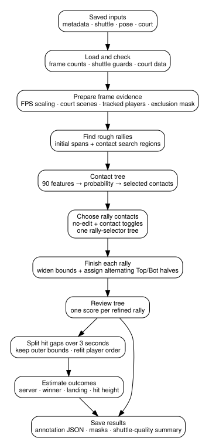

# How the auto-annotator works

The annotator turns saved shuttle tracks, player poses and court geometry into
rallies, racket contacts and estimated outcomes. Start with
[`annotate_video()`](../../src/annotator/annotate_video.py): it shows the order of the
work. The [quickstart](quickstart.md) explains how to supply a video's files.

The main path has three parts:

1. Rules find playable stretches, rough rallies and possible contacts.
2. XGBoost scores contacts and chooses rally sequences. Long gaps split rallies;
   a second selector corrects only those pieces.
3. Rules assign court halves and estimate the server, winner, landing and hit height.

A separate model gives each rally a review score. It orders manual inspection;
it does not remove contacts or approve rallies. `heuristic_only=True` skips the
fitted models and uses the rule-based contacts for the outcome stage.

## Start with one shared video timeline

Every input uses the original video's frame numbers. The shuttle track has one
normalised `(x, y, visibility)` row per frame. Pose arrays contain detected player
boxes and keypoints. Court records identify usable scenes and provide the
image-to-court transform, called a homography.

Rally bounds include `start` and exclude `end`: `[start, end)`.
The frame rate scales timing and movement thresholds. A frame is never renumbered
when a replay or tracking gap is excluded.

Within each usable court scene, the player picker follows one person on each
court half. It favours the same person across nearby frames; this is the
"sticky" player evidence in the code. Wrist-to-shuttle distances and player
motion are measured from the original track before masking.

## Find rough rallies and contacts

The exclusion mask marks footage such as replays and prolonged court absence.
When bounds are not supplied, a first pass finds rallies on the unmasked track
to estimate normal play speed for replay detection. Those preliminary bounds
are discarded; rally detection runs again after masking.

For rally detection, excluded coordinates are held at rest so they cannot create
movement. Full annotation also excludes frames without available scene geometry.

Shuttle-quality grades serve a different purpose. They mark unreliable shuttle
positions without necessarily excluding the entire frame. Those positions are
omitted from the normal-speed estimate and landing evidence. An optional contact
setting can also reject unreliable candidates without nearby player evidence;
that setting is off in the selected model.

Long rests divide shuttle activity into rough rallies. A sustained fast burst
confirms play. The selected opening rule includes the activity leading into the
burst. Tracking-gap rules prevent some high shots from being mistaken for rests.
Callers may supply rally bounds instead, as the supplied-boundary MonoTrack
benchmark does.

The contact heuristic looks for abrupt changes in shuttle velocity. It compares
each change with nearby motion, then checks wrist proximity and suppresses weaker
nearby candidates. In heuristic-only mode, these contacts feed player attribution
and outcome estimation directly. The learned path uses them as one source of
contact-search evidence.

See [Fixed heuristics](heuristics.md) for the individual rules and research controls.

## Score possible contact frames

The contact search includes impulse peaks, wrist-distance minima, visibility
changes, rough rally starts, scene starts and a serve look-back window.
[`contacts/build_features.py`](../../src/annotator/contacts/build_features.py) measures
90 values per candidate frame: 18 shuttle/player/count signals at five time offsets.
It applies the search-region priors once and returns only candidate rows. Both
training and inference use those rows directly. Time offsets still refer to the
full video timeline, including frames outside the candidate set.

The standing-person count includes all qualifying detections within the court
plus a 5% margin, including people not selected as either tracked player.
Seated poses and detection scores at or below 0.2 are excluded. Counts cover
every frame with court geometry. Missing geometry is NaN; a known court with
no standing detections is zero. The model learns how to use this count.

[`contacts/score_candidates.py`](../../src/annotator/contacts/score_candidates.py) scores candidates
with the contact classifier. Candidates compete by probability and temporal
separation. The selected cutoff is 0.9. Lower-scoring candidates remain available
for the next stage, which can recognise a useful contact from the rally as a whole.

This produces both an initial contact stream and the scored candidates that could
repair it. Initial contacts outside every rough rally remain part of that stream.

### How contact training uses ground truth

The contact model learns from frames in these broad heuristic-defined search
regions, labelled against the GT contacts. It is not restricted to
the heuristic's final hit predictions.

For example, at 30 fps, a heuristic seed at frame 95 creates a search region
extending about 15 frames either side. If ground truth says the contact was at
frame 100, frames **99–101 can become positive examples**, even though the
heuristic seed was five frames off.

Within those regions:

- Frames within **±1 frame** of a labelled contact are positive.
- Frames **2–4 frames away** are ignored.
- Frames **5+ frames away** are negative candidates. Nearby negatives are kept,
  while farther ones are sampled.

These distances scale with the video's frame rate. Class balancing gives the
positive and negative examples equal total weight. The narrow positive window
teaches the model to locate the contact precisely; the benchmark's ±10-frame
evaluation tolerance is a separate allowance.

Ground truth does not force a frame into the candidate set. A labelled contact
with no eligible candidate within ±1 frame contributes no positive example.
The sampling implementation is in
[`training/contact.py`](../../src/annotator/training/contact.py).

## Choose a contact sequence for each rally

The rally model compares alternative contact sequences. Shortlist up to two
earlier serve candidates and six later-contact candidates. Keep the initial
sequence, then generate alternatives by adding shortlisted contacts and deleting
from the first contact plus the five weakest remaining contacts. The selected
model allows up to three combined changes. Spacing and neighbouring-rally bounds
restrict those combinations.

Each proposal describes the original and proposed contacts, their timing and
probabilities, raw court-half guesses, physical contact evidence and unused
candidates. The selector scores these rows and chooses the highest-scoring
proposal for each initial rally. Stable proposal order resolves equal scores.

This first selector works on rough rallies. A separately trained second selector
uses the same proposal and feature code on split pieces. Each final rally's
selector score and the gap between its top two options inform the review model.

An earlier serve can move a rally's start and absorb intervening contacts.
Contacts originally outside all rallies survive in the full stream even if an
individual proposal omits them. This is why contact membership is stored explicitly
instead of reconstructed from the final bounds.

## Finish boundaries and court halves

Boundaries and contacts are separate, interacting parts of the prediction.
The initial window helps determine which contacts belong to a rally. Candidate
revisions can change both the contacts and the window; the selector chooses
one revision for each rally.

The chosen window keeps its context: there is no maximum number of seconds
before the first contact or after the last. The final step can extend it to
provide 10 frames of context at 30 FPS, where neighbouring rallies, video edges
and contact membership allow. Supplied boundaries stay fixed.

After the first rally selector finishes, split gaps longer than three seconds
between accepted hits. Camera cuts alone do not trigger splits. Each piece
starts with its parent's selected contacts and the original hitter guesses.
Keep the parent's start on the first piece and its end on the last.

The second rally selector compares contact alternatives within each split piece.
It uses the same proposal code as the first selector, with separately trained
weights. Rebuild each shortlist from all scored candidates so previously rejected
hits can be recovered. Keep the unchanged contact sequence as an option.

Divide each gap at the midpoint and leave a small margin around that midpoint.
The margin keeps hits chosen by neighbouring pieces farther apart than the
nearby-contact distance (six frames at 30 fps). Candidates, expanded bounds and
padding must stay inside the piece's permitted interval. Contact features retain
surrounding video evidence. After selection, refit the piece's player order.
There is one correction pass; pieces stay separate. Ordinary rallies keep their
first-pass contacts and bounds. Preserve contacts outside rallies in the full
stream.

These bounds still affect landing search, including recovery when a court view
returns after the last hit. Supplied bounds bypass splitting. The high-shot
tracking-loss allowance uses the same three-second default: both limits mark
how long a rally can continue without the expected evidence. High-shot handling
measures missing shuttle frames; splitting measures gaps between accepted hits.

The window still matters. Inside it, the selector's chosen contacts are the
rally's accepted contacts; rejected candidates stay rejected. Detector contacts
outside every chosen window remain in the full contact stream.

Training also allows unlimited outward context. It judges whether a proposal's
window covers one complete labelled rally, then checks its contacts and player
sides. A window that merges neighbouring rallies or cuts into the rally beyond
the timing allowance is still wrong.

When we assess discovery, we use the first and last accepted contacts as the
rally's endpoints. We allow up to 10 frames inward at 30 FPS and unlimited
outward extension, while still rejecting merged rallies. The boundary-only
confidence assessment adds an outward limit of 2 seconds before the first
labelled contact and 3 seconds after the last. It keeps the same inward
allowance and ignores errors in the interior contacts and player sides.

Dataset export is a separate step. It uses the first through last accepted
contact as the core rally interval, then adds exactly 2 seconds before and
3 seconds after, except at video edges. These clips may overlap. A detected
rally with no accepted contacts stops export so it can be reviewed. Export
does not change the discovery predictions used for evaluation.

Each contact initially has an individual court-half guess: `Top` for the far
half, `Bot` for the near half, or unknown. The finishing rule chooses the
alternating pattern that best matches those guesses. A tied vote uses the order
with the smaller sum of shuttle-to-wrist distances, normalised by player height.
Each contact contributes only when both court halves have usable distances.
Equal or unavailable distance sums fall back to the first known guess. When no
guess is known, all players stay unknown. These are court halves, not player identities.

The review model scores each final rally using its chosen proposal, selector
score and final boundaries. Corrected pieces use the second selector's evidence;
ordinary rallies use the first selector's evidence. Measure side agreement from
the original guesses, since enforced alternation would hide uncertainty.

## Estimate outcomes and return the result

Start with `build_outcomes()` in
[`rally_results/estimate_results.py`](../../src/annotator/rally_results/estimate_results.py). For each rally,
check the last contact, choose a camera view for the final flight, find its
landing, then determine the winner. The next server takes precedence over the
landing estimate. Insufficient evidence can leave an outcome unresolved while
retaining the contacts.

Each landing search stays within one camera view. When the final contact falls
outside the available court views, a returning view within that rally can still
provide a landing. The unseen part of the flight prevents a net-fault call.
Optional diagnostics record rejected shuttle observations. Experiments compare
shorter search windows after ordinary inference. Hit heights are calculated separately for each contact.

`AnnotatorResult` holds the public result. The dataset builder saves all of its
fields. In particular:

- `rallies` retains each finished sequence and its final striker; contact membership comes from its events.
- `contact_events` is the full learned contact stream, including contacts outside rallies.
- `rally_confidence` holds review scores in rally order.
- `outcomes` groups winner, landing and geometric estimates by rally; contact heights and unavailable-height reasons are keyed by frame.

`annotate_video` returns a `VideoAnnotation` containing the finished result
and both exclusion masks. Pass `keep_working_data=True` to also retain prepared
inputs and model scores for inspection.

Run landing-time comparisons separately with
`experiments.annotator.landing_search.compare_landing_searches()`.

The standalone command, dataset builder and MonoTrack adapter all call
`annotate_video()`. Their loading and persistence differ; the annotation decisions
come from the same function. See [Inputs and outputs](inputs_outputs.md) for
the saved contracts, [Code map](code_map.md) for source entry points, and
[How the trees work together](tree_stack.md) for model and training details.
