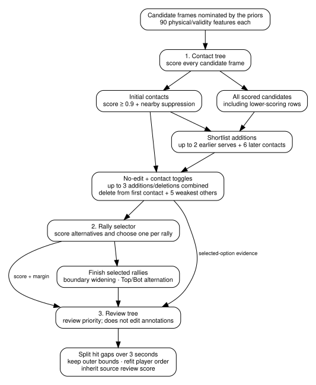
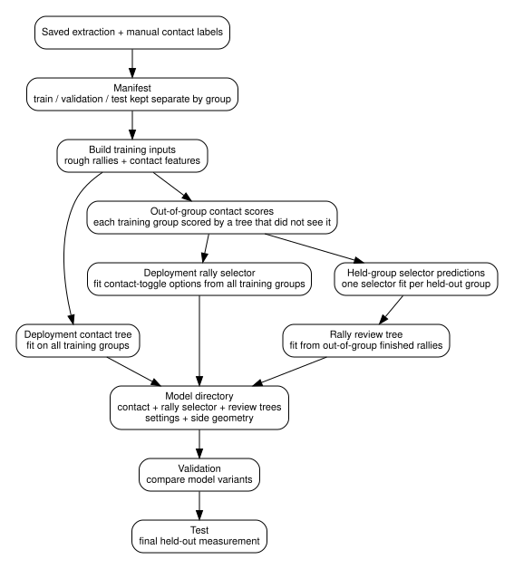

# How the trees work together

The annotator uses four XGBoost classifiers. The contact model scores candidate
frames. The first rally selector chooses a contact sequence for each rough rally.
After long gaps split a rally into pieces, the second selector corrects those
pieces. The review model scores the final rallies for manual inspection.

## The selected model

Use the [deployed bundle](../../runtime/deployed/annotator/). It was fitted on
32 training videos; seed offset 100 was selected on validation from offsets
0, 100, 200, 300 and 400. The contact features include standing-person counts.
The high-shot tracking-loss allowance and the maximum accepted-hit gap before
splitting are both three seconds.

The second selector was trained on ordinary rallies and split pieces. Training
reuses the contact fits while making new rally-selector and review examples.
See the [experiment results](../../experiments/annotator/post_split_correction/README.md)
for the comparison with unchanged weights, extra contact fits and the earlier
published pipeline.

| Model | Question | Input values | Maximum rounds | Maximum leaves | Learning rate | Base seed |
| --- | --- | ---: | ---: | ---: | ---: | ---: |
| Contact | Is this frame a racket contact? | 90 | 360 | 63 | 0.06 | 20260824 |
| First rally selector | Does this contact sequence match a complete rally? | 503 | 400 | 63 | 0.05 | 20260905 |
| Second rally selector | Which contact sequence best corrects this split piece? | 503 | 400 | 63 | 0.05 | 20260905 |
| Review | How likely is the final rally to be correct? | 27 | 100 | 7 | 0.05 | 20260905 |

All four use minimum child weight 5 and L2 regularisation 1. The selectors share
feature definitions and proposal settings, but have different fitted weights.

## Contact model

The contact features describe shuttle motion, tracked players and the count of
standing people near the court at five time offsets. The model scores candidates
within the search regions created by the heuristics. High-scoring candidates
compete with nearby frames, then the 0.9 cutoff determines the initial contact
stream.

All scored candidates remain available after that cutoff. Either rally selector
can recover a lower-scoring frame when it compares complete contact sequences.

## First rally selector

For each rough rally, keep the initial contact sequence as an option. Generate
alternatives by adding shortlisted earlier or later contacts and deleting from
the first contact plus the five weakest remaining contacts. The default budget
allows up to three additions/deletions combined. Temporal separation and
neighbouring-rally bounds restrict those combinations.

Each row contains:

- summaries of the original and proposed contacts;
- agreement between their individual court-half guesses;
- counts and probabilities of added and deleted contacts;
- physical features of the original first contact, new first contact,
  strongest addition and weakest deletion;
- evidence from unused candidates and the gaps between contacts.

The highest score wins within each rough rally. Equal scores preserve proposal
order. Finishing can add ten frames of context at 30 fps, subject to neighbour,
video-edge and contact-membership checks. Existing outward context is retained.
The chosen contacts belong explicitly to that rally; contacts outside every
chosen rally remain in the full stream. Fit the alternating hitter order from
the original individual guesses.

## Split pieces and the second rally selector

Split accepted-hit gaps strictly longer than three seconds. Keep the parent's
start on the first piece and its end on the last. Each piece begins with its
share of the selected contacts and the original hitter evidence.

Build a fresh shortlist from all scored candidate rows for each piece. Divide
the gap between sibling pieces at its midpoint. Exclude a small margin around
that midpoint so contacts added to opposite pieces stay more than six base-30
frames apart. Scale that spacing with the video's frame rate. Each piece may
recover hits before its first or after its last selected contact, inside these
bounds. Contact features still use surrounding video evidence.

Use the same proposal and selection code as the first pass, including the
unchanged contact sequence. After choosing, pad boundaries within the piece's
allowed interval and refit its player order. There is one correction pass;
pieces cannot merge. Ordinary rallies retain their first-pass contacts and
bounds. Supplied rally bounds bypass splitting and the second selector.

## Review model

Score every final rally using its chosen proposal, selector score and score
margin, plus a summary measured with its final boundaries. Corrected pieces
use the second selector's evidence; ordinary rallies use the first selector's
evidence. Measure side agreement from the original individual guesses so the
forced alternating order does not hide uncertainty.

The result is `rally_confidence`, in final rally order. Review scores order manual
inspection; they do not change contacts or apply an acceptance threshold. The
review model is fitted on final corrected outputs. Thresholds measured for an
older review model do not describe this model's accuracy.

## What the training labels mean

By default, contact training labels frames inside broad search regions: within
one base-30 frame of a labelled contact is positive, distances of two to four
frames are ignored, and five or more frames are negative candidates. It keeps
nearby negatives and samples more distant ones. See the
[worked example](how_it_works.md#how-contact-training-uses-ground-truth).
Sampling order and fit-row order both affect reproduction.

Both selectors judge proposed contact sequences. A proposal is wrong if it
merges rallies, misses or adds contacts, contradicts known player sides, or cuts
into a labelled rally beyond the timing allowance. Outward context is unlimited.
Training judges the proposal's window; benchmark discovery scoring uses its first
and last accepted contacts. Player correctness is judged after fitting the
alternating order, including the wrist-distance tie-break. Missing labels can
make an example unjudgeable; those rows are excluded from fitting.

The selector prefers labels matched within five frames at 30 fps when a rally
has a positive option at that tolerance. Otherwise it uses ten-frame labels.
Each judged rally receives total training weight 372 by default, divided equally
among its judged options. Set `RallyFitConfig.span_weight` to change that weight
independently of proposal count. Split pieces and ordinary rallies form separate
proposal groups. Their labels describe correctness, not whether splitting happened.

Review labels describe final rallies at the default ten-frame tolerance.
Unjudgeable rallies are excluded. Contact radii and correctness tolerances can
be changed through fit settings; all frame counts scale with video frame rate.

## Groups and validation

Keep related footage in the same training group. At least three groups are
required. The contact stage fits a final model on all training videos and one
model for each group left out. The first rally selector learns from contact
scores made without each video's own group.

For review training, set aside one entire group. Use its excluded-group contact
model to score the other groups, and keep those contact scores fixed. Keep the
ordinary rally examples. Fit temporary first selectors on subsets of the
remaining groups to generate split-piece examples. Fit the second selector on
both, then predict the group set aside. Repeat for every group. The reviewed group's labels therefore affect none of the models used to
make its final prediction.

This method reuses contact models. Some temporary selector examples have contact
scores from a model trained on those videos. The comparison with additional
contact fits did not justify that extra training step. Separate validation videos
remain the measure of generalisation.

Fit the full second selector on ordinary examples and split pieces from predictions
made without each piece's own group. Fit the review model on the final predictions
collected above. Save the final contact model, first selector, second selector
and review model; temporary selectors are only training tools.

The benchmark uses 32 training videos and eight validation videos. Its five
runs are independent seeded fits with the same split, not five-fold
cross-validation. The selected deployed bundle uses seed offset 100.

## Saved contract

Save both `models.joblib` and `metadata.json`. The bundle uses schema
`annotator-four-models/1`; metadata records preprocessing, contact selection,
runtime versions, feature order and proposal budgets for both selectors.
`AnnotatorModels.rally_selector` is the first selector and `followup_selector`
is the second. Use the corresponding historical checkout for earlier bundles.

Changing feature order or proposal semantics requires a new fit and evaluation.
See the [refit guide](retuning.md) for commands, configuration and saved results.
