# Our annotator and court detector compared with MonoTrack

This report asks how well our badminton annotator, and the court detector
inside it, label broadcast video compared with
[MonoTrack](https://cs.stanford.edu/people/paulliu/files/cvpr-2022.pdf). Both
systems mark when each racket hit happens and which player made it (near or
far). The test set is 46 professional broadcast videos from ShuttleSet22:
3,327 scored rallies holding 37,184 labelled hits. Another 524 rallies in these
videos have flawed labels. The test set leaves them out, and every result here
ignores them (Appendix G).

Both systems learnt from the same 32 videos of the original ShuttleSet, with
the same 8 videos held out for choosing settings.[^datasets] MonoTrack's hit
detector was rebuilt from its
[committed source code](https://github.com/jhwang7628/monotrack), which defines
a 130,179-parameter network. The published paper describes a model of about
16,000 parameters whose original weights have been lost.[^original-weights]

Our annotator finds candidate hits from the shuttle's motion and assigns each
hit to a player. Three gradient-boosted decision-tree models (the "trees") then
score candidate hits, choose each rally's hits and rank finished rallies by
confidence. "Trees off" means the same pipeline with all three disabled, using
rule settings tuned on the same 32 videos.

## Short answer

- **Given the rally bounds, our annotator leaves more rallies with nothing to
  fix, and MonoTrack makes fewer hit errors.** Ours gets 59.7% of rallies
  fully correct, against 48.2% for MonoTrack. A fully correct rally has every
  hit found, no extra hits and every hitter right, with each hit within 10
  frames of its label. The gap is 11.5 points (95% interval 8.9 to 14.2), and
  ours is higher on 42 of 46 videos (Figure 1). MonoTrack makes
  2,987 hit errors (missed, extra or wrong hitter) against 3,143 for ours,
  mainly because ours gives the wrong hitter more often (767 against 75). Ours
  adds fewer extra hits (386 against 905), and its errors sit in fewer rallies:
  1,342 against 1,725 (Figure 3). Which costs a person more depends on how
  their checking time splits between finding a rally's errors and editing
  them, which this report does not measure.
- **Both find hits about equally well, and MonoTrack names the hitter more
  reliably.** Contact F1 is 96.7% for ours and 96.0% for MonoTrack.
  Correct-player F1 is 94.6% for ours and 95.8% for MonoTrack.
- **Our annotator can also find the rallies itself.** MonoTrack's released code
  needs each rally cut out beforehand. Working from the whole video, ours gets
  54.8% of rallies fully correct, and 88.0% have the right start and end. Its
  confidence score can pick out a cleaner subset: at a threshold of 0.335, it
  keeps 2,224 of about 3,663 found rallies, and 68.1% of those are fully correct:
  1,513 rallies, or 45.5% of all labelled rallies (Figure 6).
- **Both court detectors place the court close enough that swapping courts
  barely changes the scores.** The median corner error against ShuttleSet22's
  reference corners is 3.8 px for ours and 6.5 px for MonoTrack (Figure 2).
  Swapping courts between the systems moves every score by 0.17 points or less.
  The 2.7 px gap between the medians is within a painted line's width; the
  clearer differences are in how each detector fails.
- **The trees do most of the work, and they are fairly stable.** With all three off,
  ours gets 6.6% of rallies fully correct. Across five training seeds, fully
  correct rallies span 58.4% to 60.5%.

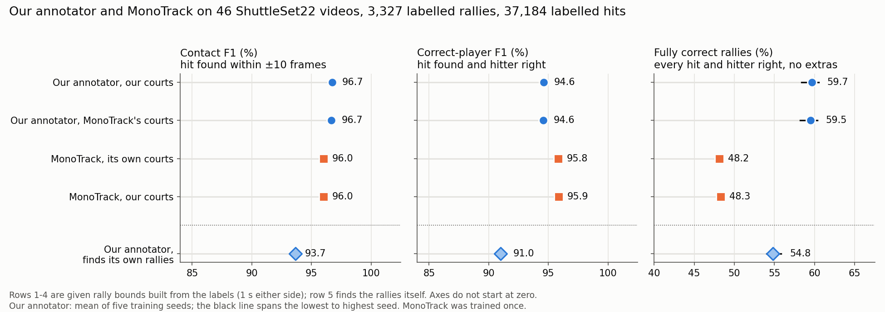

Figure 1. The three headline scores for each set-up, ±10 frames. The top four
rows are given the rally bounds; the bottom row finds the rallies itself. Black
lines span our annotator's lowest to highest seed. Axes do not start at zero.

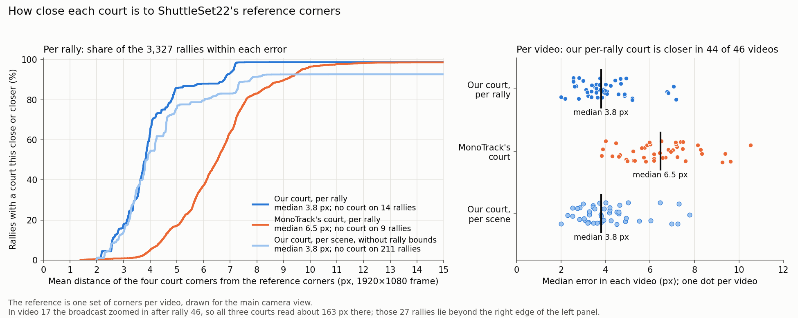

Figure 2. How close each rally's court is to ShuttleSet22's reference
corners. Left: the share of the 3,327 rallies whose court is within each error,
up to 15 px. Rallies with no court keep each line below 100%. Right: each
video's median error. Our per-rally court is closer than MonoTrack's in 44 of 46
videos. "Per scene" is the court our annotator uses when it finds the rallies
itself (discovery mode, Appendix C).

## Main results

Table 1. All conditions at ±10 frames (one third of a second). Our annotator's
values are the mean of five training seeds, with the lowest and highest seed in
brackets. The other rows are deterministic or single runs.

| System | Courts | Rally bounds | Contact F1 | Correct-player F1 | Fully correct rallies |
|---|---|---|---:|---:|---:|
| MonoTrack | Its own | Given | 96.0% | **95.8%** | 48.2% |
| MonoTrack | Ours | Given | 96.0% | **95.9%** | 48.3% |
| Our annotator | Ours | Given | **96.7%** (96.7–96.9) | 94.6% (94.4–94.8) | **59.7%** (58.4–60.5) |
| Our annotator | MonoTrack's | Given | 96.7% (96.6–96.8) | 94.6% (94.4–94.7) | 59.5% (58.2–60.3) |
| Our annotator, trees off | Ours | Given | 88.7% | 71.0% | 6.6% |
| Our annotator, trees off | MonoTrack's | Given | 88.7% | 70.9% | 6.6% |
| Our annotator | Ours, per scene | Found by the annotator | 93.7% (93.5–93.7) | 91.0% (90.6–91.3) | 54.8% (54.0–55.8) |
| Our annotator, trees off | Ours, per scene | Found by the annotator | 77.8% | 63.3% | 4.2% |

- **Contact F1** combines precision (the share of predicted hits that match a
  labelled hit) and recall (the share of labelled hits found). A match must be
  within 10 frames, and each prediction can match only one label.
- **Correct-player F1** also needs the right hitter. A hit at the right time
  with the wrong player counts as one miss and one false hit.
- **Given rally bounds** run from 1 second before each rally's first labelled
  hit to 1 second after its last. Only hits inside the bounds are scored.
- **Found by the annotator** means it works on the whole video. Every predicted
  hit counts, including those outside any scored rally. The one exception is
  hits inside the 524 left-out rallies, which are ignored (Appendix G). A found
  rally is fully correct when it covers exactly one labelled rally, its hits
  match that rally's hits one to one with none left over, and every hitter is
  right. "Covers" lets the found rally's edges fall up to 10 frames short of the
  first or last labelled hit, the same allowance hit timing gets.
- **The 95% intervals** come from 10,000 paired bootstrap resamples of the 46
  videos. Our annotator's counts are averaged over its five seeds before
  resampling.

Ours leads on Contact F1 by 0.7 points (95% interval 0.4 to 1.0), with the
higher score on 35 of 46 videos. MonoTrack leads on Correct-player F1 by 1.2
points (0.6 to 1.8), with the higher score on 30 of 46 videos.

## What the numbers mean for labelling work

A person checking the output fixes three kinds of hit error: add a missed hit,
delete an extra one, or change the hitter. With rally bounds given, ours makes
about 3,143 such errors and MonoTrack 2,987 (Figure 3). Ours misses about as many
hits (1,990 against 2,007) and adds fewer (386 against 905), but gives the wrong
hitter more often (767 against 75). Ours makes these errors in fewer rallies.
That is why it leaves more rallies with nothing to fix, even though it makes
more hit-level errors overall.

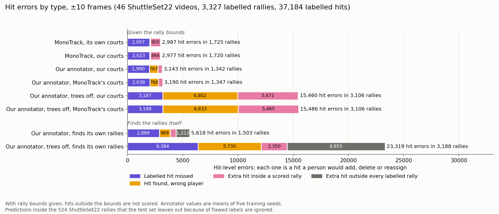

Figure 3. Hit errors by type, ±10 frames. Each error is one hit a person would
add, delete or reassign. The text beside each bar gives the total and how many
scored rallies hold at least one error. Dark grey: extra hits outside every
labelled rally, which count only when the annotator finds its own rallies.

The pattern holds video by video (Figure 4). Ours has more fully correct
rallies on 42 of 46 videos, and higher Contact F1 on 35. MonoTrack has the higher
Correct-player F1 on 30.

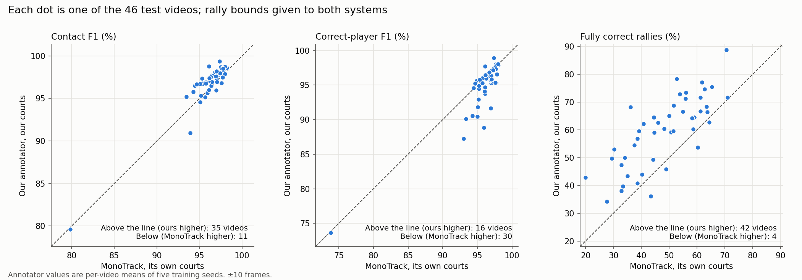

Figure 4. One dot per video, both systems given rally bounds and using their own
courts.

## Finding the rallies without help

With no rally bounds, our annotator must decide where each rally starts and
ends. Figure 5 breaks its rally results into three nested steps:

1. **Boundaries right:** one found rally spans the whole labelled rally, from
   its first labelled hit to its last, and no other labelled rally's hits sit
   inside it.
2. **Hits right:** that found rally also holds every labelled hit and no extra
   hits. Hitters are not checked.
3. **Fully correct:** every hitter is right as well.

The found rally's edges may fall up to 10 frames short of the first or last
labelled hit, the same allowance hit timing gets. Without it, about 2.1 points
fewer rallies would pass the first step, mostly where the found rally starts a
few frames after the labelled serve.

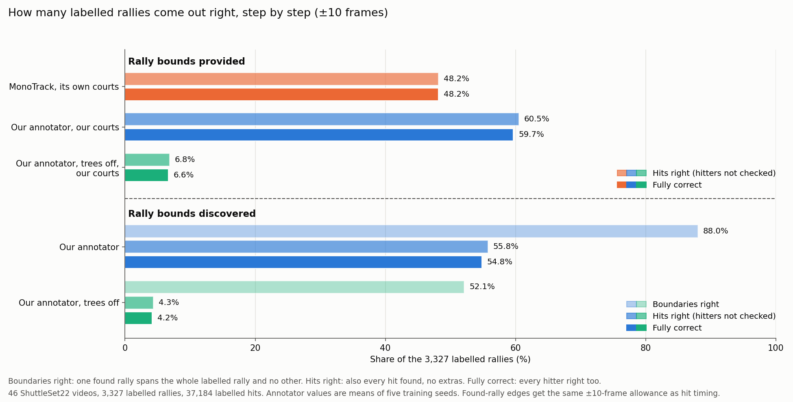

Figure 5. Share of the 3,327 scored rallies reaching each step. With rally
bounds given, the boundaries are already set, so only the last two steps apply.

The annotator gets the boundaries right for 88.0% of labelled rallies, and 55.8%
also have every hit right. Once the boundaries are right, most failures come
from missed hits, extra hits or wrong hitters, as with rally bounds given. With
its trees off, boundaries are right for 52.1% of rallies and 4.2% end up fully
correct.

Contact F1 drops from 96.7% with rally bounds given to 93.7% here. Two things
account for most of the drop:

- **Hits outside every rally.** 1,212 predicted hits sit outside every
  ShuttleSet22 rally. What they show (replays, warm-ups or play between
  rallies) has not been checked.
- **Rallies with no court.** In 211 rallies (1,461 labelled hits) this mode
  found no usable court, so the annotator predicted nothing there. Appendix D
  examines eight examples. They suggest that missed shot changes can leave the
  court search looking at graphics, close-ups or other camera views.

### Keeping only the confident rallies

Each found rally gets a confidence score from one of the trees. The score was
trained to predict whether the rally is fully correct. Raising the threshold
keeps fewer rallies, and more of those kept are right (Figure 6). No single
threshold suits every use, so Figure 6's right panel shows the whole trade-off.
Each point on that curve is one threshold. Moving left along it hands over fewer
rallies, and more of those are right.

Figure 6 and Table 3 mark three thresholds:

- **0.335, keeps half.** On the 8 validation videos, it keeps half of the
  found rallies.
- **0.385, the best balance.** On the validation videos, it gives the highest
  F1 for picking out fully correct rallies.
- **0.75, for boundaries.** On the validation videos, it is the lowest threshold
  at which 99% of kept rallies have the right start and end.

Table 3. Test results at each threshold, five-seed means. Each seed finds about
3,663 rallies, more than the 3,327 labelled ones: about 645 of them match no
labelled rally, and about 89 cover only part of one or join two. The two share
columns are shares of the kept rallies. The next column counts the kept rallies
with the right start and end, whether or not their hits are right. The last
column counts the kept rallies that are fully correct, with their share of all
3,327 labelled rallies.

| Threshold | Rallies kept (of 3,663 found) | Share fully correct | Share with the right start and end | Kept rallies with the right start and end | Fully correct rallies handed over |
|---|---:|---:|---:|---:|---:|
| 0.335 | 2,224 | 68.1% | 96.4% | 2,144 | 1,513 (45.5%) |
| 0.385 | 1,992 | 69.9% | 97.0% | 1,932 | 1,391 (41.8%) |
| 0.75 | 557 | 83.4% | 99.1% | 552 | 464 (14.0%) |

The share and the count answer different questions. The share says how far a
person can trust what they are handed: at 0.335, about 2 rallies in 3 need no
fixes. The count says how much of the labelling is done: 1,513 of the 3,327
rallies, nearly half.

Most kept rallies that are not fully correct still have the right start and
end. At 0.335, 2,144 of the 2,224 kept rallies have the right start and end,
and 1,513 are fully correct. That leaves about 630 rallies with the right
start and end that need only their hits corrected.

If only the start and end matter, the 0.75 threshold, chosen on validation,
keeps 557 test rallies, and 99.1% of them have the right start and end. On
test, that share first reaches 99% at 0.71, keeping 774 rallies, but that value is read off
the test set itself. The validation videos are harder for the annotator: 44.3%
of their rallies come out fully correct, against 54.8% on test. At 0.75 each
seed keeps only about 105 validation rallies, so that choice rests on few
rallies.

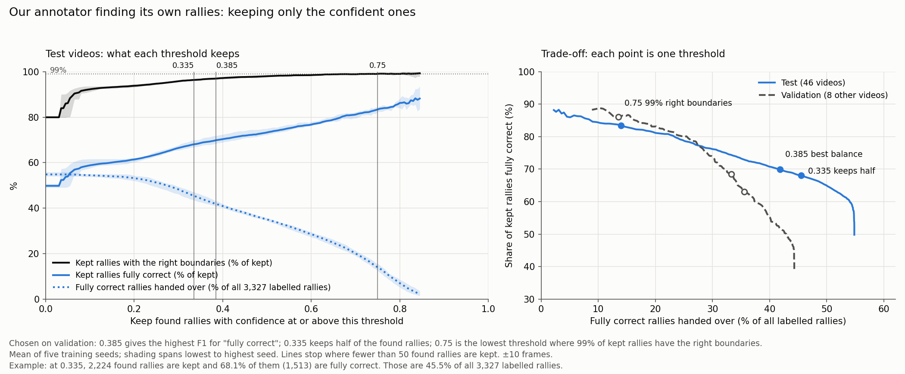

Figure 6. Left: on the test videos, what each threshold keeps. Right: the share
of kept rallies that are fully correct, against the fully correct rallies handed
over as a share of all labelled rallies, for test and validation. Lines are the
mean of five seeds; shading spans the lowest to highest seed.

## Court detection

Table 2. Each rally's court against ShuttleSet22's reference corners. Error is
the mean distance between matching corners, in 1920×1080 video pixels. IoU is
the overlap area of the two court outlines divided by the area they cover
together. For the per-scene row, each rally's court is the per-coordinate median
of the accepted courts on the frames within its rally bounds; frames without a
court are left out.

| Court source | Rallies with a court | Median error | Within 5 px | Median IoU | Rallies over 15 px |
|---|---:|---:|---:|---:|---:|
| Ours, per rally | 3,313 | 3.8 px | 85.8% | 0.986 | 27 |
| MonoTrack, per rally | 3,318 | 6.5 px | 17.2% | 0.975 | 35 |
| Ours, per scene (rallies found by the annotator) | 3,116 | 3.8 px | 75.7% | 0.985 | 31 |

ShuttleSet22 gives one set of reference corners per video, drawn for the main
camera view. Any rally filmed from another view therefore reads as a large
error, even when its court is right. A painted line is several pixels wide, and
the reference does not say which edge it marks. The 2.7 px gap between the
medians is within that width, so it does not settle which detector is more
accurate (Figure 2). The clearer difference is how each one fails.

The 39 rallies over 15 px fall into three groups:

- **27 rallies in video 17 (rallies 47–73).** The broadcast zoomed in from
  rally 47, so the reference no longer fits. All three court sources agree to
  within 4 px and sit on the painted lines (Figure 9).
- **8 rallies where MonoTrack's court is 420–778 px off.** MonoTrack fits its
  court on each rally's middle frame. In these 8 rallies that frame shows a
  close-up or another camera. Our per-rally detector returned no court on all
  8. Our per-scene courts were 3–8 px from the reference there (Figure 7).
- **4 rallies where only our per-scene court is off.** Two used a wrong scene
  court (about 4,300 and 4,700 px). Two put the right-hand sideline too far out
  (34 and 38 px); their scenes were fitted on a frame where a transition graphic
  covered the centre of the court. Our per-rally courts were 2–5 px on all four
  (Figure 8).

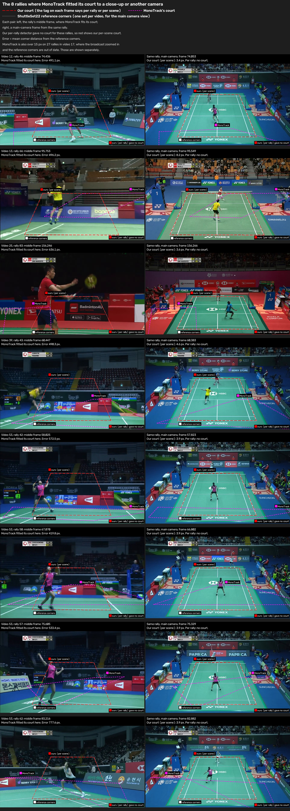

Figure 7. The 8 rallies where MonoTrack fitted its court to a close-up or
another camera. Each pair shows the frame MonoTrack fitted on (left) and a
main-camera frame from the same rally (right). Red long dashes: our per-scene
court. Fluoro-pink short dashes: MonoTrack's court. White fine dashes:
ShuttleSet22's reference corners. A tag on each frame names the source of each
outline. The bottom-right tag marks that our per-rally detector gave no court,
as it did for all 8 rallies. MonoTrack is also over 15 px on the 27 video 17
rallies, shown in Figure 9.

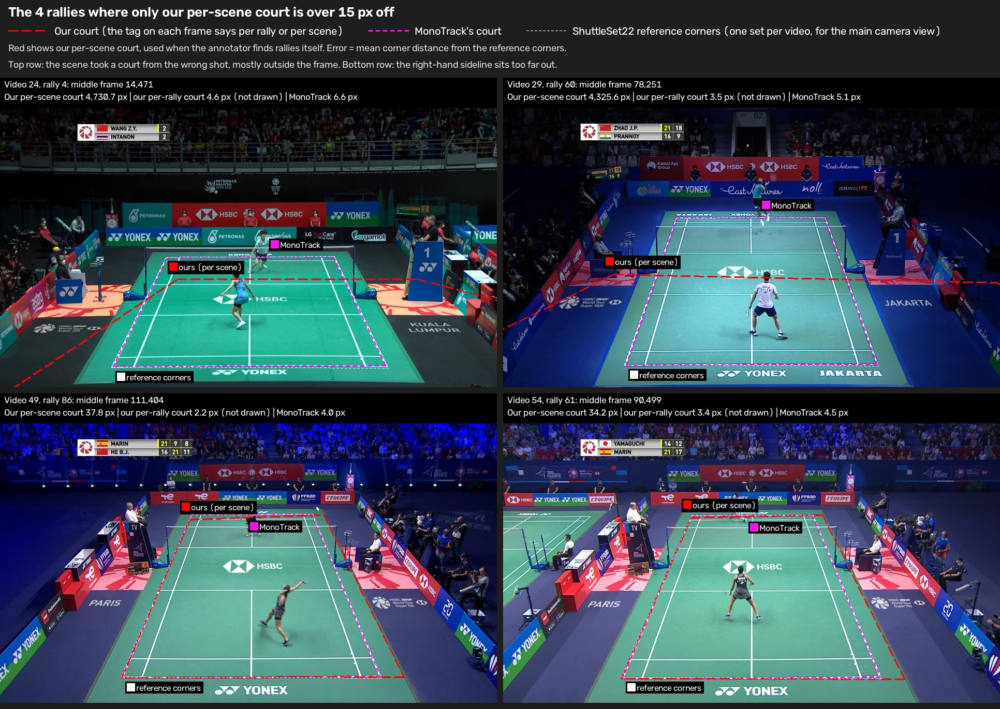

Figure 8. The 4 rallies where only our per-scene court is more than 15 px off,
on each rally's middle frame. Line styles as in Figure 7. Top row: a wrong
scene court, mostly outside the frame. Bottom row: the right-hand sideline too
far out. The scene frames those two courts were fitted on are saved for
[video 49](writeup_figures/discovery_49_f111312.jpg) and
[video 54](writeup_figures/discovery_54_f90286.jpg).

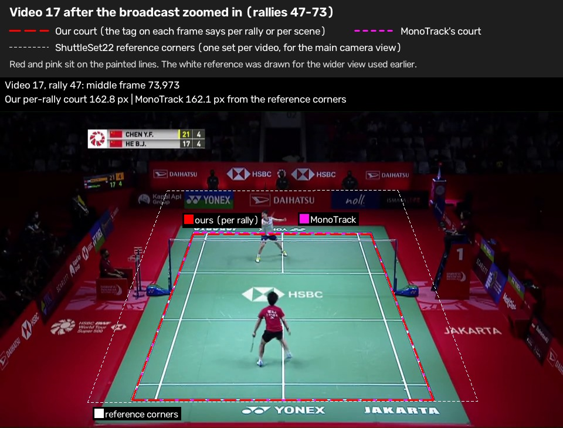

Figure 9. Video 17, rally 47, one of the 27 rallies after the broadcast zoomed
in. Red is our per-rally court. The red and pink outlines sit on the painted
lines; the white reference corners were drawn for the earlier, wider view. All
27 are on [one contact
sheet](writeup_figures/fig6_court_gallery_video17_zoom.jpg), and full-size
panels for all 39 rallies are in
[`writeup_figures/court_gallery/`](writeup_figures/court_gallery/).

**Rallies with no court.** Our per-rally detector gave no court on 14 rallies
(191 hits). A visual check found no usable court in view on 10 of them. On 2,
the two-player check rightly rejected a bad court. One good court was rejected
(video 42, rally 48), and one usable view was missed (video 32, rally 22).
MonoTrack's detector gave no court on 9 rallies (105 hits). Every system scores
these rallies as missed hits.

## How stable are the trees?

Our annotator's trees are fairly stable across training seeds, and more
training data for the contact model raises their scores modestly (Figure 10).

- **Seeds.** Across five seeds with rally bounds given, Correct-player F1 spans
  94.4–94.8% and fully correct rallies 58.4–60.5%. The 2.1-point seed spread in
  fully correct rallies is small next to the 11.5-point gap to MonoTrack.
- **Training-set size.** Training the contact model on all 40 original videos
  instead of 32 raised fully correct rallies by 1.5 points with rally bounds
  given, and by 0.3 points when finding rallies. Correct-player F1 rose by about
  0.2 points. Every seed improved with rally bounds given, by 0.4 to 2.2
  points. The 32-video models are the fair comparison with MonoTrack, so the
  headline uses them.
- **Retuning.** The preprocessing setting with the most fully correct
  validation rallies smooths player body size over 36 frames on either side. On
  test, with rally bounds given and our courts, its Correct-player F1 at ±10
  frames falls inside the range of the five seeds of the settings used here
  (Appendix B), and its Contact F1 and fully correct rallies fall just below
  that range.

Each tree is an XGBoost gradient-boosted model over named measurements of
shuttle motion and player pose. A full refit of all three takes about 25 minutes
on a machine with one GPU. Each decision traces back to those named
measurements.

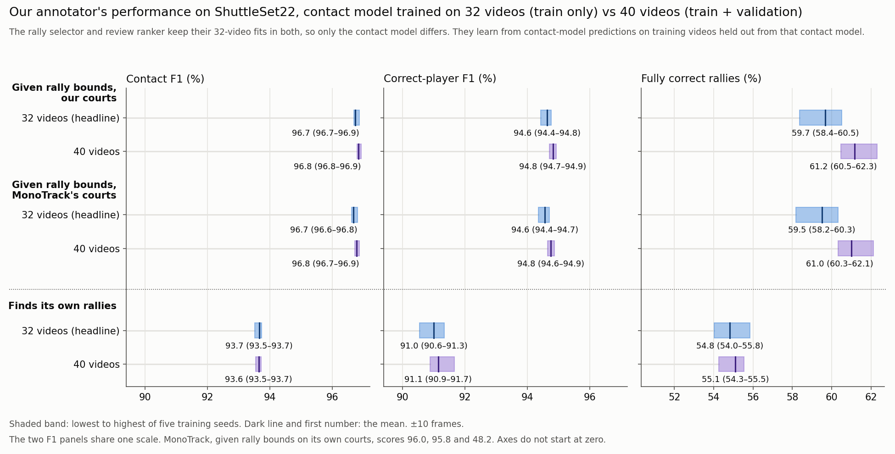

Figure 10. Our annotator's scores across five training seeds, in the layout of
Figure 1. Each shaded band runs from the lowest to the highest seed, and the
dark line inside it is the mean. Blue: contact model trained on 32 videos, as in
the headline results. Purple: trained on 40. The rally selector and review
ranker keep their 32-video fits in both, so only the contact model differs. The
two F1 panels share one scale.

## Limits

- **MonoTrack was rebuilt from its released source code.** Its hit detector was
  trained on original ShuttleSet because the original weights and training
  labels are unavailable. It receives TrackNetV3 shuttle tracks instead of its
  own TrackNetV2 build, and RTMPose poses instead of MMPose. Its training search
  was smaller than the released notebook's. Appendix A lists every change.
- **Configuration selection.** We report the highest-scoring of its four
  configurations tested on ShuttleSet22.
- **MonoTrack was trained once.** Our annotator's numbers average five seeds;
  MonoTrack's come from one training run.
- **Reference corners are coarse.** They suit only the main camera view, and a
  painted line's width is similar to the gap between the two detectors.
- **Rallies with flawed labels are ignored.** Predictions inside them are not
  scored in any condition. When the annotator finds its own rallies, its scores
  therefore describe the rest of each video (Appendix G).

## Appendix A: How the MonoTrack set-up was chosen

**Kept from the released code:** the hit detector's network (130,179 parameters;
two bidirectional GRU layers over 12-frame inputs), its feature layout, class
balancing, augmentation, batch size 64, early stopping, learning-rate reduction
and temperature calibration. Player selection, missing-pose filling and the
court detector also run as released. MonoTrack's court comes from the middle
frame within each rally's supplied bounds, as its released program does. Player
detections were limited to the top 16 by confidence.

**Changed, and why:**

- **Training labels:** the original MonoTrack labels are not available. The hit
  detector was trained on original ShuttleSet hit labels: 32 training videos
  and 8 validation videos, fixed in advance. The hitter labels come from
  ShuttleSet (near player = 1, far player = 2). The fixed split keeps whole
  videos together. Training has 16 videos at 25 fps and 16 at 30 fps;
  validation has one at 25 fps and seven at 30 fps.
- **Inputs:** TrackNetV3 shuttle tracks and saved RTMPose detections replace
  MonoTrack's custom TrackNetV2 and MMPose. Fresh MMPose extraction would have
  taken days. The reported configuration replaces InpaintNet-filled shuttle
  positions with zeros in training and inference.
- **Shuttle interpolation:** off at inference, which gave the strongest results
  among the four tested combinations. Missing-player-pose filling stays on.
- **Court corner order:** the released inference passes corners in a different
  order from the training notebook. A small adapter feeds the training order at
  inference. The vendored MonoTrack code is unchanged.
- **Optimisation:** learning rate starts at 1e-3, because 1e-2 trained poorly.
  The release's tenfold updates per epoch was dropped, because this training
  set is roughly ten times larger.
- **Training exclusions:** rallies where MonoTrack's court detector failed (50
  training, 9 validation) and 4 training rallies where its pose filling
  crashed were skipped. At test time every rally is attempted and failures
  stay in the score.

Table A1. Training data after exclusions.

| Split | Videos | Usable rallies | Usable hits | Court failures skipped | Pose-fill crashes skipped |
|---|---:|---:|---:|---:|---:|
| Training | 32 | 2,637 | 27,384 | 50 rallies (183 hits) | 4 rallies (4 hits) |
| Validation | 8 | 659 | 5,681 | 9 rallies (15 hits) | 0 |

**Hyperparameter search.** Two shuttle inputs were trained:

- **kept:** TrackNetV3 positions with InpaintNet's gap fills kept;
- **zeroed:** the same track with InpaintNet's fills replaced by zeros.

Each input ran six settings: dropout 0 or 0.2, times L2 weight 0, 1e-6 or
1e-4. All twelve used seed 0, learning rate 1e-3, up to 600 epochs, early
stopping after 15 epochs without improvement and learning-rate reduction after
12. The lowest validation loss picked the setting for each input. Both winners
use dropout 0 and L2 0 (validation loss 0.2872 kept, 0.2879 zeroed).

Table A2. Validation results for all twelve runs (best epoch's checkpoint).
Accuracy is measured before temperature calibration.

| Shuttle input | Dropout | L2 | Validation loss | Validation accuracy | Best epoch / epochs run |
|---|---:|---:|---:|---:|---:|
| kept | 0 | 0 | **0.2872** | 89.65% | 85 / 100 |
| kept | 0 | 1e-6 | 0.2892 | 89.55% | 72 / 87 |
| kept | 0 | 1e-4 | 0.3130 | 89.55% | 121 / 136 |
| kept | 0.2 | 0 | 0.4555 | 81.67% | 32 / 47 |
| kept | 0.2 | 1e-6 | 0.5109 | 80.23% | 50 / 65 |
| kept | 0.2 | 1e-4 | 0.5624 | 77.32% | 26 / 41 |
| zeroed | 0 | 0 | **0.2879** | 89.68% | 121 / 136 |
| zeroed | 0 | 1e-6 | 0.2928 | 89.50% | 100 / 115 |
| zeroed | 0 | 1e-4 | 0.3094 | 89.48% | 119 / 134 |
| zeroed | 0.2 | 0 | 0.4910 | 79.78% | 23 / 38 |
| zeroed | 0.2 | 1e-6 | 0.4319 | 83.52% | 88 / 103 |
| zeroed | 0.2 | 1e-4 | 0.5088 | 80.87% | 49 / 64 |

**Choosing the main configuration.** Each input's selected weights were run on
the test videos with shuttle interpolation on and off at inference. Zeroed input
with interpolation off scored highest on all three headline measures. We report
the highest-scoring of its four configurations tested on ShuttleSet22.

Table A3. MonoTrack on its own courts, all four shuttle variants, ±10 frames.

| Shuttle input | Interpolation at inference | Contact F1 | Correct-player F1 | Fully correct rallies |
|---|---|---:|---:|---:|
| kept | On, as released | 95.73% | 95.50% | 44.94% |
| kept | Off | 95.86% | 95.66% | 45.66% |
| zeroed | On, as released | 95.43% | 95.11% | 41.60% |
| **zeroed (main results)** | **Off** | **96.03%** | **95.82%** | **48.15%** |

The weights are `hitnet_zeroed.h5`: trial `zeroed_d0_l20`, checkpoint epoch
121, dropout 0, L2 0, learning rate 1e-3, seed 0 and calibrated temperature
1.100818. The run on our courts uses the same weights and settings.

**Rally bounds.** MonoTrack's release works on rally clips cut beforehand, by a
process that is not available. Here each rally's bounds run from 30 frames (1
second) before the first labelled hit to 30 frames after the last. Where two
rallies are close, the bounds stop at the midpoint between them. The median
bounded rally is 277 frames (9.2 seconds). The same bounds are used to train
MonoTrack, to search for both systems' per-rally courts and to run every
condition with rally bounds given. Our court detector needs 3 seconds of player
evidence. Its search therefore widened the 167 bounded rallies shorter than
that, centred on the rally's middle. The resulting court still applies only
within the original bounds.

## Appendix B: How the annotator's settings were chosen

Both searches used the same fixed original-ShuttleSet split as MonoTrack: 32
training videos (2,691 rallies, 27,571 hits) and 8 validation videos (668
rallies, 5,696 hits). Neither search used ShuttleSet22.

**Trees off (heuristic only).** The annotator was run with all three trees
disabled, finding its own rallies. A staged search tried 601 settings of 15
rule parameters on the training videos: 128 starting settings, two rounds of
local refinement for Correct-player F1, a probe of the wrist-distance gate,
and one round of local refinement for fully correct rallies. The top three
settings for each goal gave five distinct candidates. All five were scored once
on validation, and both goals picked the same setting (validation
Correct-player F1 60.94%, 32 fully correct rallies). That setting was frozen
before any test run. It raised training Correct-player F1 from 42.51% for the
earlier hand-set values to 63.83%.

**Trees on.** All three trees were fitted on the 32 training videos. The tree
settings and preprocessing were chosen on the 8 validation videos, by mean
Correct-player F1 over five training seeds. The rally selector adds 400 small
trees in turn, each correcting the ones before it, and each with up to 31 end
points (leaves). With these settings, validation Correct-player F1 is 85.53%,
and 296.0 of 668 rallies are fully correct.

**Frame-rate scaling.** A few motion features are measured per frame: shuttle
velocity, speed and acceleration, and each player's ankle speed. The same
movement reads 1.2 times larger in velocity and speed at 25 fps than at 30 fps,
and 1.44 times larger in acceleration.
Training mixes 16 videos at 25 fps with 16 at 30 fps. Rescaling these features
to 30 fps units and refitting all three trees lowered every validation score,
so the features stay per frame.

Table B1. Validation scores with the motion features in each unit, five-seed
means.

| Motion features | Correct-player F1 | Fully correct rallies (of 668) | Correct-player F1 ±5 | Fully correct rallies ±5 |
|---|---:|---:|---:|---:|
| Per frame (used here) | **85.53%** | **296.0** | **83.72%** | **243.6** |
| All rescaled to 30 fps | 85.09% | 293.0 | 83.29% | 242.2 |
| All but acceleration rescaled | 85.21% | 292.8 | 83.42% | 241.6 |

**Confidence thresholds.** The three thresholds in Table 3 were chosen on the
same 8 validation videos. The 0.335 threshold keeps half of the found rallies,
pooled over the five seeds. The 0.385 threshold gives the highest five-seed mean
F1 for picking fully correct rallies. The 0.75 threshold is the lowest at which
99% of kept rallies, pooled over the five seeds, have the right start and end.
The last two were searched in steps of 0.005.

## Appendix C: Our court detector's two modes

Both modes look for the court's painted lines (found by DeepLSD) and require
two players standing on the candidate court (from the pose detections). After
fitting, a two-player check counts how many frames show exactly two players
inside the court. A court that fails the check is dropped. The modes differ in
which frames they search and how they share results.

- **Per-rally mode** (the detector's `video-robust` mode, run within the
  supplied rally bounds). Each bounded rally is searched on three frames: its
  middle and the two ends of a 3-second player window. Rallies that show the
  same camera view can then share one pooled court. This produced "our courts"
  for the conditions with rally bounds given: 3,317 courts found, 4 dropped by
  the two-player check.
- **Discovery mode** (the `fast-robust` mode, on PySceneDetect scenes; "per
  scene" in the tables). PySceneDetect splits the whole video into camera shots.
  The detector searches only the middle frame of each shot. It then pools shots
  of the same view when at least three agree, keeping the best complete court
  unless the pooled fit scores higher. These saved courts come from an earlier
  run and were not remade for this comparison.

Discovery mode needs no rally boundaries, so it is what a fully automatic run
uses. Its weakness is that a shot's middle frame may not show play.

## Appendix D: PySceneDetect, transition graphics and 211 missing courts

**In discovery mode, 211 rallies (1,461 hits) had no accepted court on any of
their frames, and the annotator predicted nothing in them.** The per-rally mode
found a court for all 211, with a median error of 3.6 px and none over 15 px.

Table D1. What happened to the detected scenes overlapping these 211 rallies.

| Outcome for the overlapping scene | Rallies |
|---|---:|
| Court found, then rejected by the two-player check | 73 |
| No candidate court passed the player check | 115 |
| Fitted camera judged implausible | 11 |
| Line fit failed | 8 |
| Players not on the fitted court | 2 |
| Scene too short to search | 2 |
| **Total** | **211** |

The scenes overlapping these rallies are long: a median of 694 frames (23 s),
against 145 frames (5 s) for all detected scenes. The median bounded rally is
277 frames. That points to missed shot changes, with one "scene" joining a
rally's main view to replays, close-ups or graphics. The scene's middle frame
then often shows no playing court.

A random sample of 8 of the 211 rallies supports this (Figure A1). In all 8,
the rally's own middle frame shows the main broadcast view. The frame our
detector searched did not:

- 3 showed the BWF World Tour logo transition graphic;
- 3 showed another camera angle (two side views and one from behind a coach);
- 2 showed player close-ups.

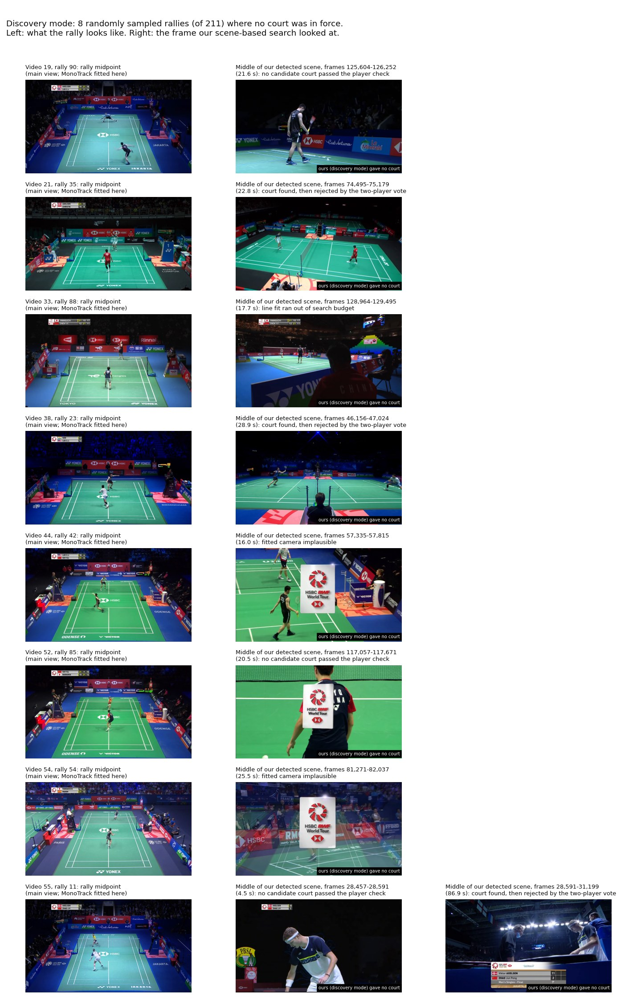

Figure A1. Left: each sampled rally's middle frame. Right: the middle frame of
the detected scene, which is what discovery mode searched, with its outcome.

This sample suggests that transition graphics and replays hide shot changes
from PySceneDetect. It does not measure how often each cause occurs across all
211. PySceneDetect was not tested directly on these transitions.

## Appendix E: Timing sensitivity at ±5 frames

The main results use ±10 frames, which matches the timing target of our
annotator's later stages. The table below rescores the same predictions at
±5 frames, with no retraining or retuning.

Table E1. Main conditions rescored at ±5 frames. Our annotator's values are
five-seed means.

| System | Courts | Rally bounds | Contact F1 ±5 | Correct-player F1 ±5 | Fully correct rallies ±5 |
|---|---|---|---:|---:|---:|
| MonoTrack | Its own | Given | 94.8% | 94.7% | 40.5% |
| MonoTrack | Ours | Given | 94.8% | 94.8% | 40.6% |
| Our annotator | Ours | Given | 95.0% | 93.0% | 49.5% |
| Our annotator | MonoTrack's | Given | 94.9% | 93.0% | 49.3% |
| Our annotator, trees off | Ours | Given | 83.5% | 67.2% | 4.2% |
| Our annotator, trees off | MonoTrack's | Given | 83.5% | 67.1% | 4.2% |
| Our annotator | Ours, per scene | Found by the annotator | 91.8% | 89.3% | 44.2% |
| Our annotator, trees off | Ours, per scene | Found by the annotator | 74.0% | 60.5% | 2.5% |

At ±5 frames the two systems find hits about equally well (95.0% against
94.8%). Ours still gets more rallies fully correct (49.5% against 40.5%).

## Appendix F: Where the numbers come from

- MonoTrack predictions and scores:
  `benchmark_results/comparison/mono_zeroed_own_off/` and
  `mono_zeroed_our_courts_off/`. Historical configurations sit beside them.
- Our annotator, five seeds: `benchmark_results/annotator_runs/test/`, with
  `our_courts/` and `monotrack_courts/` for rally bounds given and
  `discovery/` for finding its own rallies. Inside each, `32_videos/` holds the
  headline results and `40_videos/` the results with the contact model trained
  on all 40 original videos. `our_courts/body_window_36/` holds the
  preprocessing alternative in "How stable are the trees?".
- Our annotator's models: `../tree_simplification/results/models/raw_baseline-seed-<N>/`
  (32 videos) and `benchmark_results/annotator_runs/models_40_videos/` (40
  videos).
- Trees off: `../heuristic_only_tune/results/known_our_courts/`,
  `known_mono_courts/` and `test/` (finding its own rallies), with the frozen
  settings in `selected.json.gz`.
- Court inputs: `benchmark_results/inputs/{ours,monotrack,discovery}/`.
  Reference corners: `data/shuttleset22/set/homography.csv.gz` (repository
  root).
- ShuttleSet22 labels, including the left-out rallies: `data/shuttleset22/set/`
  (repository root).
- Tree settings: `../tree_simplification/results/selected-settings.json.gz`.
  Table B1: `../tree_simplification/results/fps-normalisation-evidence.json.gz`.
  Refit times: `../tree_simplification/results/input-stage-costs.csv`.
- MonoTrack training records: `hitnet_retrain/weights/`.
- Confidence scores: each discovery prediction file holds its found rallies'
  scores. The validation runs behind the thresholds are in
  `benchmark_results/annotator_runs/validation/`.
- The scripts that turn these results into this report's numbers, tables and
  figures: [`writeup_scripts/`](writeup_scripts/README.md).

## Appendix G: Rallies with flawed labels

The 46 test videos hold 3,851 ShuttleSet22 rallies. The test set scores 3,327.
The other 524 hold 4,725 labelled hits and were left out before this
comparison: 523 contain a hit flagged in ShuttleSet22's `flaw` field, and one
lists its hits out of time order.

**The flagged hits cannot be scored.** These rallies hold 661 flagged hits, 505
of them a rally's first hit. Across ShuttleSet22, 1,074 of the 1,085 flagged
hits have an unknown shot type.

- 487 of the 661 have no hitter side, because a player position is missing. 380
  of the 524 rallies hold at least one such hit, so they could never be fully
  correct.
- Of the 156 flagged hits after a rally's first, 155 are timed at or before
  the hit listed before them.
- Our annotator puts a predicted hit within 10 frames of 22% of the flagged
  hits, against 92% of the unflagged hits in the same rallies.

Scored as ordinary rallies, 0.2% of them come out fully correct when our
annotator finds its own rallies, against 55% of the scored rallies. Counting
them would charge every system for label errors, so every condition ignores
them.

**How they are ignored.** Each left-out rally gets bounds from 1 second before
its first hit to 1 second after its last, as the scored rallies do. A prediction
inside those bounds is dropped before scoring, unless it is within 10 frames of
a scored hit. A found rally left with no predictions is dropped too.

**What this changes:**

- **With rally bounds given,** only the scored rallies are run. Ignoring the
  left-out rallies removes 1 of MonoTrack's extra hits and 3 of the trees-off
  annotator's. No rate changes at one decimal place.
- **When the annotator finds its own rallies,** a mean of 4,052 predictions and
  about 358 found rallies per seed are dropped. Counted as extra hits instead,
  they would put Contact F1 at 88.7% rather than 93.7%, and Correct-player F1 at
  86.2% rather than 91.0%. With its trees off, the figures would be 74.2% rather
  than 77.8%, and 60.4% rather than 63.3%. Fully correct rallies move by less
  than 0.1 points.
- **Court results** cover only the 3,327 scored rallies, so they do not change.

The left-out rallies' bounds may also hold some false hits, so the
discovery-mode scores describe the rest of each video.

The 8 validation videos have no left-out rallies. The original ShuttleSet
release already removed its flawed rallies, so every rally in those videos is
scored.

[^datasets]: The original ShuttleSet dataset is used for training and
    validation; its follow-up ShuttleSet22, deduplicated of shared clips, is used
    for testing. ShuttleSet22 video 15 is left out because its labels are
    misaligned. All test videos run at 30 frames per second.

[^original-weights]: Private communication, Paul Liu, 14/10/2026.
