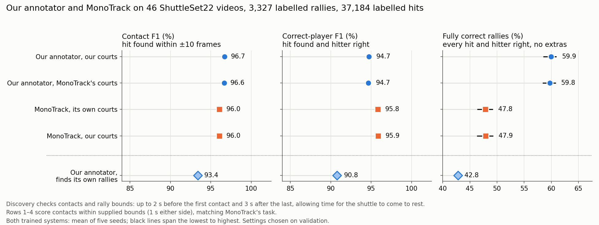
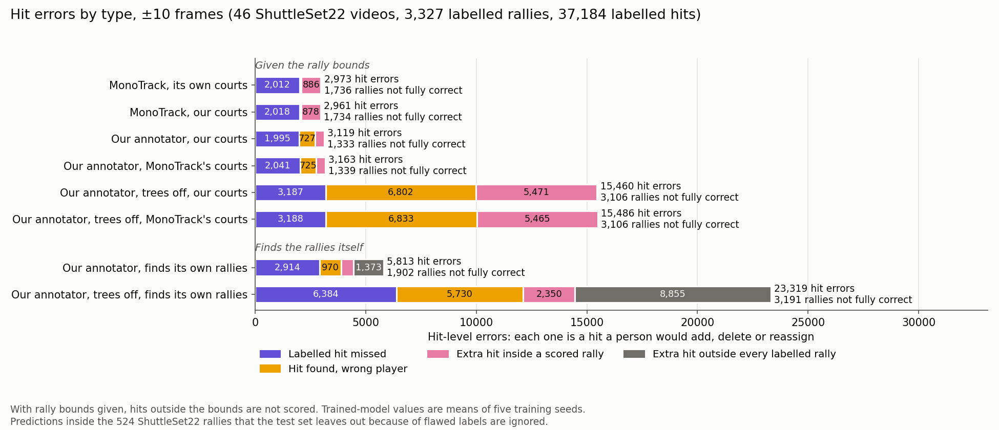
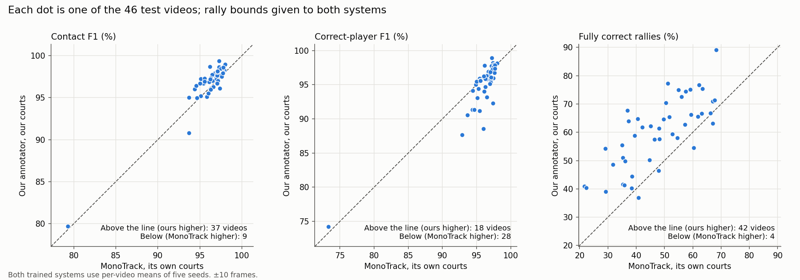
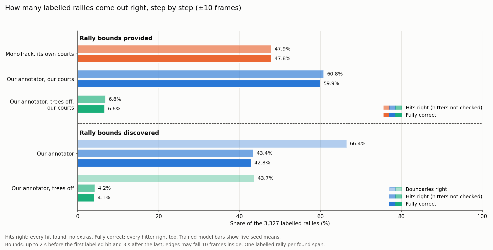
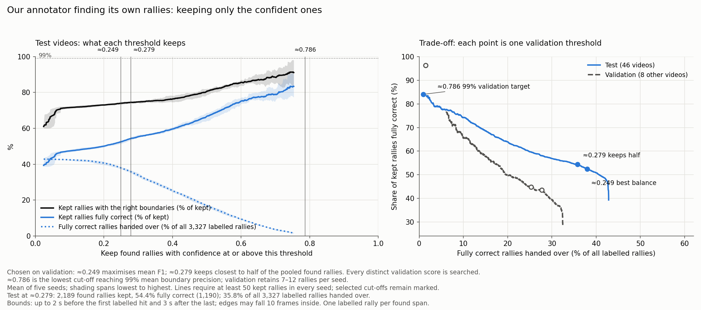
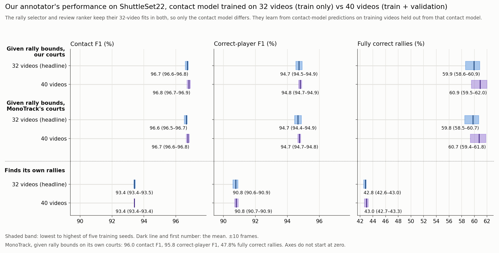

# Our annotator and court detector compared with MonoTrack

This report asks how well our badminton annotator, and the court detector
inside it, label broadcast video compared with
[MonoTrack](https://cs.stanford.edu/people/paulliu/files/cvpr-2022.pdf). Both
systems mark when each racket hit happens and which player made it (near or
far). The test set is 46 professional broadcast videos from ShuttleSet22:
3,327 scored rallies holding 37,184 labelled hits. Another 524 rallies in these
videos have flawed labels. Headline results leave them out; Appendix G checks the effect of that choice.

Both systems learnt from the same 32 videos of the original ShuttleSet, with
the same 8 videos held out for choosing settings.[^datasets] MonoTrack's hit
detector was rebuilt from its
[committed source code](https://github.com/jhwang7628/monotrack), which defines
a 130,179-parameter network. The published paper describes a model of about
16,000 parameters whose original weights have been lost.[^original-weights]

Our annotator finds candidate hits from the shuttle's motion and assigns each
hit to a player. Three gradient-boosted decision-tree models (the "trees") then
score candidate hits, choose each rally's hits and rank finished rallies by
confidence. "Trees off" means the same pipeline with all three disabled, using
rule settings tuned on the same 32 videos.

## Short answer

- **Given the rally bounds, our annotator leaves more rallies with nothing to
  fix, and MonoTrack makes fewer hit errors.** Ours gets 59.9% of rallies
  fully correct, against 47.8% for MonoTrack. A fully correct rally has every
  hit found, no extra hits and every hitter right, with each hit within 10
  frames of its label. The gap is 12.1 points (95% interval 9.4 to 14.8), and
  ours is higher on 42 of 46 videos (Figure 4). MonoTrack makes
  2,973 hit errors (missed, extra or wrong hitter) against 3,119 for ours,
  mainly because ours gives the wrong hitter more often (727 against 76). Ours
  adds fewer extra hits (397 against 886), and its errors sit in fewer rallies:
  1,333 against 1,736 (Figure 3). Which costs a person more depends on how
  their checking time splits between finding a rally's errors and editing
  them, which this report does not measure.
- **Both find hits about equally well, and MonoTrack names the hitter more
  reliably.** Contact F1 is 96.7% for ours and 96.0% for MonoTrack.
  Correct-player F1 is 94.7% for ours and 95.8% for MonoTrack.
- **Our annotator can also find the rallies itself.** MonoTrack's released code
  needs each rally cut out beforehand. Working from the whole video, ours gets
  42.8% of rallies fully correct, and 66.4% meet the boundary rule below.
  At the validation-selected threshold of about 0.279, it
  keeps 2,189 of about 3,663 found rallies, and 54.4% of those are fully correct:
  1,190 rallies, or 35.8% of all labelled rallies (Figure 6).
- **Both court detectors place the court close enough that swapping courts
  barely changes the scores.** The median corner error against ShuttleSet22's
  reference corners is 3.8 px for ours and 6.5 px for MonoTrack (Figure 2).
  Swapping courts between the systems moves every score by 0.17 points or less.
  The 2.7 px gap between the medians is within a painted line's width; the
  clearer differences are in how each detector fails.
- **The trees do most of the work, and they are fairly stable.** With all three off,
  ours gets 6.6% of rallies fully correct. Across five training seeds, fully
  correct rallies span 58.6% to 60.9%.

Figure 1. The three headline scores for each set-up, ±10 frames. The top four
rows score contacts within supplied bounds; the bottom row also checks discovered
rally boundaries, allowing up to 2 seconds before the first contact and 3 seconds
after the last for the shuttle to come to rest. Black lines span each system's
lowest to highest seed. Axes do not start at zero.

Figure 2. How close each rally's court is to ShuttleSet22's reference
corners. Left: the share of the 3,327 rallies whose court is within each error,
up to 15 px. Rallies with no court keep each line below 100%. Right: each
video's median error. Our per-rally court is closer than MonoTrack's in 44 of 46
videos. "Per scene" is the court our annotator uses when it finds the rallies
itself (discovery mode, Appendix C).

## Main results

Table 1. All conditions at ±10 frames (one third of a second). Both trained
systems use five-seed means, with the lowest and highest seed in brackets.
The trees-off rows are deterministic runs.

| System | Courts | Rally bounds | Contact F1 | Correct-player F1 | Fully correct rallies |
|---|---|---|---:|---:|---:|
| MonoTrack | Its own | Given | 96.0% (95.9–96.2) | 95.8% (95.7–96.0) | 47.8% (46.4–49.2) |
| MonoTrack | Ours | Given | 96.0% (95.9–96.2) | 95.9% (95.7–96.1) | 47.9% (46.4–49.2) |
| Our annotator | Ours | Given | 96.7% (96.6–96.8) | 94.7% (94.5–94.9) | 59.9% (58.6–60.9) |
| Our annotator | MonoTrack's | Given | 96.6% (96.5–96.7) | 94.7% (94.4–94.9) | 59.8% (58.5–60.7) |
| Our annotator, trees off | Ours | Given | 88.7% | 71.0% | 6.6% |
| Our annotator, trees off | MonoTrack's | Given | 88.7% | 70.9% | 6.6% |
| Our annotator | Ours, per scene | Found by the annotator | 93.4% (93.4–93.5) | 90.8% (90.6–90.9) | 42.8% (42.6–43.0) |
| Our annotator, trees off | Ours, per scene | Found by the annotator | 77.8% | 63.3% | 4.1% |

- **Contact F1** combines precision (the share of predicted hits that match a
  labelled hit) and recall (the share of labelled hits found). A match must be
  within 10 frames, and each prediction can match only one label.
- **Correct-player F1** also needs the right hitter. A hit at the right time
  with the wrong player counts as one miss and one false hit.
- **Given rally bounds** run from 1 second before each rally's first labelled
  hit to 1 second after its last. Only hits inside the bounds are scored.
- **Found by the annotator** means it works on the whole video. Every predicted
  hit counts, including those outside any scored rally. The one exception is
  hits inside the 524 left-out rallies, which are ignored (Appendix G). A found
  rally is fully correct when it covers exactly one labelled rally, its hits
  match that rally's hits one to one with none left over, and every hitter is
  right. Its bounds must also meet the 2-second / 3-second context limits
  defined below, with the same inward allowance that hit timing gets.
- **The 95% intervals** come from 10,000 paired bootstrap resamples of the 46
  videos. Each trained system's counts are averaged over its five seeds
  before resampling.

Ours leads on Contact F1 by 0.7 points (95% interval 0.4 to 1.0), with the higher score on 37 of 46 videos.
MonoTrack leads on Correct-player F1 by 1.1 points (95% interval 0.5 to 1.8), with the higher score on 28 videos.

## What the numbers mean for labelling work

With rally bounds given, our annotator misses 1,995 hits against
2,012 for MonoTrack, and adds fewer extras (397 against 886).
It gives the wrong hitter more often (727 against 76), but its errors
sit in fewer rallies. Counts are means over five seeds.

Figure 3. Hit errors by type, ±10 frames. Each error is one hit a person would
add, delete or reassign. The text beside each bar gives the total and how many
scored rallies are not fully correct, including boundary failures in discovery
mode. Dark grey: extra hits outside every
labelled rally, which count only when the annotator finds its own rallies.

The pattern holds video by video (Figure 4). Ours has more fully correct
rallies on 42 of 46 videos, and higher Contact F1 on 37.
MonoTrack has the higher Correct-player F1 on 28.

Figure 4. One dot per video, both systems given rally bounds and using their own
courts.

## Finding the rallies without help

With no rally bounds, our annotator must decide where each rally starts and
ends. Figure 5 breaks its rally results into three nested steps:

1. **Boundaries right:** one found rally covers exactly one labelled rally.
   Its start is no more than 2 seconds before the first labelled hit, and its
   end is no more than 3 seconds after the last. Either edge may fall up to
   10 frames inside those hits, matching the hit-timing tolerance.
2. **Hits right:** that found rally also holds every labelled hit and no extra
   hits. Hitters are not checked.
3. **Fully correct:** every hitter is right as well.

The labels mark racket contacts, not the physical start of play or the shuttle's
landing. These limits allow context around the contacts; they do not require
rallies to include the full buffer. The annotator shortens overlong discovered
spans around its retained contacts, with neighbour checks to keep spans separate.
Supplied rally bounds stay fixed. Inside a chosen span, the rally model's contact
list is final. Outside every chosen span, all detector contacts remain and count
towards whole-video hit scores.

Figure 5. Share of the 3,327 scored rallies reaching each step. With rally
bounds given, the boundaries are already set, so only the last two steps apply.

The annotator gets the boundaries right for 66.4% of labelled rallies, and 43.4%
also have every hit right. With its trees off, boundaries are right for
43.7% of rallies and 4.1% end up fully correct.

Contact F1 drops from 96.7% with rally bounds given to 93.4% here.
Two sources of errors are:

- **Hits outside every scored rally.** 1,373 predicted hits per seed sit outside
  the scored rally windows, after the excluded windows are masked. What they
  show (replays, warm-ups or play between rallies) has not been checked.
- **Rallies with no court.** In 211 rallies (1,461 labelled hits) this mode
  found no usable court, so the annotator predicted nothing there. Appendix D
  examines eight examples. They suggest that missed shot changes can leave the
  court search looking at graphics, close-ups or other camera views.

### Keeping only the confident rallies

Each found rally gets a confidence score from one of the trees, trained to
predict whether the rally is fully correct. Raising the threshold keeps fewer
rallies. Figure 6 shows how the accuracy of those kept changes.

Figure 6 and Table 3 mark three thresholds, selected from all
3,346 distinct validation scores:

- **About 0.279, keeps half.** Closest to retaining half the found validation
  rallies, pooled over five seeds.
- **About 0.249, the best balance.** Highest mean F1 across five seeds for
  retrieving fully correct validation rallies.
- **About 0.786, for boundaries.** Lowest threshold reaching 99% mean
  boundary accuracy across five seeds, retaining rallies in every seed.

Table 3. Test results at each validation-selected threshold, five-seed means.
Counts and percentages are averaged separately across seeds. Each seed has
about 3,663 found rallies after detections in excluded rallies are removed
(Appendix G). The two share columns describe the
kept rallies. The last column also gives fully correct rallies as a share of
all 3,327 labelled rallies. Thresholds shown here are rounded; the
[results file](benchmark_results/boundary_retrain_v7/primary/confidence_cutoffs.json.gz)
records the exact values used for scoring.

| Threshold | Rallies kept | Share fully correct | Share with the right start and end | Kept rallies with the right start and end | Fully correct rallies (boundaries and all contacts correctly attributed) |
|---|---:|---:|---:|---:|---:|
| ≈0.279 | 2,189 | 54.4% | 74.5% | 1,631 | 1,190 (35.8%) |
| ≈0.249 | 2,406 | 52.5% | 74.0% | 1,780 | 1,262 (37.9%) |
| ≈0.786 | 37 | 84.0% | 94.2% | 34 | 31 (0.9%) |

The 99% boundary target was met on only 7–12 validation rallies per seed
(mean 10.2). It was not met on test (Table 3).

Before confidence filtering, 42.8% of test rallies are fully correct,
compared with 32.5% on validation. Appendix G examines how excluding flawed
rallies affects this comparison.

Figure 6. Left: on the test videos, what each threshold keeps. Right: the share
of kept rallies that are fully correct, against the fully correct rallies handed
over as a share of all labelled rallies, for test and validation. Lines are the
mean of five seeds; shading spans the lowest to highest seed.

## Court detection

Table 2. Each rally's court against ShuttleSet22's reference corners. Error is
the mean distance between matching corners, in 1920×1080 video pixels. IoU is
the overlap area of the two court outlines divided by the area they cover
together. For the per-scene row, each rally's court is the per-coordinate median
of the accepted courts on the frames within its rally bounds; frames without a
court are left out.

| Court source | Rallies with a court | Median error | Within 5 px | Median IoU | Rallies over 15 px |
|---|---:|---:|---:|---:|---:|
| Ours, per rally | 3,313 | 3.8 px | 85.8% | 0.986 | 27 |
| MonoTrack, per rally | 3,318 | 6.5 px | 17.2% | 0.975 | 35 |
| Ours, per scene (rallies found by the annotator) | 3,116 | 3.8 px | 75.7% | 0.985 | 31 |

ShuttleSet22 gives one set of reference corners per video, drawn for the main
camera view. Any rally filmed from another view therefore reads as a large
error, even when its court is right. A painted line is several pixels wide, and
the reference does not say which edge it marks. The 2.7 px gap between the
medians is within that width, so it does not settle which detector is more
accurate (Figure 2). The clearer difference is how each one fails.

The 39 rallies over 15 px fall into three groups:

- **27 rallies in video 17 (rallies 47–73).** The broadcast zoomed in from
  rally 47, so the reference no longer fits. All three court sources agree to
  within 4 px and sit on the painted lines (Figure 9).
- **8 rallies where MonoTrack's court is 420–778 px off.** MonoTrack fits its
  court on each rally's middle frame. In these 8 rallies that frame shows a
  close-up or another camera. Our per-rally detector returned no court on all
  8. Our per-scene courts were 3–8 px from the reference there (Figure 7).
- **4 rallies where only our per-scene court is off.** Two used a wrong scene
  court (about 4,300 and 4,700 px). Two put the right-hand sideline too far out
  (34 and 38 px); their scenes were fitted on a frame where a transition graphic
  covered the centre of the court. Our per-rally courts were 2–5 px on all four
  (Figure 8).

Figure 7. The 8 rallies where MonoTrack fitted its court to a close-up or
another camera. Each pair shows the frame MonoTrack fitted on (left) and a
main-camera frame from the same rally (right). Red long dashes: our per-scene
court. Fluoro-pink short dashes: MonoTrack's court. White fine dashes:
ShuttleSet22's reference corners. A tag on each frame names the source of each
outline. The bottom-right tag marks that our per-rally detector gave no court,
as it did for all 8 rallies. MonoTrack is also over 15 px on the 27 video 17
rallies, shown in Figure 9.

Figure 8. The 4 rallies where only our per-scene court is more than 15 px off,
on each rally's middle frame. Line styles as in Figure 7. Top row: a wrong
scene court, mostly outside the frame. Bottom row: the right-hand sideline too
far out. The scene frames those two courts were fitted on are saved for
[video 49](writeup_figures/discovery_49_f111312.jpg) and
[video 54](writeup_figures/discovery_54_f90286.jpg).

Figure 9. Video 17, rally 47, one of the 27 rallies after the broadcast zoomed
in. Red is our per-rally court. The red and pink outlines sit on the painted
lines; the white reference corners were drawn for the earlier, wider view. All
27 are on [one contact
sheet](writeup_figures/fig6_court_gallery_video17_zoom.jpg), and full-size
panels for all 39 rallies are in
[`writeup_figures/court_gallery/`](writeup_figures/court_gallery/).

**Rallies with no court.** Our per-rally detector gave no court on 14 rallies
(191 hits). A visual check found no usable court in view on 10 of them. On 2,
the two-player check rightly rejected a bad court. One good court was rejected
(video 42, rally 48), and one usable view was missed (video 32, rally 22).
MonoTrack's detector gave no court on 9 rallies (105 hits). Every system scores
these rallies as missed hits.

## How stable are the trees?

Our annotator's trees are fairly stable across training seeds (Figure 10).

- **Seeds.** With rally bounds given, Correct-player F1 spans
  94.5–94.9% and fully correct rallies 58.6–60.9%. The 2.3-point seed spread in
  fully correct rallies is small next to the 12.1-point gap to MonoTrack.
- **Training-set size.** Training the contact model on all 40 original videos
  instead of 32 changes fully correct rallies by +1.0 points with rally bounds
  given, and by +0.2 points when finding rallies. With bounds given,
  Correct-player F1 changes by +0.1 points; the fully correct rally change across
  seeds ranges from +0.5 to +1.7 points. The 32-video models are the fair
  comparison with MonoTrack, so the headline uses them.
- **Preprocessing comparison.** The fixed alternative from the earlier validation
  search smooths player body size over 36 frames on either side. After refitting,
  with rally bounds given and our courts, it gets 96.5% Contact F1,
  94.4% Correct-player F1 and 57.6% fully correct rallies.
  The raw baseline gets 96.7%, 94.7% and 59.9%, respectively.

Each tree is an XGBoost gradient-boosted model over named measurements of
shuttle motion and player pose. Each decision traces back to those measurements.

Figure 10. Our annotator's scores across five training seeds, in the layout of
Figure 1. Each shaded band runs from the lowest to the highest seed, and the
dark line inside it is the mean. Blue: contact model trained on 32 videos, as in
the headline results. Purple: trained on 40. The rally selector and review
ranker keep their 32-video fits in both, so only the contact model differs. The
two F1 panels share one scale.

## Limits

- **MonoTrack was rebuilt from its released source code.** Its hit detector was
  trained on original ShuttleSet because the original weights and training
  labels are unavailable. It receives TrackNetV3 shuttle tracks instead of its
  own TrackNetV2 build, and RTMPose poses instead of MMPose. Its training search
  was smaller than the released notebook's. Appendix A lists every change.
- **Configuration selection.** MonoTrack uses the shuttle input, L2 weight and
  inference interpolation with the highest five-seed mean fully correct rally
  percentage on the eight validation videos, with Correct-player F1 as a
  tie-breaker. Both court conditions use this one configuration and all five seeds.

- **Reference corners are coarse.** They suit only the main camera view, and a
  painted line's width is similar to the gap between the two detectors.
- **Test rallies with flawed labels are ignored.** Predictions inside them are not
  scored in the headline conditions. When the annotator finds its own rallies, its scores
  therefore describe the rest of each video (Appendix G).

## Appendix A: How the MonoTrack set-up was chosen

**Kept from the released code:** the hit detector's network (130,179 parameters;
two bidirectional GRU layers over 12-frame inputs), its feature layout, class
balancing, augmentation, batch size 64, early stopping, learning-rate reduction
and temperature calibration. Player selection, missing-pose filling and the
court detector also run as released. MonoTrack's court comes from the middle
frame within each rally's supplied bounds, as its released program does. Player
detections were limited to the top 16 by confidence.

**Changed, and why:**

- **Training labels:** the original MonoTrack labels are not available. The hit
  detector was trained on original ShuttleSet hit labels: 32 training videos
  and 8 validation videos, fixed in advance. The hitter labels come from
  ShuttleSet (near player = 1, far player = 2). The fixed split keeps whole
  videos together. Training has 16 videos at 25 fps and 16 at 30 fps;
  validation has one at 25 fps and seven at 30 fps.
- **Inputs:** TrackNetV3 shuttle tracks and saved RTMPose detections replace
  MonoTrack's custom TrackNetV2 and MMPose. Fresh MMPose extraction would have
  taken days. The reported configuration replaces InpaintNet-filled shuttle positions with zeros
  in training and inference.
- **Shuttle interpolation:** fixed off during training. Inference interpolation
  was selected on validation and is off. Missing-player-pose filling stays on.
- **Court corner order:** the released inference passes corners in a different
  order from the training notebook. A small adapter feeds the training order at
  inference. The vendored MonoTrack code is unchanged.
- **Optimisation:** learning rate starts at 1e-3, because 1e-2 trained poorly.
  The release's tenfold updates per epoch was dropped, because this training
  set is roughly ten times larger.
- **Training exclusions:** rallies where MonoTrack's court detector failed (50
  training, 9 validation) and 4 training rallies where its pose filling
  crashed were skipped. At test time every rally is attempted and failures
  stay in the score.

Table A1. Training data after exclusions.

| Split | Videos | Usable rallies | Usable hits | Court failures skipped | Pose-fill crashes skipped |
|---|---:|---:|---:|---:|---:|
| Training | 32 | 2,637 | 27,384 | 50 rallies (183 hits) | 4 rallies (4 hits) |
| Validation | 8 | 659 | 5,681 | 9 rallies (15 hits) | 0 |

**Hyperparameter search.** Two shuttle inputs were trained:

- **kept:** TrackNetV3 positions with InpaintNet's gap fills kept;
- **zeroed:** the same track with InpaintNet's fills replaced by zeros.

Each input ran six settings: dropout 0 or 0.2, times L2 weight 0, 1e-6 or
1e-4. All twelve used seed 0, learning rate 1e-3, up to 600 epochs, early
stopping after 15 epochs without improvement and learning-rate reduction after
12. Each run retains its checkpoint with the lowest validation loss.
All six dropout-off settings were trained to five seeds (0, 100, 200, 300, 400) after
the dropout-on settings consistently attained lower validation accuracy.

**Table A2. An earlier hyperparameter grid, using seed 0 for every run.**
The six dropout-off settings were then repeated with four additional seeds for
the five-seed comparison in Table A3. Values come from each run’s
lowest-validation-loss checkpoint; accuracy is measured before temperature
calibration.

| Shuttle input | Dropout | L2 | Validation loss | Validation accuracy | Best epoch / epochs run |
|---|---:|---:|---:|---:|---:|
| kept | 0 | 0 | **0.2872** | 89.65% | 85 / 100 |
| kept | 0 | 1e-6 | 0.2892 | 89.55% | 72 / 87 |
| kept | 0 | 1e-4 | 0.3130 | 89.55% | 121 / 136 |
| kept | 0.2 | 0 | 0.4555 | 81.67% | 32 / 47 |
| kept | 0.2 | 1e-6 | 0.5109 | 80.23% | 50 / 65 |
| kept | 0.2 | 1e-4 | 0.5624 | 77.32% | 26 / 41 |
| zeroed | 0 | 0 | **0.2879** | 89.68% | 121 / 136 |
| zeroed | 0 | 1e-6 | 0.2928 | 89.50% | 100 / 115 |
| zeroed | 0 | 1e-4 | 0.3094 | 89.48% | 119 / 134 |
| zeroed | 0.2 | 0 | 0.4910 | 79.78% | 23 / 38 |
| zeroed | 0.2 | 1e-6 | 0.4319 | 83.52% | 88 / 103 |
| zeroed | 0.2 | 1e-4 | 0.5088 | 80.87% | 49 / 64 |

The final configuration is chosen on the eight validation videos using the same
rally judgement as the report: highest mean fully correct rally percentage at
±10 frames, with mean Correct-player F1 breaking a tie. All 668 validation
rallies and 5,696 contacts count, including failures in court fitting or hit detection.

Table A3. Validation scores with MonoTrack courts for all twelve shuttle, L2
and inference-interpolation combinations. Values are five-seed means (min–max).

| Shuttle input | L2 | Interpolation at inference | Contact F1 | Correct-player F1 | Fully correct rallies |
|---|---:|---|---:|---:|---:|
| kept | 0 | Off | 94.54% (94.45–94.71) | 94.07% (93.98–94.24) | 39.49% (38.62–40.27) |
| kept | 0 | On | 94.36% (94.27–94.50) | 93.82% (93.73–93.94) | 39.55% (38.62–40.27) |
| kept | 1e-6 | Off | 94.60% (94.47–94.72) | 94.11% (93.93–94.27) | 39.40% (38.47–40.27) |
| kept | 1e-6 | On | 94.49% (94.39–94.58) | 93.99% (93.87–94.07) | 40.00% (39.67–40.42) |
| kept | 1e-4 | Off | 94.42% (94.26–94.58) | 93.96% (93.79–94.22) | 38.02% (36.68–39.37) |
| kept | 1e-4 | On | 94.27% (94.13–94.37) | 93.78% (93.60–94.00) | 38.11% (37.13–39.07) |
| zeroed (selected) | 0 | Off | 94.62% (94.51–94.83) | 94.11% (94.01–94.31) | 40.06% (39.37–41.77) |
| zeroed | 0 | On | 94.31% (94.22–94.43) | 93.72% (93.54–93.87) | 38.32% (36.83–39.97) |
| zeroed | 1e-6 | Off | 94.61% (94.35–94.77) | 94.13% (93.88–94.33) | 39.37% (37.57–40.72) |
| zeroed | 1e-6 | On | 94.16% (94.00–94.42) | 93.55% (93.34–93.83) | 38.17% (36.68–39.67) |
| zeroed | 1e-4 | Off | 94.44% (94.33–94.58) | 94.00% (93.90–94.11) | 38.26% (37.87–38.77) |
| zeroed | 1e-4 | On | 93.92% (93.69–94.05) | 93.32% (93.03–93.57) | 35.99% (34.73–37.28) |

The selected configuration is **zeroed, L2 0, interpolation off**.
Test results use all five checkpoints with dropout 0 and initial learning rate 1e-3.
Both court conditions use those same checkpoints and settings.

**Rally bounds.** MonoTrack's release works on rally clips cut beforehand, by a
process that is not available. Here each rally's bounds run from 30 frames (1
second) before the first labelled hit to 30 frames after the last. Where two
rallies are close, the bounds stop at the midpoint between them. The median
bounded rally is 277 frames (9.2 seconds). The same bounds are used to train
MonoTrack, to search for both systems' per-rally courts and to run every
condition with rally bounds given. Our court detector needs 3 seconds of player
evidence. Its search therefore widened the 167 bounded rallies shorter than
that, centred on the rally's middle. The resulting court still applies only
within the original bounds.

## Appendix B: How the annotator's settings were chosen

The searches and boundary-policy refit used the same fixed original-ShuttleSet split as MonoTrack: 32
training videos (2,691 rallies, 27,571 hits) and 8 validation videos (668
rallies, 5,696 hits). Settings were selected without using ShuttleSet22 test results.

**Trees off (heuristic only).** The annotator was run with all three trees
disabled, finding its own rallies. A staged search tried 601 settings of 15
rule parameters on the training videos: 128 starting settings, two rounds of
local refinement for Correct-player F1, a probe of the wrist-distance gate,
and one round of local refinement for fully correct rallies. The top three
settings for each goal gave five distinct candidates. All five were scored once
on validation, and both goals picked the same setting (validation
Correct-player F1 60.94%, 32 fully correct rallies). That setting was frozen
before any test run. It raised training Correct-player F1 from 42.51% for the
earlier hand-set values to 63.83%.

**Trees on.** All three trees were fitted on the 32 training videos. The tree
settings and preprocessing were chosen on the 8 validation videos, by mean
Correct-player F1 over five training seeds. The rally selector adds 400 small
trees in turn, each correcting the ones before it, and each with up to 31 end
points (leaves). Those settings were kept for the boundary-policy refit. All
three models were retrained with five seed offsets; a new hyperparameter
search remains a TODO.

**Frame-rate scaling.** A few motion features are measured per frame: shuttle
velocity, speed and acceleration, and each player's ankle speed. The same
movement reads 1.2 times larger in velocity and speed at 25 fps than at 30 fps,
and 1.44 times larger in acceleration.
Training mixes 16 videos at 25 fps with 16 at 30 fps. Rescaling these features
to 30 fps units and refitting all three trees lowered every validation score,
so the features stay per frame.

Table B1. Earlier validation comparison of motion-feature units, before the
boundary-policy refit; five-seed means. These historical results selected the
per-frame convention, which the refit retains.

| Motion features | Correct-player F1 | Fully correct rallies (of 668) | Correct-player F1 ±5 | Fully correct rallies ±5 |
|---|---:|---:|---:|---:|
| Per frame (used here) | **85.53%** | **296.0** | **83.72%** | **243.6** |
| All rescaled to 30 fps | 85.09% | 293.0 | 83.29% | 242.2 |
| All but acceleration rescaled | 85.21% | 292.8 | 83.42% | 241.6 |

**Boundary policy.** We compared maximum training allowances of 2/3, 3/3 and
5/5 seconds before/after labelled contacts. Each used a separately retrained
selector and confidence model with the same contact-model fits. Selection used
mean fully correct validation-rally coverage before confidence filtering, with
the same 2/3-second evaluation rule for every training policy. The 2/3 policy
gave 216.8 of 668 fully correct rallies (32.46%), against 208.6 (31.23%) for
3/3 and 209.8 (31.41%) for 5/5. It supplies the headline results. Seed ranges
overlap, and 5/5 scores slightly higher under the two looser evaluation rules.
The allowances
are maxima, so valid boundaries closer to the contacts can still receive
positive training labels. The [supporting results](benchmark_results/boundary_retrain_v7/)
include all nine training/evaluation combinations.

**Confidence thresholds.** The three operating points in Table 3 were selected
on the same eight validation videos, checking every distinct confidence score
from the selected model's five runs. The objectives were closest to half the
pooled found rallies retained, highest mean retrieval F1 for fully correct
rallies, and the lowest threshold reaching 99% mean boundary accuracy while
retaining rallies in all five seeds. Test results did not choose the training
policy or confidence thresholds.

## Appendix C: Our court detector's two modes

Both modes look for the court's painted lines (found by DeepLSD) and require
two players standing on the candidate court (from the pose detections). After
fitting, a two-player check counts how many frames show exactly two players
inside the court. A court that fails the check is dropped. The modes differ in
which frames they search and how they share results.

- **Per-rally mode** (the detector's `video-robust` mode, run within the
  supplied rally bounds). Each bounded rally is searched on three frames: its
  middle and the two ends of a 3-second player window. Rallies that show the
  same camera view can then share one pooled court. This produced "our courts"
  for the conditions with rally bounds given: 3,317 courts found, 4 dropped by
  the two-player check.
- **Discovery mode** (the `fast-robust` mode, on PySceneDetect scenes; "per
  scene" in the tables). PySceneDetect splits the whole video into camera shots.
  The detector searches only the middle frame of each shot. It then pools shots
  of the same view when at least three agree, keeping the best complete court
  unless the pooled fit scores higher. These saved courts come from an earlier
  run and were not remade for this comparison.

Discovery mode needs no rally boundaries, so it is what a fully automatic run
uses. Its weakness is that a shot's middle frame may not show play.

## Appendix D: PySceneDetect, transition graphics and 211 missing courts

**In discovery mode, 211 rallies (1,461 hits) had no accepted court on any of
their frames, and the annotator predicted nothing in them.** The per-rally mode
found a court for all 211, with a median error of 3.6 px and none over 15 px.

Table D1. What happened to the detected scenes overlapping these 211 rallies.

| Outcome for the overlapping scene | Rallies |
|---|---:|
| Court found, then rejected by the two-player check | 73 |
| No candidate court passed the player check | 115 |
| Fitted camera judged implausible | 11 |
| Line fit failed | 8 |
| Players not on the fitted court | 2 |
| Scene too short to search | 2 |
| **Total** | **211** |

The scenes overlapping these rallies are long: a median of 694 frames (23 s),
against 145 frames (5 s) for all detected scenes. The median bounded rally is
277 frames. That points to missed shot changes, with one "scene" joining a
rally's main view to replays, close-ups or graphics. The scene's middle frame
then often shows no playing court.

A random sample of 8 of the 211 rallies supports this (Figure A1). In all 8,
the rally's own middle frame shows the main broadcast view. The frame our
detector searched did not:

- 3 showed the BWF World Tour logo transition graphic;
- 3 showed another camera angle (two side views and one from behind a coach);
- 2 showed player close-ups.

Figure A1. Left: each sampled rally's middle frame. Right: the middle frame of
the detected scene, which is what discovery mode searched, with its outcome.

This sample suggests that transition graphics and replays hide shot changes
from PySceneDetect. It does not measure how often each cause occurs across all
211. PySceneDetect was not tested directly on these transitions.

## Appendix E: Timing sensitivity at ±5 frames

The main results use ±10 frames, which matches the timing target of our
annotator's later stages. The table below rescores the same predictions at
±5 frames, with no retraining or retuning. The maximum outward context remains
2 seconds before and 3 seconds after; the inward allowance becomes five frames.

Table E1. Main conditions rescored at ±5 frames. Both trained systems use
five-seed means (min–max).

| System | Courts | Rally bounds | Contact F1 ±5 | Correct-player F1 ±5 | Fully correct rallies ±5 |
|---|---|---|---:|---:|---:|
| MonoTrack | Its own | Given | 94.9% (94.8–95.1) | 94.7% (94.6–95.0) | 40.3% (38.7–41.9) |
| MonoTrack | Ours | Given | 94.9% (94.8–95.1) | 94.8% (94.6–95.0) | 40.3% (38.7–42.0) |
| Our annotator | Ours | Given | 94.9% (94.8–95.1) | 93.1% (92.8–93.2) | 49.2% (48.8–50.2) |
| Our annotator | MonoTrack's | Given | 94.8% (94.8–95.0) | 93.0% (92.8–93.2) | 49.1% (48.7–50.0) |
| Our annotator, trees off | Ours | Given | 83.5% | 67.2% | 4.2% |
| Our annotator, trees off | MonoTrack's | Given | 83.5% | 67.1% | 4.2% |
| Our annotator | Ours, per scene | Found by the annotator | 91.5% (91.4–91.6) | 89.0% (88.9–89.1) | 33.9% (33.6–34.3) |
| Our annotator, trees off | Ours, per scene | Found by the annotator | 74.0% | 60.5% | 2.4% |

At ±5 frames, Contact F1 is 94.9% for ours and
94.9% for MonoTrack. Fully correct rallies are 49.2% and 40.3%, respectively.

## Appendix F: Where the numbers come from

- [Primary results](benchmark_results/boundary_retrain_v7/primary/): five-seed
  summaries, per-video counts, paired bootstrap intervals, found-rally outcomes
  and complete confidence curves. These use the selected 2/3 training policy
  and the common 2/3 evaluation rule.
- [Policy comparison](benchmark_results/boundary_retrain_v7/): validation
  selection, all nine training/evaluation combinations and the training-target
  comparison. Confidence thresholds use validation only.
- [Annotator models and fit settings](../tree_simplification/results/boundary_retrain_v7/README.md):
  five raw-baseline bundles and five body-window-36 bundles under `2_3/models/`;
  five contact-size comparison bundles under `2_3/models_40/`.
- Fresh annotator predictions are generated under
  `NEW_RUN/annotator_runs/<policy>/test/<condition>/<family>/seed-<N>/`, with
  validation under `validation/32_videos/seed-<N>/`. They are not duplicated in
  the compact result folder. The [run guide](writeup_scripts/README.md) gives
  the commands and input paths.
- MonoTrack predictions and scores: `benchmark_results/monotrack_five_seed/`,
  with all twelve validation configurations under `validation/`, the chosen
  setting in `selected.json.gz`, and five-seed test runs under
  `test/{monotrack,ours}/seed-<N>/`.
- Trees off: `../heuristic_only_tune/results/known_our_courts/`,
  `known_mono_courts/` and `test/` (finding its own rallies), with the frozen
  settings in `selected.json.gz`.
- Court inputs: `benchmark_results/inputs/{ours,monotrack,discovery}/`.
  Reference corners: `data/shuttleset22/set/homography.csv.gz` (repository root).
- ShuttleSet22 labels: `data/shuttleset22/set/`. Original ShuttleSet validation
  labels: `training/data/shuttleset/annotations/shots_master.csv`; raw flaw flags
  are under `data/shuttleset/set/` (all paths from the repository root).
- Historical tree-setting search: `../tree_simplification/results/selected-settings.json.gz`.
  Table B1: `../tree_simplification/results/fps-normalisation-evidence.json.gz`.
- MonoTrack training records: `benchmark_results/monotrack_five_seed/weights/`
  has histories and summaries for five seeds of all six shuttle/L2 settings,
  plus checkpoints for the selected setting. The earlier grid is in
  `hitnet_retrain/weights/`.
- [Exclusion sensitivity](benchmark_results/boundary_retrain_v7/exclusion_effect/):
  saved-prediction checks for Appendix G, including the unflagged validation subset.
- [Write-up scripts](writeup_scripts/README.md): scoring, confidence surveys
  and figures. The result index explains how to unpack the compressed figure inputs.

## Appendix G: Rallies with flawed labels

The 46 test videos hold 3,851 ShuttleSet22 rallies. The test set scores 3,327.
The other 524 hold 4,725 labelled hits and were left out before this
comparison: 523 contain a hit flagged in ShuttleSet22's `flaw` field, and one
lists its hits out of time order.

**The flagged hits cannot be scored.** These rallies hold 661 flagged hits, 505
of them a rally's first hit. Across ShuttleSet22, 1,074 of the 1,085 flagged
hits have an unknown shot type.

- 487 of the 661 have no hitter side, because a player position is missing. 380
  of the 524 rallies hold at least one such hit, so they could never be fully
  correct.
- Of the 156 flagged hits after a rally's first, 155 are timed at or before
  the hit listed before them.

**How they are ignored.** Each left-out rally gets bounds from 1 second before
its first hit to 1 second after its last, as the scored rallies do. A prediction
inside those bounds is dropped before scoring, unless it is within 10 frames of
a scored hit. A found rally left with no predictions is dropped too.

**What this changes:**

- **With rally bounds given,** only the scored rallies are run. Ignoring
  the left-out rallies removes a mean of 1.0 MonoTrack
  predictions and 3 trees-off annotator predictions.

- **When the annotator finds its own rallies,** a mean of 4,069 predictions and
  about 358 found rallies per seed are dropped. Counted as extra hits instead,
  they would put Contact F1 at 88.5% rather than 93.4%, and Correct-player F1 at
  86.0% rather than 90.8%. With its trees off, the figures would be 74.2% rather
  than 77.8%, and 60.4% rather than 63.3%. Fully correct rally coverage is unchanged for the
  retrained annotator.
- **Court results** cover only the 3,327 scored rallies, so they do not change.

The left-out rallies' bounds may also hold some false hits, so the
discovery-mode scores describe the rest of each video.

**Validation and test use different label populations.** All 668 validation
rallies are scored, including 314 with at least one `flaw == 1` row in the raw
original-ShuttleSet labels. Their flagged frames are present in the labels
loaded for scoring. The remaining 354 unflagged rallies score 157.0 fully
correct on average: **44.4%**, compared with **32.5%** across all validation
rallies and **42.8%** on the unflagged test population. Applying the same
excluded-window masking to this validation subset leaves its fully correct
count unchanged.

Using the same flaw-flag exclusion removes the apparent test advantage, though
the releases may still differ in label quality. Model selection and confidence
thresholds retain the original validation population.
The [saved counts](benchmark_results/boundary_retrain_v7/exclusion_effect/)
give the per-seed results and the effect on fixed confidence thresholds.

[^datasets]: The original ShuttleSet dataset is used for training and
    validation; its follow-up ShuttleSet22, deduplicated of shared clips, is used
    for testing. ShuttleSet22 video 15 is left out because its labels are
    misaligned. All test videos run at 30 frames per second.

[^original-weights]: Private communication, Paul Liu, 14/10/2026.
