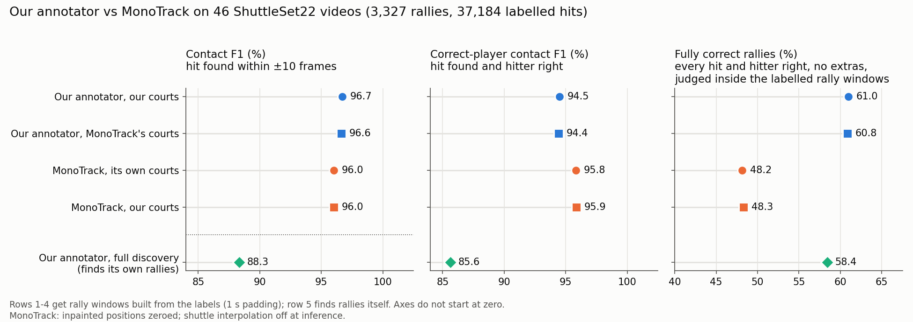
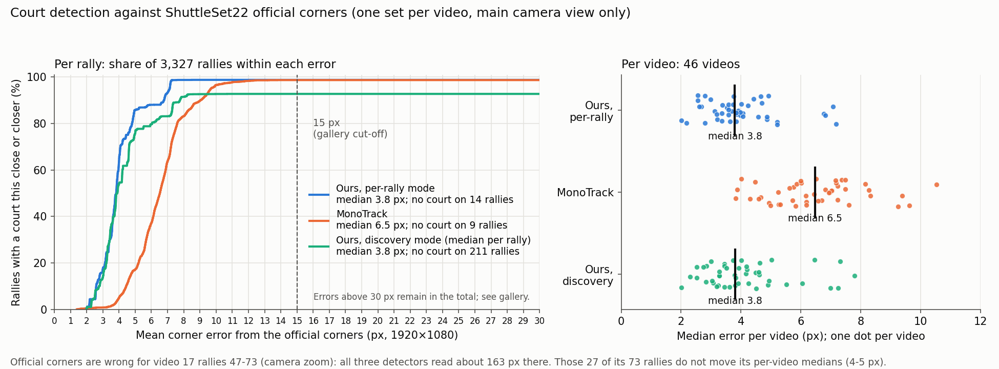
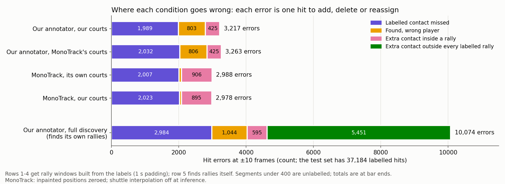
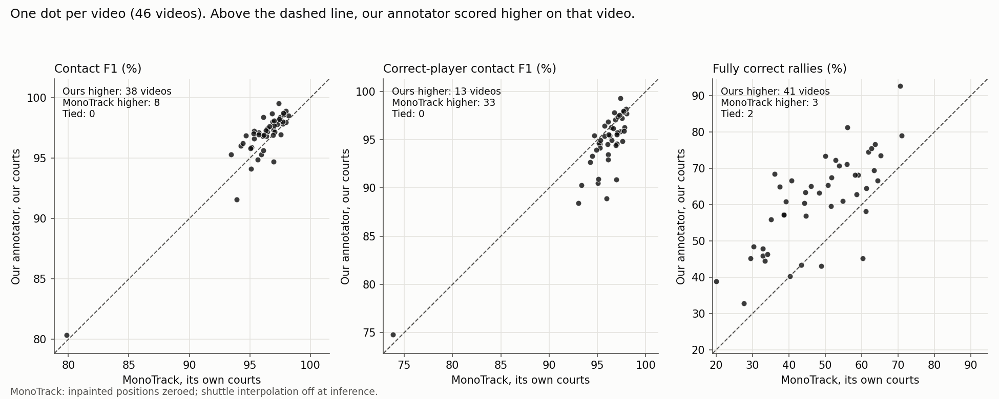
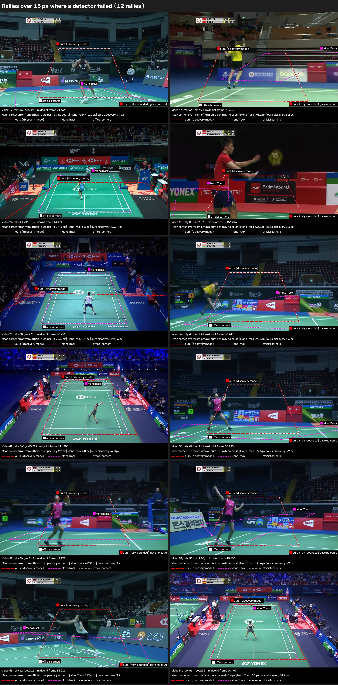
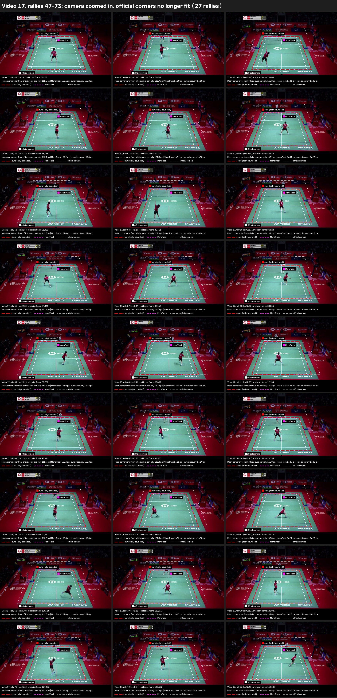

# Our annotator and court detector compared with MonoTrack

> Historical report. See the [current comparison](../../annotator_monotrack_own_weights_compared_writeup_v7.md).

This report compares our badminton annotator, and the court detector inside it,
with [MonoTrack](https://cs.stanford.edu/people/paulliu/files/cvpr-2022.pdf).
The test set is 46 professional broadcast videos from ShuttleSet22: 3,327
labelled rallies holding 37,184 labelled hits. Both systems mark when each hit
happens and which player made it.

The MonoTrack baseline uses the architecture in its
[committed source code](https://github.com/jhwang7628/monotrack), trained on
the original ShuttleSet dataset.[^datasets] That code defines a
130,179-parameter HitNet. The published paper describes a model with around
16,000 parameters, whose original weights have been lost.[^original-weights]

## Short answer

**When both systems are given the true start and end of each rally, ours gets
61.0% of rallies completely right and MonoTrack gets 48.2%.** Ours finds
slightly more hits (contact F1 96.7% against 96.0%) and adds far fewer false
hits. MonoTrack is better at naming the hitter. It gives the wrong player for
0.2% of the hits it finds; ours does so for 2.3%.

MonoTrack uses its best tested configuration throughout: InpaintNet-filled
positions zeroed, with shuttle interpolation off at inference. Appendix A
compares all four configurations.

**Our annotator can also find the rallies itself.** MonoTrack's released code
does not perform rally discovery. It uses pre-segmented rally clips. In full
discovery, our annotator gets 58.4% of rallies completely right, but
contact F1 falls to 88.3%. Most of the drop comes from 5,451 predicted hits
outside every labelled rally, and from 211 rallies (1,461 hits) where this mode
had no court. Fully correct rallies are judged inside the labelled windows;
that score does not assess the discovered boundaries or count outside hits.

**Both court detectors put the court within a few pixels of ShuttleSet22's
reference corners on nearly every rally.** The median error is 3.8 px for ours
and 6.5 px for MonoTrack. Swapping the two systems' courts moves contact F1 by
less than 0.1 points. MonoTrack returned a wrong court on 8 rallies, all
of which our detector left blank.

### Contact results

Table 1. All five conditions, scored at ±10 frames (one third of a second).

| System | Courts | Rally start and end | Contact F1 | Correct-player F1 | Fully correct rallies |
|---|---|---|---:|---:|---:|
| Our annotator | Ours, per rally | Supplied | **96.7%** | 94.5% | **61.0%** |
| Our annotator | MonoTrack's | Supplied | 96.6% | 94.4% | 60.8% |
| MonoTrack | Its own, per rally | Supplied | 96.0% | **95.8%** | 48.2% |
| MonoTrack | Ours, per rally | Supplied | 96.0% | **95.9%** | 48.3% |
| Our annotator | Ours, from detected scenes | Found by the annotator | 88.3% | 85.6% | 58.4% |

- **Contact F1** combines precision (the share of predicted hits that match a
  labelled hit) and recall (the share of labelled hits found). A match must be
  within 10 frames.
- **Correct-player F1** also needs the right hitter. A hit at the right time
  with the wrong player counts as one miss and one false hit.
- **A fully correct rally** has every labelled hit found with the right hitter,
  and no extra hits. Nothing in it needs adding, deleting or reassigning.

Figure 1. Ours (blue) leads on contact F1 and fully correct rallies. MonoTrack
(orange) leads on correct-player F1. Square markers show a system using the
other system's courts; they sit almost on top of the circles.

With supplied rally boundaries, ours makes 3,217 hit-level errors and
MonoTrack makes 2,988 (Figure 2). Ours misses a similar number of hits
(1,989 against 2,007) and adds far fewer false hits (425 against 906). It
also gives the wrong hitter far more often (803 against 75). Ours packs its
errors into 1,298 rallies; MonoTrack spreads its errors across 1,725. Ours gets
more rallies fully correct despite making more hit-level errors overall.

The pattern holds video by video (Figure 3). Ours has the higher contact F1 on
38 of 46 videos and more fully correct rallies on 41. MonoTrack has the higher
correct-player F1 on 33.

### Court detection

Table 2. Each rally's court against ShuttleSet22's reference corners. Error is
the mean distance between matching corners, in 1920×1080 video pixels.

| Court source | Rallies with a court | Median error | Median overlap (IoU) | Rallies over 15 px |
|---|---:|---:|---:|---:|
| Ours, per rally | 3,313 | 3.8 px | 0.986 | 27 |
| MonoTrack, per rally | 3,318 | 6.5 px | 0.975 | 35 |
| Ours, discovery mode | 3,116 | 3.8 px | 0.985 | 31 |

Figure 4. Left: the share of all 3,327 rallies whose court is within a given
error, shown from 0 to 30 px in 1 px steps. Rallies with no court or errors
above 30 px remain in the total. Right: each video's median error.

The reference is one set of corners per video, drawn for the main camera view.
In video 17 the broadcast zoomed in from rally 47, so all three detectors read
about 163 px off there while agreeing with each other to within 4 px. These 27
rallies make up most of the "over 15 px" counts. A painted line is several
pixels wide, and the reference does not say which edge it marks. So the 2.7 px
gap between the medians does not show which detector is more accurate. The
clearer difference is how each one fails (Figures 5 and 6).

### Limits that matter most

- MonoTrack uses the source-code architecture and inputs described in
  Appendix A. We report the highest-scoring of its four configurations tested
  on ShuttleSet22.
- Each setting was trained once; there are no repeat runs.

## What was compared

| System | Courts | Rally start and end |
|---|---|---|
| MonoTrack | Its own detector, one court per supplied rally | Supplied |
| MonoTrack | Our detector, one court per supplied rally | Supplied |
| Our annotator | Our detector, one court per supplied rally | Supplied |
| Our annotator | MonoTrack's detector, one court per supplied rally | Supplied |
| Our annotator | Our detector, one court per detected scene | Found by the annotator |

Both systems learnt from the same 40 videos of the original ShuttleSet. They
start from the same saved inputs:

- **Player poses:** RTMPose detections, at most 16 people per frame. Each
  system picks the two players with its own code.
- **Shuttle track:** TrackNetV3 positions with InpaintNet filling gaps. Our
  annotator retains the filled positions; MonoTrack replaces them with zeros
  and disables shuttle interpolation at inference.
- **Rally windows, when supplied:** from 1 second before the first labelled hit
  to 1 second after the last, cut short at the midpoint to a neighbouring rally.

ShuttleSet22 video 15 is left out because its labels are misaligned. All
videos run at 30 frames per second.

Failed rallies stay in every score as missed hits. MonoTrack failed on 10
rallies (129 hits) with its own courts: 9 had no court, and 1 crashed while
filling missing poses. With our courts it failed on the 14 rallies (191 hits)
where our per-rally detector gave no court. Our annotator predicted nothing on
those same 14 rallies. No video failed in any condition.

## Contact results in detail

Table 3. Precision and recall at ±10 frames.

| Condition | Precision ±10 | Recall ±10 |
|---|---:|---:|
| Ours, our courts | 98.8% | 94.7% |
| Ours, MonoTrack courts | 98.8% | 94.5% |
| MonoTrack, own courts | 97.5% | 94.6% |
| MonoTrack, our courts | 97.5% | 94.6% |
| Ours, full discovery | 85.0% | 92.0% |

Figure 2. Errors at ±10 frames. Each error is one hit to add, delete or
reassign. Supplied-boundary conditions have no hits outside the rally windows
because only in-window predictions are scored for them.

Figure 3. One dot per video, ours on its own courts against MonoTrack on its own
courts.

How sure are these gaps? Resampling whole videos 10,000 times gives these 95%
intervals for ours minus MonoTrack (both on their own courts):

| Measure | Difference | 95% interval |
|---|---:|---:|
| Contact F1 | +0.66 points | +0.33 to +0.96 |
| Correct-player F1 | −1.34 points | −1.98 to −0.76 |
| Fully correct rallies | +12.8 points | +9.9 to +15.6 |

The court swaps give differences of 0.2 points or less, with intervals that
reach zero or come within 0.03 points of it. The cause of our higher
wrong-player rate has not been established.

**Full discovery.** Ours predicted 40,246 hits. Of these, 5,451 fall outside
every labelled rally window. Labels sit about 1 second inside each window, so
these are almost certainly unmatched. Dropping them would lift precision from
85.0% to about 98.3% and contact F1 to about 95.0%. What those 5,451
predictions show (replays, warm-ups or play between labelled rallies) has not
been checked. A further 1,461 labelled hits sit in the 211 rallies where this
mode had no court; the annotator predicted nothing there. That is about half of
this mode's 2,984 missed hits. Appendix C covers why those courts are missing.

## Court detection in detail

**How the error was measured.** Each rally's court is four corners. ShuttleSet22
gives one set of reference corners per video, in 1280×720 pixels; these were
scaled to the 1920×1080 videos. Each detected corner is paired with the
reference corner in the same position (top left with top left, and so on), and
the four distances are averaged. IoU is the overlap area of the two court
outlines divided by the area they cover together. For discovery mode, a rally's
court is the per-coordinate median of the courts in force on each frame of its
supplied window. Frames without a court are skipped; 1,632 rallies were only
partly covered.

Table 4. Fuller court statistics. Rallies without a court are excluded from
the error and IoU columns.

| Court source | No court | Median error | 90th percentile | Within 10 px | 10th-percentile IoU |
|---|---:|---:|---:|---:|---:|
| Ours, per rally | 14 | 3.8 px | 6.8 px | 99.2% | 0.980 |
| MonoTrack, per rally | 9 | 6.5 px | 9.0 px | 96.8% | 0.969 |
| Ours, discovery mode | 211 | 3.8 px | 7.2 px | 99.0% | 0.979 |

Errors are close to one value per video, because each detector gives the same
view nearly the same court. The rally counts therefore reflect about 46 views.
Per video, ours has the lower median error on 44 of 46 videos.

**The 39 rallies over 15 px fall into three groups.**

- **27 rallies in video 17 (rallies 47–73).** The camera zoomed in, and the
  reference corners no longer fit. All three detectors agree to within 4 px
  and match the painted court (Figure 6).
- **8 rallies where MonoTrack's court is 420–778 px off.** The middle frame of
  each of these rallies shows a close-up or another camera. MonoTrack fits its
  court on that single frame. Our per-rally detector returned no court on all
  8. Our discovery-mode courts were 3–8 px from the reference there (Figure 5).
- **4 rallies where only our discovery-mode court is off.** Two used a wrong scene court (about 4,300 and 4,700 px). Two put the right-hand sideline too
  far out (34 and 38 px). Our per-rally courts were 2–5 px on all four.

Figure 5. The 12 rallies over 15 px outside video 17, on each rally's middle
frame. Red, long dashes (2 px): our court. Fluoro pink, short dashes (2 px):
MonoTrack's court. White, fine dashes (1 px): ShuttleSet22's reference corners.
A text tag beside each outline names it. Red shows our per-rally court, except
where that court is missing or only the discovery court is off; there it shows
our discovery-mode court, and the tag says so.

\* Video 49/rally 86 and video 54/rally 61: the discovery scene midpoints
fall on a broadcast transition graphic covering the centre of the court
and obscuring the players. Both discovery fits were accepted, but their
right-hand sidelines sit too far out. Their rally-bounded fits are good
(2.2 and 3.4 px mean corner error). The inspected discovery
midpoints are saved for [video 49](../../writeup_figures/discovery_49_f111312.jpg)
and [video 54](../../writeup_figures/discovery_54_f90286.jpg).

Figure 6. Video 17, rallies 47–73, same line styles. All three courts sit on
the painted lines; the white reference outline sits well outside them.

Full-size versions of all 39 panels are in
[`../../writeup_figures/court_gallery/`](../../writeup_figures/court_gallery/).

**Rallies with no court.** Our per-rally mode gave no court on 14 rallies (191
hits). An earlier visual review of these found no usable court in view on 10.
On 2 the person vote rightly rejected a bad court. One good court was lost to
the vote (video 42, rally 48), and one usable view was missed (video 32, rally
22). MonoTrack's detector gave no court on 9 rallies (105 hits). Our discovery
mode gave no court on 211 rallies (1,461 hits); see Appendix C.

## Limits

- **MonoTrack was reconstructed from its committed source code.** Its hit
  detector was trained on original ShuttleSet because the original weights
  and training labels are unavailable. It receives
  TrackNetV3 shuttle tracks instead of its own TrackNetV2 build, and RTMPose
  poses instead of MMPose. Its training search was smaller than the released
  notebook's. Appendix A lists every change.
- **Configuration selection.** We report the highest-scoring of its four
  configurations tested on ShuttleSet22.
  Appendix A compares all four input/interpolation combinations.
- **One run per setting.** Training randomness was not measured.
- **Reference corners are coarse.** They suit only the main camera view, and a
  painted line's width is similar to the gap between the two detectors.
- Player detections were limited to the top 16 returned by confidence.

## Appendix A: How the MonoTrack set-up was chosen

**Kept from the released code:** the hit detector's network (130,179
parameters; two bidirectional GRU layers over 12-frame inputs), its feature
layout, class balancing, augmentation, batch size 64, early stopping,
learning-rate reduction and temperature calibration. Player selection,
missing-pose filling and the court detector also run as released. MonoTrack's
court comes from the middle frame of each supplied rally
window, as its released program does.

**Changed, and why:**

- **Training labels:** the original MonoTrack labels are not available. The hit
  detector was trained on original ShuttleSet hit labels: 32 training videos
  and 8 validation videos, fixed in advance. The hitter labels come from
  ShuttleSet (near player = 1, far player = 2). The fixed split was deliberately stratified,
  with whole videos kept together. Training has 16 videos at 25 fps and 16 at
  30 fps; validation has one at 25 fps and seven at 30 fps.
- **Inputs:** TrackNetV3 shuttle tracks and saved RTMPose detections replace
  MonoTrack's custom TrackNetV2 and MMPose. Fresh MMPose extraction would have
  taken days. The reported configuration replaces InpaintNet-filled shuttle
  positions with zeros in training and inference.
- **Shuttle interpolation:** off at inference, which gave the strongest results
  among the four tested combinations. Missing-player-pose filling stays on.
- **Court corner order:** the released inference passes corners in a different
  order from the training notebook. A small adapter feeds the training order at
  inference. The vendored MonoTrack code is unchanged.
- **Optimisation:** learning rate starts at 1e-3, because 1e-2 trained poorly.
  The release's tenfold updates per epoch was dropped, because this training
  set is roughly ten times larger.
- **Training exclusions:** rallies where MonoTrack's court detector failed (50
  training, 9 validation) and 4 training rallies where its pose filling
  crashed were skipped. At test time every rally is attempted and failures
  stay in the score.

Table A1. Training data after exclusions.

| Split | Videos | Usable rallies | Usable hits | Court failures skipped | Pose-fill crashes skipped |
|---|---:|---:|---:|---:|---:|
| Training | 32 | 2,637 | 27,384 | 50 rallies (183 hits) | 4 rallies (4 hits) |
| Validation | 8 | 659 | 5,681 | 9 rallies (15 hits) | 0 |

**Hyperparameter search.** Two shuttle inputs were trained:

- **kept:** TrackNetV3 positions with InpaintNet's gap fills kept;
- **zeroed:** the same track with InpaintNet's fills replaced by zeros.

Each input ran six settings: dropout 0 or 0.2, times L2 weight 0, 1e-6 or
1e-4. All twelve used seed 0, learning rate 1e-3, up to 600 epochs, early
stopping after 15 epochs without improvement and learning-rate reduction after
12. The lowest validation loss picked the setting for each input.

Table A2. Validation results for all twelve runs (best epoch's checkpoint).

| Shuttle input | Dropout | L2 | Validation loss | Validation accuracy | Best epoch / epochs run |
|---|---:|---:|---:|---:|---:|
| kept | 0 | 0 | **0.2872** | 89.65% | 85 / 100 |
| kept | 0 | 1e-6 | 0.2892 | 89.55% | 72 / 87 |
| kept | 0 | 1e-4 | 0.3130 | 89.55% | 121 / 136 |
| kept | 0.2 | 0 | 0.4555 | 81.67% | 32 / 47 |
| kept | 0.2 | 1e-6 | 0.5109 | 80.23% | 50 / 65 |
| kept | 0.2 | 1e-4 | 0.5624 | 77.32% | 26 / 41 |
| zeroed | 0 | 0 | **0.2879** | 89.68% | 121 / 136 |
| zeroed | 0 | 1e-6 | 0.2928 | 89.50% | 100 / 115 |
| zeroed | 0 | 1e-4 | 0.3094 | 89.48% | 119 / 134 |
| zeroed | 0.2 | 0 | 0.4910 | 79.78% | 23 / 38 |
| zeroed | 0.2 | 1e-6 | 0.4319 | 83.52% | 88 / 103 |
| zeroed | 0.2 | 1e-4 | 0.5088 | 80.87% | 49 / 64 |

Both winners use dropout 0 and L2 0. Accuracy is measured before temperature
calibration.

**Choosing the main configuration.** Each shuttle input's weights were selected
by validation loss. Both models were then tested with shuttle interpolation on
and off at inference. Zeroed input with interpolation off gave the highest
contact F1, correct-player F1 and fully correct rally rate on MonoTrack's own
courts. Both MonoTrack rows in the main table use that configuration.
We report the highest-scoring of its four configurations tested on ShuttleSet22.

The weights are `hitnet_zeroed.h5` from the 16 October 2026 training run:
trial `zeroed_d0_l20`, checkpoint epoch 121, dropout 0, L2 0, learning rate
1e-3, seed 0 and calibrated temperature 1.100818. The run on our courts uses
the same weights and settings.

Table A3. MonoTrack on its own courts, all four shuttle variants, ±10 frames.

| Shuttle input | Interpolation at inference | Contact F1 | Correct-player F1 | Fully correct rallies |
|---|---|---:|---:|---:|
| kept | On, as released | 95.73% | 95.50% | 44.94% |
| kept | Off | 95.86% | 95.66% | 45.66% |
| zeroed | On, as released | 95.43% | 95.11% | 41.60% |
| **zeroed (main table)** | **Off** | **96.02%** | **95.82%** | **48.15%** |

Training had interpolation off, as in the released notebook. Turning it off at
inference helps both inputs. The selected configuration trails ours on contact
F1 at ±10 frames (96.02% against 96.68%) and fully correct rallies (48.15%
against 60.99%). It leads on correct-player F1 (95.82% against 94.48%).

**Rally windows ("boundary frame offsets").** MonoTrack's release works on
rally clips cut beforehand by a process that is not available. Here, each rally
window runs from 30 frames (1 second) before the first labelled hit to 30
frames after the last. Where two rallies are close, each window stops at the
midpoint between them. The median window is 277 frames (9.2 seconds). The same
windows are used to train MonoTrack, to search for both systems' per-rally
courts, to run all supplied-boundary conditions and to judge fully correct
rallies in all five conditions. Our detector needs 3 seconds of player
evidence, so its search widened the 167 windows shorter than that, centred on
the rally's middle. The resulting court still applies only to the original
window.

## Appendix B: Our court detector's two modes

Both modes look for the court's painted lines (found by DeepLSD) and require
two players standing on the candidate court (from the pose detections). After
fitting, a person vote checks how many frames show exactly two players inside
the court. A court that fails the vote is dropped. The modes differ in which
frames they search and how they share results.

- **Per-rally mode** (the detector's `video-robust` mode, run on the supplied
  rally windows). Each window is searched on three frames: its middle and the
  two ends of a 3-second player window. Windows that show the same camera view
  can then share one pooled court. This produced "our courts" for the
  supplied-boundary conditions: 3,317 courts found, 4 dropped by the vote.
- **Discovery mode** (the `fast-robust` mode, on PySceneDetect scenes).
  PySceneDetect splits the whole video into camera shots. The detector searches
  only the middle frame of each shot. It then pools shots of the same view when
  at least three agree, keeping the best complete court unless the pooled fit
  scores higher. These saved courts come from an earlier run and were not
  remade for this comparison.

The discovery mode needs no rally boundaries, so it is what a fully automatic
run uses. Its weakness is that a shot's middle frame may not show play.

## Appendix C: PySceneDetect, transition graphics and 211 missing courts

**In discovery mode, 211 rallies (1,461 hits) had no accepted court on any of
their frames, and the annotator predicted nothing in them.** The per-rally mode
found a court for all 211, with a median error of 3.6 px and none over 15 px.

Table C1. What happened to the detected scenes overlapping these 211 rallies.

| Outcome for the overlapping scene | Rallies |
|---|---:|
| Court found, then rejected by the two-player vote | 73 |
| No candidate court passed the player check | 115 |
| Fitted camera judged implausible | 11 |
| Line fit failed | 8 |
| Players not on the fitted court | 2 |
| Scene too short to search | 2 |
| **Total** | **211** |

The scenes overlapping these rallies are long: a median of 694 frames (23 s),
against 145 frames (5 s) for all detected scenes. A rally window's median is
277 frames. That points to missed shot changes, with one "scene" joining a
rally's main view to replays, close-ups or graphics. The scene's middle frame
then often shows no playing court.

A random sample of 8 of the 211 rallies supports this (Figure A1). In all 8,
the rally's own middle frame shows the main broadcast view. The frame our
detector searched did not:

- 3 showed the BWF World Tour logo transition graphic;
- 3 showed another camera angle (two side views and one from behind a coach);
- 2 showed player close-ups.

Figure A1. Left: each sampled rally's middle frame. Right: the middle frame of
the detected scene, which is what discovery mode searched, with its outcome.

This sample suggests that transition graphics and replays hide shot changes
from PySceneDetect. It does not measure how often each cause occurs across all
211. PySceneDetect was not tested directly on these transitions.

## Appendix D: Where the numbers come from

- Contact scores: each condition's `scores.json.gz` under
  `../results/comparison/`. The MonoTrack rows use `mono_zeroed_own_off/`
  and `mono_zeroed_our_courts_off/`; the three annotator rows use
  `ours_our_courts/`, `ours_mono_courts/` and `ours_discovery/`.
  The historical `comparison.json.gz` retains the earlier configuration choice.
- The additional MonoTrack run on our courts uses the existing zeroed-input
  weights with inference interpolation off. No model was retrained.
- Court inputs: `../../benchmark_results/inputs/{ours,monotrack,discovery}/`.
- Reference corners: `data/shuttleset22/set/homography.csv.gz`.
- Training records: `../../hitnet_retrain/weights/`.
- Report analysis and figure scripts: [write-up scripts](../../writeup_scripts/README.md),
  using the version matching this report.

## Appendix E: Timing sensitivity at ±5 frames

The main comparison uses ±10 frames, matching the targets and model-selection
scores used by our annotator's later stages. Its initial contact tree uses a
tighter training target. The scoring below measures timing sensitivity beyond
the later stages' design target. It uses the same predictions, with no
retraining or retuning.

Table E1. All five conditions rescored at ±5 frames.

| Condition | Contact F1 ±5 | Correct-player F1 ±5 | Fully correct ±5 |
|---|---:|---:|---:|
| Ours, our courts | 94.74% | 92.74% | 48.99% |
| Ours, MonoTrack courts | 94.68% | 92.67% | 48.87% |
| MonoTrack, own courts | 94.85% | 94.73% | 40.49% |
| MonoTrack, our courts | 94.83% | 94.75% | 40.64% |
| Ours, full discovery | 86.54% | 84.01% | 46.83% |

With each system on its own courts, MonoTrack has contact F1 of 94.85% and
ours 94.74%. Ours gets 48.99% of rallies fully correct, against 40.49% for
MonoTrack.

[^datasets]: The original ShuttleSet dataset is used for training and validation;
    its follow-up ShuttleSet22, deduplicated of shared clips, is used for testing.

[^original-weights]: Private communication, Paul Liu, 14/10/2026.
