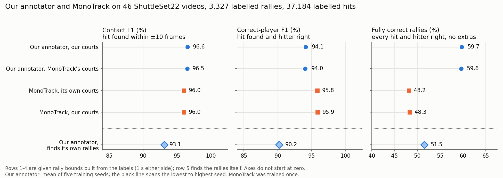
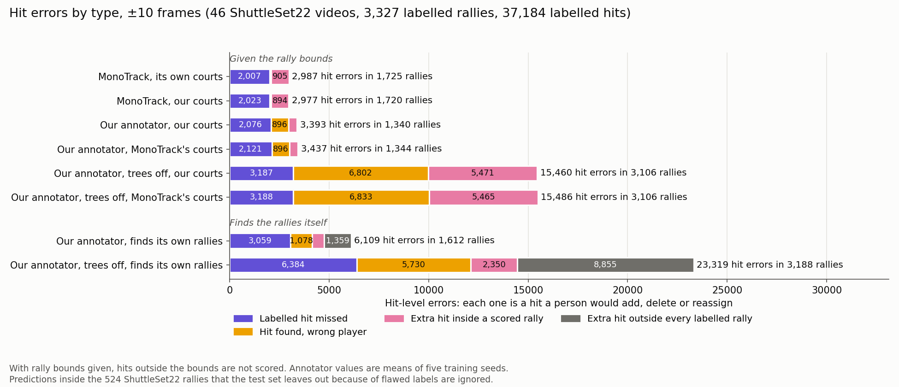
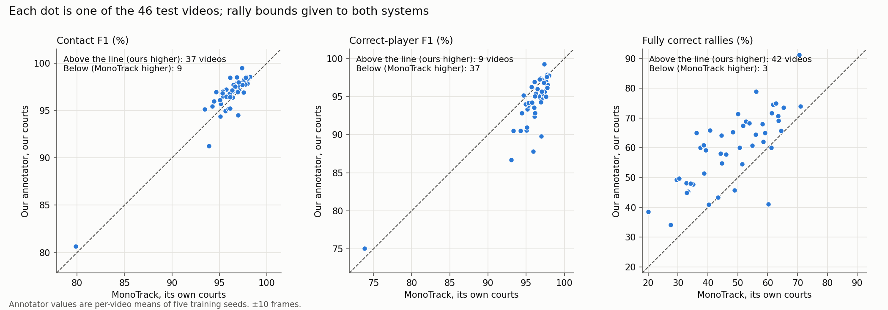
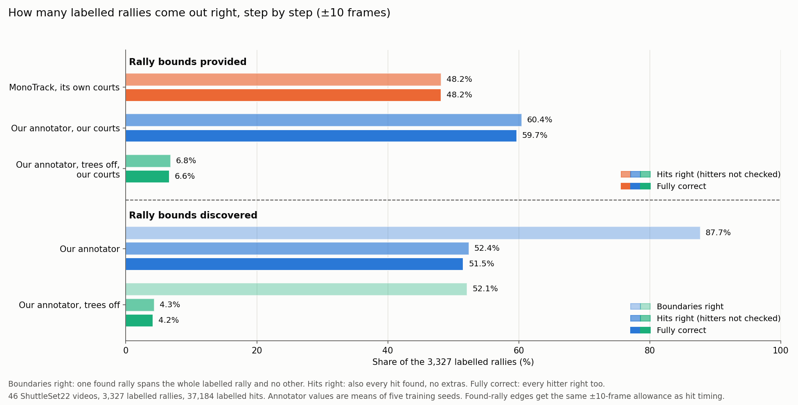
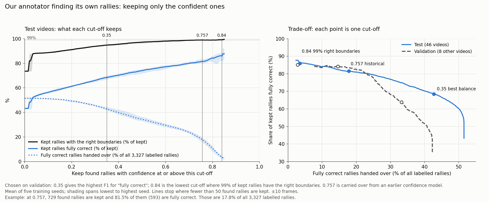
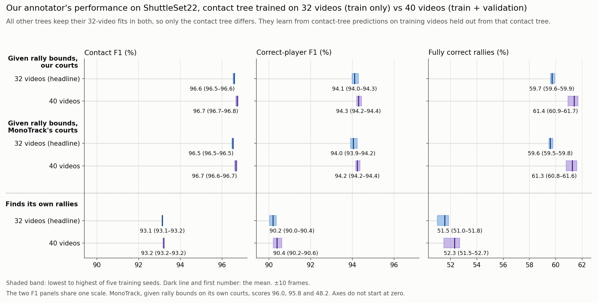

# Our annotator and court detector compared with MonoTrack

> Historical report. See the [current comparison](../../annotator_monotrack_own_weights_compared_writeup_v7.md).

## What this report asks

Our badminton annotator labels broadcast video automatically. For each racket
hit, it marks when the hit happens and which player made it, near or far. Its
purpose is to cut the manual work of labelling that video.

This report asks how well the annotator, and the court detector inside it, does
that job compared with
[MonoTrack](https://cs.stanford.edu/people/paulliu/files/cvpr-2022.pdf).
MonoTrack is a published system (CVPR 2022 Workshops) that labels the same
things.

In short: given the rally bounds, our annotator gets 59.7% of rallies fully
correct against MonoTrack's 48.2%, while MonoTrack names the hitter more
reliably. Our annotator can also find the rallies itself, which MonoTrack's
released code cannot. The two court detectors are close enough that swapping
them changes no score by more than 0.15 points.

## How the comparison was run

### The two systems

- **Our annotator** finds candidate hits from the shuttle's motion and assigns
  each hit to a player. Eight gradient-boosted decision-tree models (the
  "trees") then score hits, repair rally sequences and rank finished rallies by
  confidence. **Trees off** means the same pipeline with all eight disabled. It
  uses rule settings tuned on the same 32 training videos (Appendix B).
- **MonoTrack** was rebuilt from its
  [released source code](https://github.com/jhwang7628/monotrack). Its original
  weights are lost,[^original-weights] so its hit detector was retrained. The
  code defines a 130,179-parameter network. The paper describes a model of
  about 16,000 parameters. Appendix A lists every change from the release.

### Training data and held-out status

Both systems learnt from the same 32 videos of the original ShuttleSet. The
same 8 other videos were held out for choosing settings.[^datasets] The test
set played no part in training our annotator or choosing its settings.
MonoTrack's reported configuration is the highest-scoring of four tested on the
test set. That choice can only favour MonoTrack (Appendix A).

### Test set

The test set is 46 professional broadcast videos from ShuttleSet22, all at 30
frames per second. They hold 3,327 scored rallies with 37,184 labelled hits.
Another 524 rallies in these videos have flawed labels. The test set leaves them
out, and every condition ignores predictions inside them (Appendix G).

### Two ways to run

- **Rally bounds given.** The bounds run from 1 second before a rally's first
  labelled hit to 1 second after its last. Only hits inside the bounds are
  scored. MonoTrack's released code needs each rally cut out beforehand, so it
  runs only this way.
- **Found by the annotator.** Our annotator works on the whole video and finds
  the rallies itself. This is its discovery mode. Every predicted hit counts,
  including those outside any scored rally. Its courts come from a saved run of
  the court detector's discovery mode (Appendix C).

### Scoring

- **Hit timing.** A predicted hit matches a labelled hit when it falls within
  ±10 frames (one third of a second). Each prediction can match only one label.
  Appendix E rescores everything at ±5 frames.
- **Contact F1** combines precision (the share of predicted hits that match a
  labelled hit) and recall (the share of labelled hits found).
- **Correct-player F1** also needs the right hitter. A hit at the right time
  with the wrong player counts as one miss and one false hit.
- **Fully correct rallies** have every hit found, no extra hits and every hitter
  right. Under this scoring a person would have nothing to add, delete or
  reassign in them. A hit up to 10 frames off still counts as right. Results
  give their share of the 3,327 scored rallies. In discovery mode, a found rally
  must also cover exactly one labelled rally (see "Finding the rallies without
  help").
- **Seeds and intervals.** Our annotator's numbers are the mean of five training
  seeds. MonoTrack was trained once, and the other results are deterministic or
  single runs. The 95% intervals come from 10,000 paired bootstrap resamples of
  the 46 videos, with our annotator's counts averaged over its seeds first.

## What happened

- **With rally bounds given, our annotator gets more rallies fully correct.**
  Ours gets 59.7% of rallies fully correct, against 48.2% for MonoTrack. The gap
  is 11.6 points (95% interval 8.8 to 14.3). Ours is higher on 42 of 46 videos
  and level on 1 (Figure 1).
- **MonoTrack leaves fewer hits to fix.** A person would make 2,987 hit fixes to
  MonoTrack's output and 3,393 to ours. Both miss about as many hits: 2,007 for
  MonoTrack and 2,076 for ours. Ours gives the wrong hitter more often, 896
  times against 75. Ours adds fewer extra hits, 422 against 905. Ours puts its
  errors in fewer rallies: 1,340 against 1,725 (Figure 3).
- **Both find hits about equally well, and MonoTrack names the hitter more
  reliably.** Contact F1 is 96.6% for ours and 96.0% for MonoTrack.
  Correct-player F1 is 94.1% for ours and 95.8% for MonoTrack.
- **Our annotator can also find the rallies itself.** Working from the whole
  video, it gets 51.5% of rallies fully correct, and the right start and end for
  87.7%. Its confidence score can pick out a cleaner subset. At a cut-off of
  0.757, it keeps 729 of about 3,966 found rallies, and 81.5% of those are fully
  correct: 593 rallies, or 17.8% of all labelled rallies.
- **Swapping court detectors barely changes the scores.** The median corner
  error against ShuttleSet22's reference corners is 3.8 px for our detector and
  6.5 px for MonoTrack's (Figure 2). Swapping courts between the systems moves
  every score by 0.15 points or less. The 2.7 px gap between the medians is
  within a painted line's width. The clearer differences are in how each
  detector fails.
- **The trees do most of the work, and they are stable.** With all eight off,
  ours gets 6.6% of rallies fully correct. Across five training seeds, fully
  correct rallies span 59.6% to 59.9%.

Figure 1. The three headline scores for each set-up, ±10 frames. The top four
rows are given the rally bounds; the bottom row finds the rallies itself. Black
lines span our annotator's lowest to highest seed. Axes do not start at zero.

Figure 2. How close each rally's court is to ShuttleSet22's reference
corners. Left: the share of the 3,327 rallies whose court is within each error,
up to 15 px. Rallies with no court keep each line below 100%. Right: each
video's median error. Our per-rally court is closer than MonoTrack's in 44 of 46
videos. "Per scene" is the court our annotator uses when it finds the rallies
itself (discovery mode, Appendix C).

## What it means

The two systems leave different kinds of work. MonoTrack's errors are mostly
missed and extra hits, spread over more rallies. Ours are mostly missed hits and
wrong hitters, in fewer rallies. That is why ours leaves more rallies with
nothing to fix, even though it makes more hit-level errors overall.

Both court detectors place the court close enough that swapping them barely
changes the hit scores. The reference corners cannot settle which detector is
more accurate. Their failures differ instead. MonoTrack fits its court on each
rally's middle frame, and in 8 rallies that frame showed a close-up or another
camera. Our discovery mode's failures suggest that missed shot changes can leave
its court search looking at graphics, close-ups or other camera views.

Our annotator's accuracy comes from its trees. Without them, 6.6% of rallies are
fully correct instead of 59.7%. The trees give nearly the same scores across
seeds, with fully correct rallies spanning 0.3 points. Training the contact tree
on 40 videos instead of 32 added 1.7 points, with every seed improving.
Retuning the preprocessing kept each headline score inside the original
settings' seed range. These modest returns are consistent with trees near the limit of their
current design. Neither test measures that limit directly. A full refit of all
eight runs on a CPU in one to six hours. Each decision traces back to named
measurements of shuttle motion and player pose, which a person can inspect.

## What the results point to next

- The main gap to MonoTrack on hit fixes is naming the hitter. Ours gives the
  wrong hitter 896 times, against 75 for MonoTrack.
- Discovery mode's losses trace to two sources. In 211 rallies it found no
  court. A sample of 8 points to scene detection missing shot changes around
  transition graphics and replays (Appendix D). Discovery mode also predicts
  1,359 hits outside every labelled rally, and what those hits show has not been
  checked.

## What this means for cutting labelling work

With rally bounds given, a person checking our annotator's output has something
to fix in 1,340 rallies, against 1,725 for MonoTrack. Those rallies hold 3,393
hit fixes for ours and 2,987 for MonoTrack. The difference comes mainly from
ours giving the wrong hitter more often.

The two counts measure different costs. Hit fixes count edits; rallies with
something to fix count how many rallies a person must change. Ours needs 406
more edits and leaves 385 more rallies needing no change. Which costs a person
more depends on how their checking time splits between finding a rally's
errors and editing them, which this report does not measure.

Our annotator also runs without rally bounds, while MonoTrack's released code
needs the rallies cut out first. From the whole video, ours gets 51.5% of
rallies fully correct.

The confidence score lets a person trade trust against coverage. The share of
kept rallies that are fully correct says how far a person can trust what they
are handed. The count of fully correct rallies says how much of the labelling is
done. At the 0.757 cut-off, 4 in 5 kept rallies need no fixes. The rallies
needing no fixes number 593 of the 3,327, about 1 in 6. At 0.35, 68.4% of kept
rallies need no fixes, and those 1,421 rallies are 42.7% of all rallies. No
single cut-off suits every use (Figure 6).

## Results in detail

### Scores for every condition

Table 1. All conditions at ±10 frames. Our annotator's values are the mean of
five training seeds, with the lowest and highest seed in brackets. The other
rows are deterministic or single runs. "Ours" courts come from our detector's
per-rally mode. "Per scene" courts come from its discovery mode (Appendix C).

| System | Courts | Rally bounds | Contact F1 | Correct-player F1 | Fully correct rallies |
|---|---|---|---:|---:|---:|
| MonoTrack | Its own | Given | 96.0% | **95.8%** | 48.2% |
| MonoTrack | Ours | Given | 96.0% | **95.9%** | 48.3% |
| Our annotator | Ours | Given | **96.6%** (96.5–96.6) | 94.1% (94.0–94.3) | **59.7%** (59.6–59.9) |
| Our annotator | MonoTrack's | Given | 96.5% (96.5–96.5) | 94.0% (93.9–94.2) | 59.6% (59.5–59.8) |
| Our annotator, trees off | Ours | Given | 88.7% | 71.0% | 6.6% |
| Our annotator, trees off | MonoTrack's | Given | 88.7% | 70.9% | 6.6% |
| Our annotator | Ours, per scene | Found by the annotator | 93.1% (93.1–93.2) | 90.2% (90.0–90.4) | 51.5% (51.0–51.8) |
| Our annotator, trees off | Ours, per scene | Found by the annotator | 77.8% | 63.3% | 4.2% |

Ours leads on Contact F1 by 0.5 points (95% interval 0.2 to 0.8), with the
higher score on 37 of 46 videos. MonoTrack leads on Correct-player F1 by 1.7
points (1.1 to 2.4), with the higher score on 37 of 46 videos.

### Where the hit errors are

A person checking the output fixes three kinds of hit error. They add a missed
hit, delete an extra one, or change the hitter. Figure 3 counts each kind for
every condition.

Figure 3. Hit errors by type at ±10 frames. Each error is one hit a person would
add, delete or reassign. The text beside each bar gives the total and how many
scored rallies hold at least one error. Dark grey: extra hits outside every
labelled rally, which count only when the annotator finds its own rallies.

- **Swapping courts.** MonoTrack on our courts leaves 2,977 errors in 1,720
  rallies. Ours on MonoTrack's courts leaves 3,437 in 1,344.
- **Trees off.** Errors rise to 15,460 in 3,106 rallies on our courts, and to
  15,486 in 3,106 on MonoTrack's.
- **Finding its own rallies.** Ours leaves 6,109 errors in 1,612 rallies. They
  are 3,059 missed hits, 1,078 wrong hitters, 614 extra hits inside a scored
  rally and 1,359 extra hits outside every labelled rally. With trees off, the
  total is 23,319 errors in 3,188 rallies.

The pattern holds video by video (Figure 4). Ours has more fully correct rallies
on 42 of 46 videos, with 1 level, and higher Contact F1 on 37. MonoTrack has the higher
Correct-player F1 on 37.

Figure 4. One dot per test video, with both systems given rally bounds and using
their own courts. A dot above the dashed line is a video where ours scores
higher. Our annotator's values are per-video means of five seeds.

### Finding the rallies without help

With no rally bounds, our annotator must decide where each rally starts and
ends. A found rally is fully correct when it covers exactly one labelled rally.
Its hits must also match that rally's hits one to one with none left over, and
every hitter must be right. Figure 5 breaks this into three nested steps:

1. **Boundaries right:** one found rally spans the whole labelled rally, from
   its first labelled hit to its last. No other labelled rally's hits sit inside
   it.
2. **Hits right:** that found rally also holds every labelled hit and no extra
   hits. Hitters are not checked.
3. **Fully correct:** every hitter is right as well.

The found rally's edges may fall up to 10 frames short of the first or last
labelled hit. This is the same allowance hit timing gets. It is defined at 30
fps and scales with frame rate. The allowance adds 2.5 to 3.1 points to
"boundaries right" across seeds. Most of those rallies start a few frames after
the labelled serve.

Figure 5. The share of the 3,327 scored rallies reaching each step. With rally
bounds given, the boundaries are already set, so only the last two steps apply.

The annotator gets the boundaries right for 87.7% of labelled rallies. Of all
rallies, 52.4% also have every hit right, and 51.5% are fully correct. Once the
boundaries are right, most failures come from missed hits, extra hits or wrong
hitters, as with rally bounds given. With its trees off, boundaries are right
for 52.1% of rallies, hits for 4.3% and 4.2% end up fully correct. With rally
bounds given, "hits right" is 60.4% for ours, 48.2% for MonoTrack and 6.8% with
trees off.

Contact F1 drops from 96.6% with rally bounds given to 93.1% here. Two things
account for most of the drop:

- **Hits outside every rally.** 1,359 predicted hits sit outside every
  ShuttleSet22 rally. What they show has not been checked. Replays, warm-ups or
  play between rallies are possibilities.
- **Rallies with no court.** In 211 rallies (1,461 labelled hits), discovery
  mode found no usable court, so the annotator predicted nothing there.
  Appendix D examines eight examples. They suggest that missed shot changes can
  leave the court search looking at graphics, close-ups or other camera views.

These figures ignore predictions inside the 524 rallies with flawed labels:
about 4,075 per seed. Counted as extra hits, they would put Contact F1 at 88.2%
rather than 93.1% (Appendix G).

### Keeping only the confident rallies

Each found rally gets a confidence score from one of the trees. That tree was
trained to predict whether the rally is fully correct. Raising the cut-off keeps
fewer rallies, and more of those kept are right (Figure 6). No single cut-off
suits every use, so the right panel of Figure 6 shows the whole trade-off.

Figure 6 and Table 2 mark three cut-offs:

- **0.35, the best balance.** On the 8 validation videos, it gives the highest
  F1 for picking out fully correct rallies. Here precision is the share of kept
  rallies that are fully correct. Recall is the share of all fully correct found
  rallies that are kept.
- **0.757, the historical cut-off.** It was set for an earlier version of the
  confidence model and is carried over unchanged.
- **0.84, for boundaries.** On the validation videos, it is the lowest cut-off
  at which 99% of kept rallies have the right boundaries.

Table 2. Test results at each cut-off, as five-seed means. Each seed finds about
3,966 rallies, more than the 3,327 labelled ones: about 854 of them match no
labelled rally, and about 194 cover only part of one or join two. The two share
columns are shares of the kept rallies. The last column counts the kept rallies
that are fully correct, with their share of all 3,327 labelled rallies.

| Cut-off | Rallies kept (of 3,966 found) | Share fully correct | Share with right boundaries | Fully correct rallies handed over |
|---|---:|---:|---:|---:|
| 0.35 | 2,078 | 68.4% | 94.8% | 1,421 (42.7%) |
| 0.757 | 729 | 81.5% | 98.9% | 593 (17.8%) |
| 0.84 | 135 | 85.9% | 99.1% | 116 (3.5%) |

The share and the count answer different questions. The share says how far a
person can trust what they are handed: at 0.757, 4 rallies in 5 need no fixes.
The count says how much of the labelling is done: 593 of the 3,327 rallies,
about 1 in 6.

If only the boundaries matter, the historical cut-off gives 98.9% of kept
rallies the right boundaries on test. On test, that share first reaches 99% at
0.825, which keeps 232 rallies. That value is read off the test set itself,
so it only describes the test set. The 0.84 cut-off, chosen on validation, keeps
135. The validation videos are harder for the annotator: 42.3% of their rallies
come out fully correct, against 51.5% on test. At 0.84, each seed keeps about 22
validation rallies, so that choice rests on few rallies.

Figure 6. Left: on the test videos, what each cut-off keeps. Right: each point is
one cut-off. It plots the share of kept rallies that are fully correct against
the fully correct rallies handed over, as a share of all labelled rallies, for
test and validation. Moving left along a curve hands over fewer rallies, and
more of those are right. Lines are the mean of five seeds. Shading spans the
lowest to highest seed.

### Court detection

Our court detector has two modes (Appendix C). Per-rally mode searches within
each rally's supplied bounds. It gives "our courts" whenever rally bounds are
given. Discovery mode searches the camera shots of the whole video. It gives the
"per scene" courts that the annotator uses when it finds rallies itself.

Table 3. Each rally's court against ShuttleSet22's reference corners. Error is
the mean distance between matching corners, in 1920×1080 video pixels. IoU is
the overlap area of the two court outlines divided by the area they cover
together. For the per-scene row, each rally's court takes the median of each
corner coordinate across the accepted courts on the frames within its rally
bounds. Frames without a court are left out.

| Court source | Rallies with a court | Median error | Within 5 px | Median IoU | Rallies over 15 px |
|---|---:|---:|---:|---:|---:|
| Ours, per rally | 3,313 | 3.8 px | 85.8% | 0.986 | 27 |
| MonoTrack, per rally | 3,318 | 6.5 px | 17.2% | 0.975 | 35 |
| Ours, per scene (rallies found by the annotator) | 3,116 | 3.8 px | 75.7% | 0.985 | 31 |

ShuttleSet22 gives one set of reference corners per video, drawn for the main
camera view. A rally filmed from another view therefore reads as a large error,
even when its court is right. A painted line is several pixels wide, and the
reference does not say which edge it marks. The 2.7 px gap between the medians
is within that width, so it does not settle which detector is more accurate.
The clearer difference is how each one fails.

MonoTrack's court sits 5–10 px off in 79.4% of rallies and 10–15 px off in 2.1%
(Figure 2, left). For our per-rally court, those shares are 13.0% and 0.0%. For
our per-scene court, they are 17.0% and 0.0%. Our per-scene court is missing for
6.3% of rallies, which are the 211 rallies described under "Finding the rallies
without help".

The 39 rallies over 15 px fall into three groups. Every source is over 15 px on
the 27 video 17 rallies. MonoTrack adds 8 more and our per-scene court adds 4.

- **8 rallies where MonoTrack's court is 420–778 px off.** MonoTrack fits its
  court on each rally's middle frame. In these 8 rallies, that frame shows a
  close-up or another camera. Our per-rally detector returned no court on all 8.
  Our per-scene courts were 3–8 px from the reference there (Figure 7).
- **4 rallies where only our per-scene court is off.** Two used a wrong scene
  court, about 4,300 and 4,700 px off. Two put the right-hand sideline too far
  out, by 34 and 38 px. Their scenes were fitted on a frame where a transition
  graphic covered the centre of the court. Our per-rally courts were 2–5 px off
  on all four (Figure 8).
- **27 rallies in video 17 (rallies 47–73).** The broadcast zoomed in from rally
  47, so the reference no longer fits. All three court sources agree to within
  4 px and sit on the painted lines (Figure 9).

Figure 7. The 8 rallies where MonoTrack fitted its court to a close-up or
another camera. Each pair shows the frame MonoTrack fitted on (left) and a
main-camera frame from the same rally (right). Red long dashes: our per-scene
court. Fluoro-pink short dashes: MonoTrack's court. White fine dashes:
ShuttleSet22's reference corners. A tag on each frame names the source of each
outline. The bottom-right tag marks that our per-rally detector gave no court,
as it did for all 8 rallies. MonoTrack is also over 15 px on the 27 video 17
rallies, shown in Figure 9.

Figure 8. The 4 rallies where only our per-scene court is more than 15 px off,
on each rally's middle frame. Line styles as in Figure 7. Our per-rally courts
are not drawn. Top row: a wrong scene court, mostly outside the frame. Bottom
row: the right-hand sideline too far out. The scene frames those two courts were
fitted on are saved for
[video 49](../../writeup_figures/discovery_49_f111312.jpg) and
[video 54](../../writeup_figures/discovery_54_f90286.jpg).

Figure 9. Video 17, rally 47, one of the 27 rallies after the broadcast zoomed
in. Red is our per-rally court. The red and pink outlines sit on the painted
lines. The white reference corners were drawn for the earlier, wider view. All
27 are on [one contact
sheet](../../writeup_figures/fig6_court_gallery_video17_zoom.jpg). Full-size panels
for all 39 rallies are in
[`../../writeup_figures/court_gallery/`](../../writeup_figures/court_gallery/).

**Rallies with no court.** Our per-rally detector gave no court on 14 rallies
(191 hits). A visual check found no usable court in view on 10 of them. On 2,
the two-player check rightly rejected a bad court. One good court was rejected
(video 42, rally 48), and one usable view was missed (video 32, rally 22).
MonoTrack's detector gave no court on 9 rallies (105 hits). Every system scores
these rallies as missed hits.

### How stable are the trees?

Our annotator's trees give nearly the same scores whatever the training seed.
More training data for the contact tree raises them modestly (Figure 10).

- **Seeds.** Across five seeds with rally bounds given, Correct-player F1 spans
  94.0–94.3%, and fully correct rallies span 59.6–59.9%. The 0.3-point seed
  spread in fully correct rallies is small next to the 11.6-point gap to
  MonoTrack.
- **Training-set size.** One of the eight trees is the contact tree. Training it
  on all 40 original videos instead of 32 raised fully correct rallies by 1.7
  points with rally bounds given, and by 0.7 points when finding rallies.
  Correct-player F1 rose by about 0.2 points. Every seed improved with rally
  bounds given, by 1.3 to 1.9 points. The 32-video models use the same training
  videos as MonoTrack, so they are the fair comparison, and the headline uses
  them.
- **Retuning.** A search over 48 preprocessing settings, refitting all trees for
  each, chose the settings used here on validation (Appendix B). On test, each
  of their headline scores at ±10 frames falls inside the range of the shipped
  settings' five seeds. The tree hyperparameters stayed fixed in that search.

Each tree is a scikit-learn gradient-boosted model over named measurements of
shuttle motion and player pose. A full refit of all eight runs on a CPU in one
to six hours. Each decision traces back to those named measurements.

Figure 10. Our annotator's scores across five training seeds, in the layout of
Figure 1. Each shaded band runs from the lowest to the highest seed, and the
dark line inside it is the mean. Blue: contact tree trained on 32 videos, as in
the headline results. Purple: trained on 40. The other seven trees keep
their 32-video fits in both, so only the contact tree differs. The two F1 panels
share one scale.

## Limits

- **MonoTrack was rebuilt from its released source code.** Its hit detector was
  trained on original ShuttleSet because the original weights and training
  labels are unavailable. It receives TrackNetV3 shuttle tracks instead of its
  own TrackNetV2 build, and RTMPose poses instead of MMPose. Its training search
  was smaller than the released notebook's. Appendix A lists every change.
- **MonoTrack's configuration was picked on the test set.** The report uses the
  highest-scoring of its four configurations tested on ShuttleSet22. This choice
  can only favour MonoTrack.
- **MonoTrack was trained once.** Our annotator's numbers average five seeds.
  MonoTrack's come from one training run.
- **Reference corners are coarse.** They suit only the main camera view. A
  painted line's width is similar to the gap between the two detectors.
- **Rallies with flawed labels are ignored.** Predictions inside them are not
  scored in any condition. When the annotator finds its own rallies, its scores
  therefore describe the rest of each video (Appendix G).

## Appendix A: How the MonoTrack set-up was chosen

**Kept from the released code:** the hit detector's network (130,179 parameters;
two bidirectional GRU layers over 12-frame inputs), its feature layout, class
balancing, augmentation, batch size 64, early stopping, learning-rate reduction
and temperature calibration. Player selection, missing-pose filling and the
court detector also run as released. MonoTrack's court comes from the middle
frame within each rally's supplied bounds, as its released program does. Player
detections were limited to the top 16 by confidence.

**Changed, and why:**

- **Training labels.** The original MonoTrack labels are not available. The hit
  detector was trained on original ShuttleSet hit labels: 32 training videos and
  8 validation videos, fixed in advance. The hitter labels come from ShuttleSet
  (near player = 1, far player = 2). The fixed split keeps whole videos
  together. Training has 16 videos at 25 fps and 16 at 30 fps. Validation has
  one at 25 fps and seven at 30 fps.
- **Inputs.** TrackNetV3 shuttle tracks and saved RTMPose detections replace
  MonoTrack's custom TrackNetV2 and MMPose. Fresh MMPose extraction would have
  taken days. The reported configuration replaces InpaintNet-filled shuttle
  positions with zeros in training and inference.
- **Shuttle interpolation.** It is off at inference, which gave the strongest
  results among the four tested combinations. Missing-player-pose filling stays
  on.
- **Court corner order.** The released inference passes corners in a different
  order from the training notebook. A small adapter feeds the training order at
  inference. The vendored MonoTrack code is unchanged.
- **Optimisation.** The learning rate starts at 1e-3, because 1e-2 trained
  poorly. The release's tenfold updates per epoch were dropped, because this
  training set is roughly ten times larger.
- **Training exclusions.** Rallies where MonoTrack's court detector failed (50
  training, 9 validation) were skipped. So were 4 training rallies where its
  pose filling crashed. At test time, every rally is attempted and failures stay
  in the score.

Table A1. Training data after exclusions.

| Split | Videos | Usable rallies | Usable hits | Court failures skipped | Pose-fill crashes skipped |
|---|---:|---:|---:|---:|---:|
| Training | 32 | 2,637 | 27,384 | 50 rallies (183 hits) | 4 rallies (4 hits) |
| Validation | 8 | 659 | 5,681 | 9 rallies (15 hits) | 0 |

**Hyperparameter search.** Two shuttle inputs were trained:

- **kept:** TrackNetV3 positions with InpaintNet's gap fills kept;
- **zeroed:** the same track with InpaintNet's fills replaced by zeros.

Each input ran six settings: dropout 0 or 0.2, times L2 weight 0, 1e-6 or 1e-4.
All twelve used seed 0, learning rate 1e-3 and up to 600 epochs. Early stopping
came after 15 epochs without improvement, and learning-rate reduction after 12.
The lowest validation loss picked the setting for each input. Both winners use
dropout 0 and L2 0 (validation loss 0.2872 kept, 0.2879 zeroed).

Table A2. Validation results for all twelve runs (best epoch's checkpoint).
Accuracy is measured before temperature calibration.

| Shuttle input | Dropout | L2 | Validation loss | Validation accuracy | Best epoch / epochs run |
|---|---:|---:|---:|---:|---:|
| kept | 0 | 0 | **0.2872** | 89.65% | 85 / 100 |
| kept | 0 | 1e-6 | 0.2892 | 89.55% | 72 / 87 |
| kept | 0 | 1e-4 | 0.3130 | 89.55% | 121 / 136 |
| kept | 0.2 | 0 | 0.4555 | 81.67% | 32 / 47 |
| kept | 0.2 | 1e-6 | 0.5109 | 80.23% | 50 / 65 |
| kept | 0.2 | 1e-4 | 0.5624 | 77.32% | 26 / 41 |
| zeroed | 0 | 0 | **0.2879** | 89.68% | 121 / 136 |
| zeroed | 0 | 1e-6 | 0.2928 | 89.50% | 100 / 115 |
| zeroed | 0 | 1e-4 | 0.3094 | 89.48% | 119 / 134 |
| zeroed | 0.2 | 0 | 0.4910 | 79.78% | 23 / 38 |
| zeroed | 0.2 | 1e-6 | 0.4319 | 83.52% | 88 / 103 |
| zeroed | 0.2 | 1e-4 | 0.5088 | 80.87% | 49 / 64 |

**Choosing the main configuration.** Each input's selected weights were run on
the test videos with shuttle interpolation on and off at inference. Zeroed input
with interpolation off scored highest on all three headline measures. The report
uses the highest-scoring of these four configurations tested on ShuttleSet22.
This choice used the test set, so it can only favour MonoTrack.

Table A3. MonoTrack on its own courts, all four shuttle variants, ±10 frames.

| Shuttle input | Interpolation at inference | Contact F1 | Correct-player F1 | Fully correct rallies |
|---|---|---:|---:|---:|
| kept | On, as released | 95.73% | 95.50% | 44.94% |
| kept | Off | 95.86% | 95.66% | 45.66% |
| zeroed | On, as released | 95.43% | 95.11% | 41.60% |
| **zeroed (main results)** | **Off** | **96.03%** | **95.82%** | **48.15%** |

The weights are `hitnet_zeroed.h5`: trial `zeroed_d0_l20`, checkpoint epoch
121, dropout 0, L2 0, learning rate 1e-3, seed 0 and calibrated temperature
1.100818. The run on our courts uses the same weights and settings.

**Rally bounds.** MonoTrack's release works on rally clips cut beforehand, by a
process that is not available. Here each rally's bounds run from 30 frames (1
second) before the first labelled hit to 30 frames after the last. Where two
rallies are close, the bounds stop at the midpoint between them. The median
bounded rally is 277 frames (9.2 seconds). The same bounds are used to train
MonoTrack, to search for both systems' per-rally courts and to run every
condition with rally bounds given. Our court detector needs 3 seconds of player
evidence. Its search therefore widened the 167 bounded rallies shorter than
that, centred on the rally's middle. The resulting court still applies only
within the original bounds.

## Appendix B: How the annotator's settings were chosen

Both searches used the same fixed original-ShuttleSet split as MonoTrack: 32
training videos (2,691 rallies, 27,571 hits) and 8 validation videos (668
rallies, 5,696 hits). Neither search used ShuttleSet22.

**Trees off (rules only).** The annotator was run with all eight trees disabled,
finding its own rallies. A staged search tried 601 settings of 15 rule
parameters on the training videos. It had 128 starting settings, two rounds of
local refinement for Correct-player F1, a probe of the wrist-distance gate, and
one round of local refinement for fully correct rallies. The top three settings
for each goal gave five distinct candidates. All five were scored once on
validation, and both goals picked the same setting (validation Correct-player
F1 60.94%, 32 fully correct rallies). That setting was frozen before any test
run. It raised training Correct-player F1 from 42.51%, for the earlier hand-set
values, to 63.83%.

**Trees on.** The trees are retrained whenever the preprocessing changes. The
search varied five preprocessing settings between the shipped annotator's values
and the tuned rule-only values. That gave 48 combinations, each with all trees
refitted on the 32 training videos. The tree hyperparameters stayed fixed. The
four best on training, one of them the shipped settings, were each refitted with
five seeds and scored on validation. The best mean validation Correct-player F1
picked `grid-017`, which this report uses throughout. It led the shipped
settings by 0.28 points, inside the seed spread.

**Confidence cut-offs.** The 0.35 and 0.84 cut-offs in Table 2 were chosen on
the same 8 validation videos. The 32-video models were rerun there to record
each found rally's confidence. The best-balance cut-off maximises the five-seed
mean F1 for picking fully correct rallies. The boundary cut-off is the lowest at
which 99% of kept rallies, pooled over the five seeds, have the right
boundaries. Cut-offs were searched in steps of 0.005.

## Appendix C: Our court detector's two modes

Both modes look for the court's painted lines, found by DeepLSD. Both require
two players standing on the candidate court, using the pose detections. After
fitting, a two-player check counts how many frames show exactly two players
inside the court. A court that fails the check is dropped. The modes differ in
which frames they search and how they share results.

- **Per-rally mode** (the detector's `video-robust` mode, run within the
  supplied rally bounds). It searches three frames in each bounded rally: the
  middle and the two ends of a 3-second player window. Rallies that show the
  same camera view can then share one pooled court. This mode produced "our
  courts" for the conditions with rally bounds given. It found 3,317 courts, and
  the two-player check dropped 4.
- **Discovery mode** (the `fast-robust` mode, run on PySceneDetect scenes; "per
  scene" in the tables). PySceneDetect splits the whole video into camera shots.
  The detector searches only the middle frame of each shot. It then pools shots
  of the same view when at least three agree. It keeps the best complete court
  unless the pooled fit scores higher. These saved courts come from an earlier
  run and were not remade for this comparison.

Discovery mode needs no rally boundaries, so a fully automatic run uses it. Its
weakness is that a shot's middle frame may not show play.

## Appendix D: PySceneDetect, transition graphics and 211 missing courts

In discovery mode, 211 rallies (1,461 hits) had no accepted court on any of
their frames. The annotator predicted nothing in them. Per-rally mode found a
court for all 211, with a median error of 3.6 px and none over 15 px.

Table D1. What happened to the detected scenes overlapping these 211 rallies.

| Outcome for the overlapping scene | Rallies |
|---|---:|
| Court found, then rejected by the two-player check | 73 |
| No candidate court passed the player check | 115 |
| Fitted camera judged implausible | 11 |
| Line fit failed | 8 |
| Players not on the fitted court | 2 |
| Scene too short to search | 2 |
| **Total** | **211** |

The scenes overlapping these rallies are long. Their median is 694 frames (23
s), against 145 frames (5 s) for all detected scenes. The median bounded rally
is 277 frames. That points to missed shot changes, where one "scene" joins a
rally's main view to replays, close-ups or graphics. The scene's middle frame
then often shows no playing court.

A random sample of 8 of the 211 rallies supports this (Figure A1). In all 8, the
rally's own middle frame shows the main broadcast view. The frame our detector
searched did not:

- 3 showed the BWF World Tour logo transition graphic;
- 3 showed another camera angle (two side views and one from behind a coach);
- 2 showed player close-ups.

Figure A1. Eight randomly sampled rallies from the 211 where discovery mode had
no court. Left: each rally's middle frame, in the main view. Right: the middle
frame of the detected scene, which is what discovery mode searched, with the
outcome. Video 55, rally 11 overlaps two detected scenes, so it has two searched
frames. In the figure's labels, "two-player vote" is the two-player check, and
"line fit ran out of search budget" is the "Line fit failed" row of Table D1.

This sample suggests that transition graphics and replays hide shot changes from
PySceneDetect. It does not measure how often each cause occurs across all 211.
PySceneDetect was not tested directly on these transitions.

## Appendix E: Timing sensitivity at ±5 frames

The main results use ±10 frames, which matches the timing target of our
annotator's later stages. Table E1 rescores the same predictions at ±5 frames,
with no retraining or retuning.

Table E1. Main conditions rescored at ±5 frames. Our annotator's values are
five-seed means.

| System | Courts | Rally bounds | Contact F1 ±5 | Correct-player F1 ±5 | Fully correct rallies ±5 |
|---|---|---|---:|---:|---:|
| MonoTrack | Its own | Given | 94.8% | 94.7% | 40.5% |
| MonoTrack | Ours | Given | 94.8% | 94.8% | 40.6% |
| Our annotator | Ours | Given | 94.6% | 92.3% | 48.0% |
| Our annotator | MonoTrack's | Given | 94.5% | 92.3% | 47.9% |
| Our annotator, trees off | Ours | Given | 83.5% | 67.2% | 4.2% |
| Our annotator, trees off | MonoTrack's | Given | 83.5% | 67.1% | 4.2% |
| Our annotator | Ours, per scene | Found by the annotator | 91.2% | 88.4% | 41.2% |
| Our annotator, trees off | Ours, per scene | Found by the annotator | 74.0% | 60.5% | 2.5% |

At ±5 frames, the two systems find hits about equally well (94.8% against
94.6%). Ours still gets more rallies fully correct (48.0% against 40.5%).

## Appendix F: Where the numbers come from

- MonoTrack predictions and scores:
  `../results/comparison/mono_zeroed_own_off/` and
  `mono_zeroed_our_courts_off/`. Historical configurations sit beside them.
- Our annotator with rally bounds given, 32- and 40-video models, five seeds:
  `../../../tree_hp_tune/results/test_rerun/B/` (our courts) and `C/` (MonoTrack's
  courts). Finding its own rallies: `A/`. Inside each, the report uses
  `v32/grid-017/` (32 videos) and `final40/grid-017/` (40 videos).
- Trees off: `../../../heuristic_only_tune/results/known_our_courts/`,
  `known_mono_courts/` and `test/` (finding its own rallies), with the frozen
  settings in `selected.json.gz`.
- Court inputs: `../../benchmark_results/inputs/{ours,monotrack,discovery}/`.
  Reference corners: `data/shuttleset22/set/homography.csv.gz` (repository
  root).
- ShuttleSet22 labels, including the left-out rallies: `data/shuttleset22/set/`
  (repository root).
- MonoTrack training records: `../../hitnet_retrain/weights/`.
- Confidence scores in discovery mode: `../results/confidence_rerun/`,
  with `test/` and `validation/` folders. They come from a rerun of the 32-video
  `grid-017` models whose hits and rally spans match the committed streams
  exactly.
- The scripts that turn these results into this report's numbers, tables and
  figures: [`../../writeup_scripts/`](../../writeup_scripts/README.md).

## Appendix G: Rallies with flawed labels

The 46 test videos hold 3,851 ShuttleSet22 rallies. The test set scores 3,327.
The other 524 hold 4,725 labelled hits and were left out before this
comparison. 523 of them contain a hit flagged in ShuttleSet22's `flaw` field,
and one lists its hits out of time order.

**The flagged hits cannot be scored.** These rallies hold 661 flagged hits, and
505 of them are a rally's first hit. Across ShuttleSet22, 1,074 of the 1,085
flagged hits have an unknown shot type.

- 487 of the 661 have no hitter side, because a player position is missing. 380
  of the 524 rallies hold at least one such hit, so they could never be fully
  correct.
- Of the 156 flagged hits after a rally's first, 155 are timed at or before the
  hit listed before them.
- Our annotator puts a predicted hit within 10 frames of 23% of the flagged
  hits, against 92% of the unflagged hits in the same rallies.

Scored as ordinary rallies, 0.4% of them come out fully correct when our
annotator finds its own rallies, against 51% of the scored rallies. Counting
them would charge every system for label errors, so every condition ignores
them.

**How they are ignored.** Each left-out rally gets bounds from 1 second before
its first hit to 1 second after its last, as the scored rallies do. A prediction
inside those bounds is dropped before scoring, unless it is within 10 frames of
a scored hit. A found rally left with no predictions is dropped too.

**What this changes:**

- **With rally bounds given,** only the scored rallies are run. Ignoring the
  left-out rallies removes 1 of MonoTrack's extra hits and 3 of the trees-off
  annotator's. No rate changes at one decimal place.
- **When the annotator finds its own rallies,** a mean of 4,075 predictions and
  about 368 found rallies per seed are dropped. Counted as extra hits instead,
  they would put Contact F1 at 88.2% rather than 93.1%. Correct-player F1 would
  be 85.4% rather than 90.2%. With trees off, the figures would be 74.2% rather
  than 77.8%, and 60.4% rather than 63.3%. Fully correct rallies move by less
  than 0.1 points.
- **Court results** cover only the 3,327 scored rallies, so they do not change.

The left-out rallies' bounds may also hold some false hits, so the
discovery-mode scores describe the rest of each video.

The 8 validation videos have no left-out rallies. The original ShuttleSet
release already removed its flawed rallies, so every rally in those videos is
scored.

[^datasets]: The original ShuttleSet dataset is used for training and
    validation. Its follow-up, ShuttleSet22, is used for testing, with clips
    shared between the two removed. ShuttleSet22 video 15 is left out because
    its labels are misaligned. All test videos run at 30 frames per second.

[^original-weights]: Private communication, Paul Liu, 14/10/2026.
