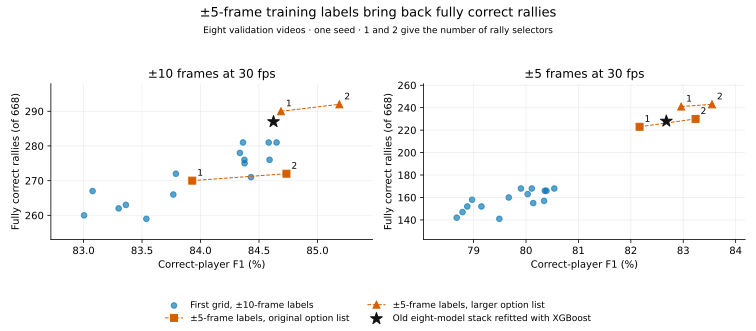
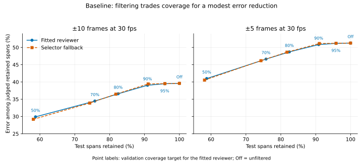

# Three fitted models can replace the annotator's eight

Three fitted models do the annotator's job slightly better than the old eight.
On the 46-video ShuttleSet22 test set, with both annotators scored the same way,
the new stack gets 86.24% correct-player F1 against 85.44% for the old
eight-model annotator. Fully correct rallies are 54.78% against 51.02%. That is
0.79 and 3.76 points, or about 125 more fully correct rallies per fit. The
price is speed: the timed inference stage takes about 3.74 times as long as the
old stack refitted with XGBoost. The recommended setup is the three-model stack
with baseline preprocessing and review filtering off.

## The short version

- **What changed.** A contact model still finds the hits. One XGBoost rally
  selector (31 leaves per tree, 400 boosting rounds) then picks one contact
  sequence for each proposed rally section from a fixed list of options. A small
  review ranker (7 leaves, 100 rounds) orders the output for manual checking and
  never changes it. Production fitting still defaults to the eight-model stack,
  and `--rally-layers 1` fits the new one.
- **Reading the numbers.** Correct-player F1 counts a predicted contact only
  when it matches a labelled contact within ±10 frames (or ±5) and names the
  right player. A fully correct rally has every labelled contact matched with
  the right player and no extra contacts. The headline test scores average five
  fits on the same videos. Mean F1 averages the five per-fit F1 scores, each
  pooled over videos. The test figures use discovery mode and standard scoring,
  defined below.
- **The MonoTrack write-up's 90.2%** is the old annotator under a different
  rule. That rule drops predictions inside 524 rallies the test set leaves out
  for flawed labels. Under that rule the new stack gets 91.01% correct-player
  F1 and 54.82% fully correct rallies.
- **Validation.** On the eight validation videos, the new stack beats the old
  eight-model stack refitted with XGBoost in all five seeds, on both measures at
  both tolerances. The mean gains are 11.2 fully correct rallies and 0.53 points
  of F1 at ±10 frames, and 17.4 and 0.70 at ±5.
- **Inputs.** Scaling motion features to a common frame rate did not help, so
  raw features stay. Baseline preprocessing stays. Smoothing body size over a
  36-frame half-window is an optional alternative with a small, mixed test gain.
- **Review filtering stays optional.** The threshold chosen on validation to
  keep 80% of predicted rally sections keeps 82.45% on test. It cuts judged
  error at ±10 (wrong sections among those checkable against labels) from
  39.60% to 36.58%. The 50% threshold still leaves 29.90%.
- **Not measured.** Whole-pipeline time, manual correction time and transfer to
  amateur or 60 fps footage.

## Comparing with the MonoTrack write-up

The [MonoTrack write-up](../monotrack_benchmark/annotator_monotrack_own_weights_compared_writeup_v4.md)
reports 90.2% correct-player F1 for the old annotator. That does not compare
with 86.24%, because the two use different rules for one group of predictions.

| System (test set, five-fit mean) | Predictions inside left-out rallies | Correct-player F1, ±10 | Fully correct rallies, this report's rule | Fully correct rallies, write-up's rule |
|---|---|---:|---:|---:|
| Old annotator: eight models, HGB setting grid-017 | Standard: counted as extra hits | 85.44% | 51.02% (1,697.4) | 51.48% (1,712.8) |
| New stack, baseline preprocessing | Standard | 86.24% | 54.78% (1,822.4) | 54.78% (1,822.6) |
| New stack, 36-frame body half-window | Standard | 86.32% | 55.00% (1,830.0) | 55.02% (1,830.6) |
| Old annotator (the write-up's headline) | Ignore: dropped | 90.19% | 51.09% (1,699.6) | 51.55% (1,715.0) |
| New stack, baseline preprocessing | Ignore | 91.01% | 54.82% (1,823.8) | 54.82% (1,824.0) |

The two rally columns differ in one detail. The write-up also counts a rally
whose found section stops up to 10 frames short of its first or last labelled
hit. That adds about 15 rallies for the old annotator and almost none for the
new stack. The gap is therefore 3.30 points under the write-up's rule and 3.76
under this report's. This report uses its own rule everywhere else.

The old annotator uses scikit-learn's histogram gradient boosting (HGB), with the
tree setting labelled grid-017.

**Discovery mode** means the annotator works on whole videos and finds the
rallies itself. Every predicted hit counts.

**The left-out rallies.** The 46 test videos hold 3,851 labelled rallies, and
the test set scores 3,327. The other 524 were left out: 523 contain a hit marked
as flawed in ShuttleSet22, and one lists its hits out of time order. Discovery
mode still finds them.

**Standard scoring**, used here, counts predictions inside those rallies as
extra hits, because they have no labels. **Ignore scoring**, used in the
write-up, gives each left-out rally a window from 1 second before its first hit
to 1 second after its last. It drops every prediction in that window unless the
prediction is within 10 frames of a scored hit. It then drops found rallies left
empty. Both rules keep the denominator at 3,327 rallies.

The scoring rule moves F1 a lot and fully correct rallies hardly at all. For the old
annotator, ignore scoring drops about 4,075 predictions per seed, raises F1 by
4.75 points and moves fully correct rallies by less than 0.1 points. For the new
stack, it drops about 4,052 predictions per seed, raises F1 by 4.77 points and
moves fully correct rallies by 0.04 points.

Otherwise the comparison is like for like: the same 32 training videos, the
committed discovery-mode courts, the same cleaned labels and whole-video scoring.
Apart from the rally rule, the write-up's terms match this report's. Its
filtering by rally confidence counts kept rallies, so it does not compare with
the review filtering here.

## Data, metrics and seeds

- **Videos.** All models fit on 32 ShuttleSet training videos. Validation is
  eight other ShuttleSet videos: 668 labelled rallies and 5,696 contacts. Test
  is 46 ShuttleSet22 videos: 3,327 scored rallies and 37,184 contacts.
- **Correct-player F1** is twice the correct contacts divided by predicted
  plus labelled contacts. Tolerances are ±10 frames (primary) and ±5, defined
  at 30 fps and scaled to each video's frame rate.
- **A fully correct rally** must sit inside one predicted rally section. Start
  and end frames need not match exactly.
- **Seeds.** The five fits use seed offsets 0, 100, 200, 300 and 400. They share
  their videos, so they show fitting variation, not independent samples.
  The seed-0 bundle's results and the search in appendix A come from single
  fits. F1 differences are in percentage points ("points").
- **Frame rates.** Training has 16 videos at 25 fps and 16 at 30 fps. Only
  `sset_18` in validation runs at 25 fps. All test videos run at 30 fps.
- **Roles.** Validation labels never enter fitting, but validation chose every
  setting. Validation has no left-out rallies, so the two scoring rules differ
  only on test. Validation chose the two test configurations and the review
  thresholds before the new test evaluation ran. Historical published test
  summaries had been seen earlier, while locating the old HGB record. They were
  not used to choose settings.

## The three-model stack

The old annotator has eight fitted models: one contact model, two serve-repair
models, one later-insertion model, three sequence choosers and one review
confidence model. [How the trees work together](../../../docs/annotator/tree_stack.md)
describes them.

The three sequence choosers do overlapping work. All three score the same fixed
list of proposed contact sequences. Two of them differ by a single score column.
The first two add no score columns to the final chooser. They only supply the
picks it must beat.

The new stack has three fitted models, all XGBoost:

| Model | Job | Settings |
|---|---|---|
| Contact model | Scores candidate frames as hits | 31 leaves, 180 rounds, learning rate 0.06, minimum child weight 5, seed 20260824, contact score threshold 0.9 |
| Rally selector | Picks one option for each proposed rally section | 31 leaves, 400 rounds, learning rate 0.05, minimum child weight 5, L2 regularisation strength 1, seed 20260905 |
| Review ranker | Orders finished rally sections for manual review | 7 leaves, 100 rounds, learning rate 0.05 |

The selector chooses from a larger option list than the old stack's. It keeps
every original option and adds combinations of up to three contact edits. Each
edit adds a shortlisted frame or deletes one of six deletion candidates: the
first contact and the five weakest later ones.

**Training.** The 32 training videos sit in four fixed groups of eight. Each
training video's selector inputs use contact predictions from a model fitted on
the other 24 videos. The final contact model is then fitted on all 32. With
more than one selector, each later selector trains on predictions that earlier
models made for groups they were not fitted on. Contact labels can still pass
between groups indirectly. For example, a contact model supplying group B may
have trained on group A, even when a later selector fit excludes group A.
Internal training scores are therefore not unbiased estimates.

**Training labels.** For each proposed rally section, training uses ±5-frame
labels when its option list holds an option that is correct at ±5. Otherwise it
uses ±10-frame labels. Unknowns are excluded. Each judged rally section gets the
same total training weight however many options it has. The overall weight
total comes from the 32 training videos' original option list, so a bigger
option list does not change how strongly the trees are regularised.

**What the comparisons can show.** Each comparison with the old stack covers a
whole system. The option list and the training labels changed along with the
selector stack. So the gains do not isolate tree size, selector count or the
switch from HGB to XGBoost.

For code readers: the code and saved bundles call each selector a "layer" and
the number of selectors the "depth", because saved bundles already use those
names.

Independent reviews changed this design in four places:

- A design review recommended one fixed option list for every selector count
  and setting, instead of a search that grows the options. That keeps the
  reachable ceiling the same across all comparisons. Adopted in `5f4bfd99` and
  `faa3d959`.
- The same review pointed out that contact exclusion is only one level deep.
  That is why internal cross-fit scores count as diagnostics only.
- A review of the first implementation found that a mean training weight of 1
  per row let option-list size change the regularisation strength. Since
  `4753b882`, one weight total from the 32 training videos holds across every
  configuration, subset and selector count.
- A later review noted that the ±5-label change confounds any claim about why
  the stack improved. It does not affect the whole-system comparison. The
  paragraph on what the comparisons can show reflects that point.

## Choosing the setting on validation

The table shows mean fully correct rallies (out of 668) and correct-player F1
on the eight validation videos, over five fits.

| System | Fully correct rallies, ±10 | F1, ±10 | Fully correct rallies, ±5 | F1, ±5 |
|---|---:|---:|---:|---:|
| Old annotator, HGB setting grid-017 (tied with grid-021) | 282.4 | 84.9174% | 216.0 | 82.7971% |
| Old eight-model stack refitted with XGBoost | 284.8 | 85.00% | 226.2 | 83.02% |
| Selected: one 31-leaf, 400-round selector | 296.0 | 85.53% | 243.6 | 83.72% |

Against the old stack refitted with XGBoost, each seed pair improved on both
measures. The rally gains ranged from +4 to +15 at ±10 and +9 to +24 at ±5. The
F1 gains ranged from +0.19 to +1.06 points at ±10 and +0.22 to +1.30 points at
±5. Against
grid-017 the mean differences are +13.6 and +27.6 rallies and about +0.61 and
+0.92 points of F1. The grid-017 record holds means only, so those differences
are descriptive, not paired by seed.

The repeated search ended with four settings, all on the larger option list
with ±5-frame labels where possible:

| Rally selectors | Rounds each | Fully correct rallies, ±10 | F1, ±10 | Fully correct rallies, ±5 | F1, ±5 |
|---|---:|---:|---:|---:|---:|
| One, 31 leaves | 200 | 293.8 | 85.28% | 242.0 | 83.42% |
| Two, 31 leaves | 200 | 293.8 | 85.17% | 241.4 | 83.28% |
| **One, 31 leaves** | **400** | **296.0** | **85.53%** | **243.6** | **83.72%** |
| Two, 31 leaves | 400 | 296.8 | 85.27% | 244.8 | 83.43% |

**Why 31 leaves.** Against one 15-leaf selector, the selected setting gains
7.2 rallies and 0.60 points at ±10, and 6.8 rallies and 0.65 points at ±5.

**Why 400 rounds.** Going from 200 to 400 rounds raises the one-selector means
by 2.2 and 1.6 rallies and by 0.25 and 0.30 points (±10 and ±5). Some seed
pairs went the other way.

**Why one selector.** A second selector adds only 0.8 and 1.2 rallies and costs
0.26 and 0.29 points of F1. One selector also keeps the annotation path to two
fitted models, a contact model and a rally selector. The review ranker makes
three.

The search stopped after the repeats fixed in advance. The exported bundle is
the original seed-0 fit. Its seed was not picked by validation score. That
bundle gets 301/668 fully correct rallies at ±10 and 252/668 at ±5, with F1 of
85.23% and 83.70%. Those are one fit's results, not the five-fit means.

**Per-video losses.** At ±10 the selected setting loses a mean 0.4 rallies on
`sset_18` and 1.4 on `sset_22`, against the old stack refitted with XGBoost.
Their F1 changes are −0.55 and −0.54 points. On `sset_30` it gains 0.4 rallies
and 0.36 points at ±10, but loses two rallies at ±5 while gaining 0.16 points.
Against one 15-leaf selector, `sset_30` gains 2.0 rallies and 1.11 points at
±10, and 2.4 rallies and 1.09 points at ±5. These losses matter even with
positive overall means. The saved predictions cannot show whether a candidate
contact was missing, or which feature caused a loss.

**The chosen model** is [`results/models/selected/`](../tree_simplification/results/models/selected/)
(md5 `9f96c0f40ab42b9498cb0c6a2533951d`). The preprocessing sweep refitted the
same setting as its baseline. Those refits give exactly the same validation
prediction files at all five seeds (40 of 40 files). The sweep's seed-0 bundle
(md5 `44c858b2d92c4c8658f26e22fde6c9ad`) differs from the chosen bundle in bytes,
not in output.

## The ShuttleSet22 test run

Validation chose two configurations for the test run before the new test
evaluation ran.
Baseline preprocessing had the best validation F1. The 36-frame body half-window
had the most fully correct rallies (appendix C). Validation also chose the
review thresholds. The test run measured those choices unchanged.

| Configuration | F1, ±10 | Fully correct rallies, ±10 (of 3,327) | F1, ±5 | Fully correct rallies, ±5 (of 3,327) |
|---|---:|---:|---:|---:|
| Baseline preprocessing | 86.24% | 1,822.4 | 84.62% | 1,470.2 |
| 36-frame body half-window | 86.32% | 1,830.0 | 84.70% | 1,474.6 |

| 36-frame half-window minus baseline | Mean | Range across five seeds | Better / worse seeds |
|---|---:|---:|---:|
| F1 ±10, points | +0.083 | −0.157 to +0.499 | 2 / 3 |
| Fully correct rallies ±10 | +7.6 | −29 to +38 | 3 / 2 |
| F1 ±5, points | +0.081 | −0.255 to +0.457 | 4 / 1 |
| Fully correct rallies ±5 | +4.4 | −43 to +44 | 3 / 2 |

Per video, the 36-frame half-window improves mean ±10 F1 on 27 of 46 test videos
and lowers it on 19. Fully correct rallies improve on 24, fall on 21 and tie on
one. The spread across seeds is bigger than the mean gain. This supports a small
trade-off between two fitted models. It shows no statistical significance,
equivalence or transfer to amateur footage. The test run did not pick a
deployment seed.

All ten test runs (two configurations, five seeds) passed bundle, source, input
and 46-video completeness checks. All 460 saved prediction files were readable.
An independent recount reproduced all ten test summaries from per-video counts,
and all 24 threshold reports from the saved review rows and unchanged
thresholds.

## Review scores

Keep the 7-leaf, 100-round review ranker. On validation it orders rally
sections better than the selector's own scores. Its AUROC, the chance that a
correct section scores above a wrong one, is 0.8013 against 0.7804 at ±10.
Its gain near the top of the queue is mixed. Review filtering stays optional and
off by default. The threshold chosen on validation to keep 80% of
predicted rally sections keeps 82.45% on test and cuts judged error at ±10 from
39.60% to 36.58%. The 50% threshold still leaves 29.90%. The scores are not
calibrated probabilities. Appendix D has the detail and the dataset guidance.

## Inference cost

The smaller stack is slower at inference. Two runs over all eight validation
videos through the same production entry point took 116.51 and 116.47 seconds.
The old stack refitted with XGBoost took 31.02 and 31.34 seconds. That is about
3.74 times as long. Both were limited to two CPU threads. The model order was
reversed on the second run. Every output matched its saved reference. These are
descriptive measurements on one host.

The timed stage covers contact scoring, building the option lists, selection
and review scoring. It leaves out vision processing, the initial contact
features, file reads and metric scoring.

A profile of `sset_30` puts most of the time into building and describing the
larger option list. The unprofiled replay takes about 22.7 seconds for that
video's 91.25 minutes of footage. Profiling adds overhead, so the profile only
locates the cost.

The choice puts fully correct rallies, contact quality and fewer fitted models
ahead of the extra 85 seconds this CPU stage takes across eight videos. That is
an engineering judgement. Total pipeline time and manual correction time have
not been measured, so the practical trade-off is still open.

## Limits

- **Transfer.** All the footage is professional broadcast video at 25 or 30
  fps, not 60 fps amateur footage. Rally durations are in seconds and frame
  windows scale with frame rate. Motion features such as shuttle velocity and
  ankle speed keep raw per-frame values, as they have since `ae3ff968` for
  compatibility with trained bundles. Scaling the windows therefore does not
  make those features frame-rate invariant. Scaling the features themselves did
  not help on these videos (appendix B). No transfer comparison has been run.
  Five seeds on the same eight videos measure fitting variation, not
  robustness to new footage. These experiments do not show whether smaller trees
  transfer better. A sample of the target footage could guide development, but
  choosing a model on it would need separate footage for the final check.
- **Statistics.** The report makes no significance or equivalence claims. The
  validation set is small, and the seeds are not independent samples. Ranges
  across seeds are observed ranges, not confidence intervals.
- **Review.** The final choice of one 31-leaf, 400-round selector had no
  external review.
- **The option list sets a ceiling.** With the current contact model, the
  option list allows at most 500 of 668 validation rallies to be fully correct
  at ±10 (appendix A). Better proposals could lift that ceiling.
- **Next step for a dataset.** The useful next step is to check annotation
  errors and how much review effort the scores save, on independent videos.
  Small preprocessing gains still leave substantial judged error after
  filtering. More preprocessing search has less immediate support.

## Evidence and reproduction

**Where things are.**

- [Reproduction guide](../tree_simplification/README.md): commands for every run
  in this report, including [production export](../tree_simplification/README.md#production-export-and-review-ranking),
  [inference timing](../tree_simplification/README.md#production-inference-timing),
  [frame-rate scaling](../tree_simplification/README.md#fps-motion-unit-experiment),
  [preprocessing refits](../tree_simplification/README.md#refit-changed-preprocessing-with-raw-features),
  [the test run and review thresholds](../tree_simplification/README.md#test-run-and-review-thresholds),
  [tracked models and prediction files](../tree_simplification/README.md#tracked-models-and-prediction-files)
  and [analysis scripts](../tree_simplification/README.md#analysis-scripts).
- [Results index](../tree_simplification/results/README.md): every evidence
  file, the label defaults, each sweep configuration id with its exact setting,
  and the bundle md5 table.
- [Models](../tree_simplification/results/models/): the chosen bundle, the ten
  test-run bundles (`raw_baseline-seed-<N>` and `body_window_36-seed-<N>`) and
  the old stack refitted with XGBoost at seed 0, for re-running the timing
  comparison.
- [Prediction files](../tree_simplification/results/streams/): every validation
  and test prediction behind the tables, plus per-video test scores.
- [Test-run records](../tree_simplification/results/test-run/): the record of
  the two configurations chosen on validation, and each test bundle's settings,
  results and contact-stage record.
- [Analysis scripts](../tree_simplification/analysis/README.md): one row per
  script, with its inputs, output and any data it needs from outside the repo.
- For a fresh one-selector fit through the production API, use
  [`--rally-layers 1`](../../../docs/annotator/retuning.md#rally-layer-bundles).
  Loading a saved bundle picks its inference path automatically.

**Evidence files**, all under `../tree_simplification/results/`:

| File | Backs |
|---|---|
| [`five-seed-evidence.json.gz`](../tree_simplification/results/five-seed-evidence.json.gz) | the old stack refitted with XGBoost, the 7- and 15-leaf selectors over five seeds, and the six-setting screen |
| [`selector-settings-evidence.json.gz`](../tree_simplification/results/selector-settings-evidence.json.gz) | the four 31-leaf settings over five seeds, per-video counts and paired differences |
| [`previous-hgb-validation.json.gz`](../tree_simplification/results/previous-hgb-validation.json.gz) | grid-017's validation means and source commit |
| [`selected-settings.json.gz`](../tree_simplification/results/selected-settings.json.gz) | the chosen run's exact training and option-list settings |
| [`selected-production.json.gz`](../tree_simplification/results/selected-production.json.gz), [`selected-review-rows.json.gz`](../tree_simplification/results/selected-review-rows.json.gz) | the chosen bundle's production replay and the validation ranking table |
| [`selected-timing.json.gz`](../tree_simplification/results/selected-timing.json.gz), [`selected-profile.json.gz`](../tree_simplification/results/selected-profile.json.gz) | inference timing (all 32 measurements) and the `sset_30` profile |
| [`fps-normalisation-evidence.json.gz`](../tree_simplification/results/fps-normalisation-evidence.json.gz) | appendix B |
| [`input-preprocessing-evidence.json.gz`](../tree_simplification/results/input-preprocessing-evidence.json.gz) | appendix C, the test run and the review-threshold reports |
| [`input-validation-review-rows.json.gz`](../tree_simplification/results/input-validation-review-rows.json.gz), [`input-test-review-rows.json.gz`](../tree_simplification/results/input-test-review-rows.json.gz), [`input-review-thresholds.json.gz`](../tree_simplification/results/input-review-thresholds.json.gz) | review rows and the review thresholds chosen on validation |
| [`input-stage-costs.csv`](../tree_simplification/results/input-stage-costs.csv) | time and memory for each sweep and test command |
| [`screening-evidence.json.gz`](../tree_simplification/results/screening-evidence.json.gz), [`target-screen.svg`](../tree_simplification/results/target-screen.svg) | appendix A's dropped configurations, ceiling and frame-rate contact diagnostics |
| [`test-flaw-scoring.json.gz`](../tree_simplification/results/test-flaw-scoring.json.gz) | the comparison with the MonoTrack write-up: old and new annotators under standard and ignore scoring, with both rally rules |

The old annotator's test predictions are tracked in
[`tree_hp_tune/results/test_rerun/A/v32/grid-017/`](../tree_hp_tune/results/test_rerun/A/v32/grid-017/).
The scoring rules come from the write-up's
[`flaw_scoring.py`](../monotrack_benchmark/writeup_scripts/flaw_scoring.py) and
its [appendix on flawed labels](../monotrack_benchmark/annotator_monotrack_own_weights_compared_writeup_v4.md#appendix-g-rallies-with-flawed-labels).

**What the repository alone supports.** With tracked files only, you can load
all ten test bundles and pass them through the test runner's own checks, using
`analysis/test_run.py`. You can also re-score every prediction file, redo the
review-threshold analysis and rebuild every table and figure except the
screening evidence.

**What needs data outside the repository.** Running test inference again needs
the 46 test videos' prepared inputs. A paths file names them with `test_inputs`,
`test_courts`, `inpaint_root` and `pose_root`. Rebuilding the screening evidence
and the two review-row files needs the archived raw run records, which are not
tracked. Profiling and option-list coverage need prepared arrays or option lists
from a fresh run.

**Commits.** Production integration and selection: `335fdcff`, `e2b948d2` and
`9a1cd0b6`. Frame-rate scaling: `a0d8ddf7` and `40513f20`. Preprocessing and the
test run: `b9c2c62b`, `ab5f3bfe`, `370506cd`, `94099e16` and `3bc81f1b`. The
experiment checkout was `ddd2a7f2` and the export checkout `e2b948d2`. In the
preprocessing sweep, baseline fits used `b9c2c62b` and the other configurations
`94099e16`. The commits in between added provenance guards without changing any
fit calculation. Two renaming commits after `3bc81f1b` gave commands, settings
keys and evidence keys plain names without changing any calculation. Archived
run records keep the old names.

**Provenance notes.** Historical published test summaries were visible while
the old HGB validation record was being located. They did not inform any
selection or comparison here. Each commit passed scoped tests, whole-project
Pyrefly and changed-file Ruff. Full pytest runs had one failure caused only by
`python` missing from PATH.

## Appendix A. How the search reached the selected stack

Every result in this appendix is a single seed-0 fit on the eight validation
videos unless stated. Rally counts are out of 668.

### A1. Swapping HGB for XGBoost

The first step kept the old eight-model stack and swapped its HGB models for
XGBoost. Saved vision outputs were reused. Both backends used two CPU threads.
XGBoost fitting also used an NVIDIA L40 GPU. Validation prediction ran on CPU.
The times are end-to-end under shared load, not isolated benchmarks.

| Backend for the old stack | Fit and validation time | Validation alone | F1, ±10 | Fully correct rallies, ±10 | F1, ±5 | Fully correct rallies, ±5 |
|---|---:|---:|---:|---:|---:|---:|
| HGB, two CPU threads | 67m29s | 47.88s | 84.15% | 273 | 82.13% | 212 |
| XGBoost, minimum child weight 5 | 17m13s | 27.03s | 84.62% | 287 | 82.68% | 228 |
| XGBoost, minimum child weight 10 | 19m13s | 43.59s | 84.80% | 273 | 82.46% | 200 |

XGBoost with minimum child weight 5 was 3.92 times faster than HGB. Minimum
child weight 10 slightly raised ±10 F1 but got 14 fewer fully correct rallies,
so 5 became the reference. Neither value matches HGB's minimum leaf size.
Review note: an independent review pointed out that child weight 5 is much
looser than HGB's 40-row minimum contact leaf once class weights apply. The
child-weight-10 run was added in response.

For context, five earlier HGB validation seeds ranged from 84.15% to 85.05% F1
and 273 to 290 rallies at ±10. At ±5 they ranged from 82.13% to 82.94% and 209
to 221. That spread is context, not an equivalence margin. One XGBoost seed shows
neither equivalence nor a reliable gain.

### A2. First grid with ±10-frame labels

This screen kept the XGBoost contact model and replaced every later model with
one, two or three general rally selectors. All selectors chose from one fixed
option list, so a later selector could revise an earlier choice. Later
selectors also saw earlier predictions and confidence features. Training used
whole-rally labels at ±10 frames and a fixed training weight per rally section.
All runs used 200 boosting rounds. The original option list holds the old
stack's edit proposals. The larger list adds combinations of up to three contact
additions or deletions.

| Option list and tree setting | Rally selectors | F1, ±10 | Fully correct rallies, ±10 | F1, ±5 | Fully correct rallies, ±5 |
|---|---:|---:|---:|---:|---:|
| Original, 15 leaves | 1 | 83.00% | 260 | 78.68% | 142 |
| Original, 15 leaves | 2 | 83.08% | 267 | 78.97% | 158 |
| Original, 15 leaves | 3 | 83.36% | 263 | 78.88% | 152 |
| Larger, 7 leaves | 1 | 83.54% | 259 | 79.67% | 160 |
| Larger, 7 leaves | 2 | 84.34% | 278 | 80.35% | 157 |
| Larger, 7 leaves | 3 | 83.79% | 272 | 79.90% | 168 |
| Larger, 15 leaves | 1 | 83.30% | 262 | 78.79% | 147 |
| Larger, 15 leaves | 2 | 84.43% | 271 | 80.54% | 168 |
| Larger, 15 leaves | 3 | 84.59% | 276 | 80.14% | 155 |
| Larger, 31 leaves | 1 | 84.38% | 276 | 79.49% | 141 |
| Larger, 31 leaves | 2 | 84.36% | 281 | 80.03% | 163 |
| Larger, 31 leaves | 3 | 84.65% | 281 | 80.36% | 166 |
| Larger, 15 leaves, minimum child weight 10 | 1 | 83.77% | 266 | 79.15% | 152 |
| Larger, 15 leaves, minimum child weight 10 | 2 | 84.38% | 275 | 80.11% | 168 |
| Larger, 15 leaves, minimum child weight 10 | 3 | 84.58% | 281 | 80.39% | 166 |

At ±10 some reduced stacks looked competitive. At ±5 every configuration fell
below the old stack refitted with XGBoost (82.68% and 228) on both measures.
That includes the original-option-list control, so the larger list is not needed
to explain the loss. It could still add a separate effect.

The same grid with an HGB contact model and HGB selectors showed the same
pattern. Its reference, the old HGB stack, gets 84.15% F1 and 273 rallies at
±10, and 82.13% and 212 at ±5. At ±5 every HGB configuration fell below it.

| HGB option list and tree setting | Rally selectors | F1, ±10 | Fully correct rallies, ±10 | F1, ±5 | Fully correct rallies, ±5 |
|---|---:|---:|---:|---:|---:|
| Original, 15 leaves | 1 | 83.39% | 265 | 79.12% | 139 |
| Original, 15 leaves | 2 | 83.54% | 264 | 79.71% | 158 |
| Original, 15 leaves | 3 | 83.42% | 265 | 79.70% | 155 |
| Larger, 7 leaves | 1 | 83.53% | 265 | 79.11% | 151 |
| Larger, 7 leaves | 2 | 84.08% | 270 | 80.45% | 176 |
| Larger, 7 leaves | 3 | 84.34% | 270 | 80.60% | 161 |
| Larger, 15 leaves | 1 | 83.68% | 265 | 79.43% | 156 |
| Larger, 15 leaves | 2 | 83.95% | 270 | 79.78% | 167 |
| Larger, 15 leaves | 3 | 83.99% | 272 | 79.75% | 164 |
| Larger, 31 leaves | 1 | 84.56% | 271 | 79.86% | 143 |
| Larger, 31 leaves | 2 | 84.70% | 278 | 80.74% | 179 |
| Larger, 31 leaves | 3 | 84.10% | 267 | 79.83% | 153 |

Review note: an independent design review asked for the original-option-list
control, to separate the larger list from extra selectors. It ran at all three
selector counts.

### A3. ±5-frame labels and the larger option list

These runs changed the training labels and kept everything else from the first
grid. For each rally section, training
used ±5-frame labels when its option list held an option correct at ±5, and
±10-frame labels otherwise. Unknowns stayed excluded. Features and proposal
rules stayed fixed. All use 15 leaves.

| Option list | Rally selectors | F1, ±10 | Fully correct rallies, ±10 | F1, ±5 | Fully correct rallies, ±5 |
|---|---:|---:|---:|---:|---:|
| Original | 1 | 83.93% | 270 | 82.17% | 223 |
| Original | 2 | 84.73% | 272 | 83.24% | 230 |
| Larger | 1 | 84.69% | 290 | 82.96% | 241 |
| Larger | 2 | 85.19% | 292 | 83.55% | 243 |

On the original list with one selector, the label change alone lifted ±5 fully
correct rallies from 142 to 223, and ±10 from 260 to 270. The larger list then
reached 241 and 290. A second selector reached 243 and 292, and raised F1 at both
tolerances. The old stack refitted with XGBoost gets 228 and 287, with F1 of
82.68% and 84.62% at ±5 and ±10.



Each panel plots fully correct rallies (out of 668) against correct-player F1
for one tolerance. Higher and further right is better. Dots are the first grid
with ±10-frame labels. The two dashed lines are the ±5-label runs on the
original and larger option lists, with points labelled by selector count. The
star is the old stack refitted with XGBoost. All points are single seed-0 fits.

Review note: an independent review traced the early ±5 losses to the ±10
labels. On four videos, 36 of 45 rallies that the general selectors lost at ±5
were still correct at ±10 with one contact 6 to 10 frames off. In `sset_22`, rally section 17, the
selector replaced a contact at frame 24599 (contact score 0.993) with one at
24607 (score 0.186). The label sits at 24601, and the ±10 label still scored the
choice correct. That finding led to the ±5-frame training labels (`3aab6375`).

### A4. Smaller trees and a third selector

All rows use the larger option list, ±5-frame labels where possible and the same
contact model.

| Leaves per tree | Rally selectors | F1, ±10 | Fully correct rallies, ±10 | F1, ±5 | Fully correct rallies, ±5 |
|---|---:|---:|---:|---:|---:|
| 7 | 1 | 85.38% | 288 | 83.93% | 245 |
| 7 | 2 | 85.52% | 283 | 84.04% | 236 |
| 15 | 2 | 85.19% | 292 | 83.55% | 243 |
| 15 | 3 | 84.91% | 288 | 83.40% | 245 |

One 7-leaf selector beat two 15-leaf selectors on F1 at both tolerances, with
four fewer fully correct rallies at ±10 and two more at ±5. Both 7-leaf
configurations therefore joined the seed repeats before any repeat results were
seen. A third 15-leaf selector showed no clear gain.

### A5. Contact models fitted on 28 videos

This check changed only the training inputs. Contact predictions for each
training video came from models fitted on 28 other videos (eight folds of four)
instead of 24. The final contact model and the validation option lists stayed
the same. With one selector it got 285 and 235 fully correct rallies (±10 and
±5), and with two it got 286 and 229. Contact models fitted on 24 videos got 290
and 241, and 292 and 243. So 24 stayed. Review note: an independent review pointed
out that rebuilding the option lists would move the training weight total. It
was held at 371.86228729719033, so the check changed only the contact inputs.

One-level contact cross-fitting stayed for a practical reason. Full nesting
would add 24 inner contact fits for a two-selector stack. It would also need
option lists matched across different contact models.

### A6. Specialist selectors

This screen tested whether the old serve and insertion models help a single
whole-rally selector. All four designs used the original option list,
±10-frame labels, 15 leaves and 200 rounds.

| Design | Rally selectors | F1, ±10 | Fully correct rallies, ±10 | F1, ±5 | Fully correct rallies, ±5 |
|---|---:|---:|---:|---:|---:|
| Contact, then whole-rally selector | 1 | 83.00% | 260 | 78.68% | 142 |
| Contact, then whole-rally selector | 2 | 83.08% | 267 | 78.97% | 158 |
| Plus serve specialist | 1 | 82.76% | 269 | 77.49% | 123 |
| Plus serve specialist | 2 | 83.11% | 269 | 79.13% | 172 |
| Plus insertion specialist | 1 | 84.16% | 270 | 80.02% | 157 |
| Plus insertion specialist | 2 | 84.17% | 280 | 79.91% | 165 |
| Plus both specialists | 1 | 84.19% | 276 | 79.85% | 150 |
| Plus both specialists | 2 | 84.06% | 286 | 79.51% | 155 |

Specialists raised ±10 fully correct rallies, up to 286 with both. At ±5 all of
them stayed far below the ±5-label runs in A3 and below the old stack's 228. They
did not produce a better overall candidate. Review note: the specialists used
only the original ±10 labels, so this screen does not show that specialists are
useless with ±5-frame labels.

### A7. Keep-margin replays

The final selector picks the top-scoring option. These replays asked whether a
preference for keeping the original sequence helps. A margin of 0.05 lets the
selector switch only when its best option beats the keep option by at least
0.05. Margin 0 reproduced every source run exactly. Fully correct rallies at
±10 and ±5:

| Configuration | Rally selectors | Margin 0 | Margin 0.05 |
|---|---:|---:|---:|
| Larger list, ±5 labels, 15 leaves | 1 | 290 and 241 | 277 and 241 |
| Larger list, ±5 labels, 15 leaves | 2 | 292 and 243 | 288 and 244 |
| Larger list, ±5 labels, 7 leaves | 1 | 288 and 245 | 261 and 230 |
| Larger list, ±5 labels, 7 leaves | 2 | 283 and 236 | 280 and 238 |
| Larger list, ±10 labels, 15 leaves | 2 | 271 and 168 | 268 and 184 |
| Original list, ±10 labels, 15 leaves | 2 | 267 and 158 | 264 and 188 |

Margin 0.05 traded ±10 rallies for ±5 gains, and the ±5 gains mostly came on
runs trained with ±10 labels. Margin 0 stayed. Review note: an independent
review suggested that picking the top option with no preference for keeping
might trade F1 for rallies. These replays tested that.

### A8. Six-setting follow-up

Before fitting, six settings were fixed for a seed-0 screen against the
15-leaf, 200-round selector on the same larger option list with ±5-frame labels.
The rule, also fixed in advance, let at most two settings advance to five-seed
repeats.

| Setting | Rally selectors | F1, ±10 | Fully correct rallies, ±10 | F1, ±5 | Fully correct rallies, ±5 |
|---|---:|---:|---:|---:|---:|
| 15 leaves, 200 rounds (reference) | 1 | 84.69% | 290 | 82.96% | 241 |
| 15 leaves, 200 rounds (reference) | 2 | 85.19% | 292 | 83.55% | 243 |
| 31 leaves, 200 rounds | 1 | 85.40% | 301 | 83.74% | 253 |
| 31 leaves, 200 rounds | 2 | 85.59% | 300 | 83.95% | 248 |
| 15 leaves, 400 rounds | 1 | 85.34% | 295 | 83.66% | 246 |
| 15 leaves, 400 rounds | 2 | 85.36% | 296 | 83.76% | 242 |
| 31 leaves, 400 rounds | 1 | 85.23% | 301 | 83.70% | 252 |
| 31 leaves, 400 rounds | 2 | 85.26% | 307 | 83.63% | 250 |
| 15 leaves, 200 rounds, learning rate 0.1 | 1 | 84.64% | 287 | 82.86% | 237 |
| 15 leaves, 200 rounds, learning rate 0.1 | 2 | 84.69% | 291 | 83.07% | 246 |
| 15 leaves, 400 rounds, learning rate 0.025 | 1 | 85.05% | 290 | 83.58% | 249 |
| 15 leaves, 400 rounds, learning rate 0.025 | 2 | 85.11% | 294 | 83.51% | 251 |
| 15 leaves, 200 rounds, minimum child weight 10 | 1 | 85.20% | 298 | 83.49% | 250 |
| 15 leaves, 200 rounds, minimum child weight 10 | 2 | 85.13% | 297 | 83.41% | 247 |

Learning rate is 0.05 and minimum child weight 5 unless stated. 31 leaves at 200
rounds improved all four measures at both selector counts. 31 leaves at 400
rounds with two selectors reached 307 and 250, with smaller F1 gains. Those two
settings went to five-seed repeats, fixed before any repeat outcome. The search
stopped after them. Review note: an independent review of the three-seed
evidence recommended adding offsets 300 and 400 and a targeted search over 15
or 31 leaves and 200 or 400 rounds. Offsets 300 and 400 ran for all five
repeated configurations, and this screen covered the targeted settings.

### A9. Seeds

A seed offset changes the contact model's negative sampling and its internal
stopping split. Those changes flow into the option lists and everything
downstream. At each offset the old stack and the new selectors share the same
contact models. Offsets 300 and 400 were added before their outcomes were seen.
Review note: an independent review asked for this pairing, so that the old and
new stacks see the same contact noise (`ddd2a7f2`).

Five-seed means for the configurations repeated before the 31-leaf settings:

| Stack | Fully correct rallies, ±10 | F1, ±10 | Fully correct rallies, ±5 | F1, ±5 |
|---|---:|---:|---:|---:|
| Old stack refitted with XGBoost | 284.8 | 85.00% | 226.2 | 83.02% |
| One 15-leaf selector | 288.8 | 84.92% | 236.8 | 83.07% |
| Two 15-leaf selectors | 291.8 | 85.01% | 239.2 | 83.22% |
| One 7-leaf selector | 280.6 | 84.95% | 235.4 | 83.26% |
| Two 7-leaf selectors | 281.6 | 85.05% | 233.6 | 83.26% |

### A10. The option-list ceiling

The selectors can only choose among options the code proposes. Each chosen
option replaces one proposed rally section. A start may move earlier, up to the
previous section's end, but ends stay fixed. Selection cannot create a missing
rally section or fill an empty one. New contact frames can only come from the
existing shortlists: at most two earlier serve candidates and six later
candidates per section. There is no separate side correction. The final
alternating-side rule votes from the raw side guesses. Frames that the rule-based
search regions exclude cannot come back.

A probe of the eight validation option lists checked two necessary conditions
for each rally. With the current contact model, 168 of 668 rallies fail at
least one. For 115, no reachable section bounds can contain the rally. The
other 53 lack the needed frames even in the union of all their options. At most
500 of 668 (74.9%) can be fully correct at ±10. Further limits may lower that.

| Video | Labelled rallies | With a correct option (initial neighbours) | Bounds impossible | Further frame-union failures |
|---|---:|---:|---:|---:|
| `sset_18` | 64 | 20 | 29 | 3 |
| `sset_22` | 70 | 42 | 12 | 12 |
| `sset_24` | 99 | 62 | 21 | 8 |
| `sset_25` | 74 | 59 | 12 | 2 |
| `sset_30` | 116 | 66 | 18 | 16 |
| `sset_31` | 63 | 23 | 4 | 0 |
| `sset_39` | 103 | 75 | 15 | 9 |
| `sset_40` | 79 | 66 | 4 | 3 |
| **Total** | **668** | **413** | **115** | **53** |

The 413 rallies with a correct option assume the neighbouring sections stay as
they started. That count is neither a joint ceiling nor a guaranteed score. Two
rallies are provably unreachable: `sset_18` set1:13 (labels 17580 to 18033) and
set1:33 (labels 36696 to 36899). Review note: an independent review could not
falsify the 500 ceiling. It is loose, and it holds only for the contact model
probed here.

### Summary of the search

| Step | Question | Seed-0 outcome | Evidence |
|---|---|---|---|
| A1 | Can XGBoost replace HGB? | 3.92 times faster, similar validation scores | `screening-evidence.json.gz`, backend comparison |
| A2 | Do general selectors with ±10 labels match the old stack? | Competitive at ±10, worse at ±5 | `screening-evidence.json.gz`, first grid |
| A3 | Do ±5-frame labels and the larger list help? | Yes: 292 and 243 with two selectors | `screening-evidence.json.gz`, label and option-list comparison |
| A4 | Do smaller trees or a third selector help? | 7 leaves is a trade-off; third selector no gain | `screening-evidence.json.gz`, smaller trees |
| A5 | Do contact models fitted on 28 videos help? | No: 285 and 235, 286 and 229 | `screening-evidence.json.gz`, 28-video contact inputs |
| A6 | Do serve or insertion specialists help? | Not with ±10 labels | `screening-evidence.json.gz`, specialists |
| A7 | Does a keep margin help? | Trades ±10 for ±5; margin 0 stays | `screening-evidence.json.gz`, keep-margin replays |
| A8 | Which tree settings to repeat? | 31 leaves at 200 and 400 rounds | `five-seed-evidence.json.gz`, `six_setting_screen` |
| A10 | How much can selection reach? | At most 500 of 668 at ±10 | `screening-evidence.json.gz`, option-list ceiling |

## Appendix B. Frame-rate scaling of motion features

Scaling learned motion features to equivalent 30 fps units did not improve mean
fully correct rallies or correct-player F1 over five seeds. Raw features stay.

**The change.** Two variants were compared with raw features. Both multiply
shuttle velocity and speed, and both players' ankle speeds, by `q = fps / 30`,
at five temporal feature offsets. "All motion features scaled" also multiplies
the second-difference impulse by `q²` and recomputes its ratio with the fixed
denominator floor in 30 fps units. "Velocity only scaled" leaves impulse and its
ratio alone. Geometry, frame windows, candidate-region flags and vision evidence
stay fixed. Preparation at exactly 30 fps is unchanged. Both the contact model
and the rally selector use the scaled rows, so this changes the whole stack.
Changed contact scores can also change the proposed options.

**Fixed settings.** The selected stack: contact model with 31 leaves and 180
rounds, one rally selector with 31 leaves and 400 rounds, and the review ranker.
Each comparison reuses its raw seed's training weight total, splits and sampling
order, paired across variants at offsets 0, 100, 200, 300 and 400. Training
input order is rebuilt explicitly, so worker completion order cannot change row
order. GPU execution determinism itself was not tested.

| Features | Fully correct rallies, ±10 (of 668) | Fully correct rallies, ±5 | F1, ±10 | F1, ±5 |
|---|---:|---:|---:|---:|
| Raw | 296.0 | 243.6 | 85.53% | 83.72% |
| All motion features scaled | 293.0 | 242.2 | 85.09% | 83.29% |
| Velocity only scaled | 292.8 | 241.6 | 85.21% | 83.42% |

Raw has the highest mean on all four measures. Paired changes subtract the raw
result at the same seed. Brackets show the lowest and highest seed change.

| Variant | Fully correct rallies, ±10 | F1, ±10 (points) | Fully correct rallies, ±5 | F1, ±5 (points) |
|---|---:|---:|---:|---:|
| All motion features scaled | −3.0 (−5 to +3) | −0.44 (−1.32 to +0.19) | −1.4 (−8 to +4) | −0.43 (−1.41 to −0.06) |
| Velocity only scaled | −3.2 (−23 to +14) | −0.32 (−1.06 to +0.27) | −2.0 (−21 to +14) | −0.30 (−1.22 to +0.42) |

Scaling all motion features loses ±5 F1 in every seed. Scaling velocity only
gives mixed paired results and wider swings in fully correct rallies. Both
variants have a large negative outlier on `sset_31` at offset 400, of about 7
to 8.5 points of F1. These differences show no statistical significance or
equivalence. They give no measured reason to replace raw features.

**Contact-model diagnostics** over offsets 100 to 400 compare raw and scaled
contact models directly. Training F1 at 25 fps rose slightly (all motion +0.07
and +0.06 points at ±5 and ±10, velocity only +0.15 and +0.16). At 30 fps it
fell for both. Validation F1 at 30 fps fell for both. At 25 fps it fell for all
motion features (−0.33 and −0.22) and was mixed for velocity only. Training
scores here are not unbiased estimates.

All ten runs rebuilt every validation option list and prediction file exactly.

Review note: an independent review of the design checked the impulse units.
Multiplying by `q²` converts smooth acceleration exactly. An earlier proposed
`sqrt(fps/30)` factor had no basis. The review also required the scaling to
apply only to learned feature rows, after the rule-based rally sections are
built, so those stay fixed.

**Limits.** This tests two specific transformations with the selected tree
settings. It does not show that raw features are better outside this validation
set, or that scaling is unhelpful in general. Rounded smoothing windows, missing
observations and tracking noise still depend on frame rate. Synthetic trajectory
tests check the derivative units, not real 60 fps tracking or amateur video. One
25 fps validation video cannot show a reliable advantage for that frame rate.

## Appendix C. Preprocessing sweep

The sweep asked whether input settings chosen for the old annotator still suit
the new stack. It changed one input at a time: baseline plus 13 initial
alternatives, then six refinements. Values are at 30 fps. Frame counts and speed
thresholds scale with each video's frame rate.

| Input | Baseline | Initial alternatives | Refinements |
|---|---:|---|---|
| Rest-speed threshold | 0.002 | 0.001, 0.0125 | none |
| Frames of rest before rally end | 90 | 30, 150 | 120, 180 |
| Gap-state demotion bound | 75 | 15, 150 | none |
| Body-size half-window | 12 | 1, 24 | 18, 36 |
| Trajectory smoothing window | 3 | 1, 5 | none |
| Start-speed threshold | 0.015 | 0.01, 0.0225 | 0.0075, 0.03 |
| Rally section opening rule | Back-fill | Region start | none |

The body-size half-window smooths player bounding-box height, which turns
shuttle-to-wrist distance into body-height units. 36 frames is the half-window,
not the total window length.

**Fixed model settings.** All models use XGBoost. The contact model keeps 31
leaves, 180 rounds and learning rate 0.06. The selector keeps 31 leaves, 400
rounds and learning rate 0.05, with up to three contact edits and six deletion
candidates. The review ranker has seven leaves and 100 rounds. Minimum child
weight is 5 and L2 regularisation is 1. Raw features and the ±5-label rule stay
fixed. Four contact fits on 24 videos each supply training scores, and the final
contact fit uses all 32. Each configuration rebuilds its own training option
lists and weights. There is no refit on all 40 training and validation videos.

**Selection rules.** The seed-0 screen shortlisted baseline plus the union of
the top two configurations by F1 and by fully correct rallies. That shortlist
was fixed before any repeat scores were opened. Four more seeds per shortlisted
configuration gave 40 validation fits from 20 preparations. Repeats reused the
preparation and rebuilt the learned stages and export. No combinations were
searched. The F1 ranking uses mean F1 at ±10, then fully correct rallies at ±10,
then F1 at ±5. The rally ranking uses fully correct rallies at ±10, then F1 at
±10, then fully correct rallies at ±5. Remaining ties favour baseline, fewer
changed settings and a stable id. No first-measure tie affected either choice.

| Configuration | F1, ±10 | Fully correct rallies, ±10 (of 668) | F1, ±5 | Fully correct rallies, ±5 (of 668) |
|---|---:|---:|---:|---:|
| Baseline | **85.53%** | 296.0 | 83.72% | 243.6 |
| End rest 150 | 85.45% | 261.6 | **83.76%** | 217.4 |
| End rest 180 | 85.26% | 231.4 | 83.60% | 190.2 |
| Body half-window 36 | 85.22% | **301.0** | 83.44% | 244.8 |
| Body half-window 24 | 85.20% | 300.2 | 83.49% | **248.4** |

Longer end-rest settings led seed-0 F1, but lost that lead over five seeds and
lowered ±10 fully correct rallies in every paired seed. The 36-frame body
half-window gained fully correct rallies in three seeds, tied once and lost
once. It lost F1 in four. The gap-demotion alternatives matched baseline's
seed-0 results exactly.

**Sensitivity checks.** Leaving out seed 0 keeps both choices. Leaving out one
validation video at a time gives the 36-frame half-window the most fully correct
rallies in seven of eight cases. Baseline wins F1 in five, end rest 150 in two
and the 36-frame half-window in one. These checks stay within the same small
validation set.

Review notes: an independent design review led to fixing the objectives, tie
rules and coverage-based review-threshold targets before the sweep. It also led
to sending any rally section with a missing score to manual review
(`94099e16`). A review of the single-seed screen judged it exploratory, which is
why it carries the seed-0-excluded and leave-one-video-out checks.

**Cost**, from [`input-stage-costs.csv`](../tree_simplification/results/input-stage-costs.csv).
The 20 preparations and 40 validation fits ran 220 timed commands. Their summed
elapsed time is 21.08 hours, and their summed user CPU time 35.17 hours.
Building option lists took 5.99 hours, export and replay 6.24 and contact
fitting 1.86. The largest peak memory for one command was 18.07 GiB. Validation
used at most 28 CPU workers. The ten test runs used 20 workers and took about 39
minutes. Summed elapsed time is not batch wall time, because runs went in
parallel. Peak memory is per command, not the total in use at once.

## Appendix D. Review ranking and filtering

**Validation ranking.** The fitted review ranker and the selector's own scores
rank the same chosen rally sections from the seed-0 bundle. The comparison has
613 judged sections and leaves out 141 of unknown correctness. 312 judged
sections are wrong at ±10 and 361 at ±5. "First 10%, 25% and 50%" means the
first 62, 154 and 307 judged sections after ordering, not those fractions of the
full queue.

| Tolerance | Ranking | Correct-section AUROC | Wrong-section average precision | Wrong in first 10% / 25% / 50% |
|---|---|---:|---:|---:|
| ±10 | Selector score | 0.7804 | 0.7766 | 55 / 123 / 222 |
| ±10 | Fitted review ranker | 0.8013 | 0.7901 | 53 / 126 / 228 |
| ±5 | Selector score | 0.7954 | 0.8398 | 57 / 136 / 247 |
| ±5 | Fitted review ranker | 0.8166 | 0.8533 | 58 / 137 / 252 |

AUROC measures whether correct sections tend to score higher than wrong ones.
Average precision measures how well the queue finds errors as more of it is
checked. Higher is better for both. The ranker finds two fewer wrong sections in
the first 10% at ±10, but six more by halfway. Its per-video AUROC falls on
`sset_18`, `sset_30` and `sset_39` at both tolerances. This is one fitted ranker
on eight validation videos, and its gain is modest. The old annotator's
confidence model scores different annotations, so it is not a matched
comparison.

**Test filtering.** Filtering counts predicted rally sections, not labelled
rallies. Each test configuration has 20,105 predicted sections over five seeds
(4,021 per seed, same 46 videos). 5,020 of them have unknown correctness. Judged
error is wrong / (correct + wrong) among kept sections. Unknown sections count
towards coverage but stay out of the error. No test scores are missing.

For each model and ranking, validation chose thresholds closest to keeping 50%,
70%, 80%, 90% and 95% of sections, with ties going to more coverage. The
thresholds use all five validation seeds at ±10 and apply unchanged to both test
tolerances. A validation coverage target guarantees neither test coverage nor
error.

The baseline's fitted review ranker gives these test results. Unfiltered, its
±10 judged sections are 9,112 correct and 5,973 wrong.

| Validation coverage target | Test coverage | Kept sections | Unknown kept | Judged error, ±10 | Judged error, ±5 |
|---|---:|---:|---:|---:|---:|
| Unfiltered | 100.00% | 20,105 | 5,020 | 39.60% | 51.27% |
| 95% | 95.80% | 19,260 | 4,202 | 39.49% | 51.18% |
| 90% | 90.85% | 18,266 | 3,329 | 39.04% | 50.82% |
| 80% | 82.45% | 16,577 | 2,394 | 36.58% | 48.71% |
| 70% | 75.76% | 15,232 | 1,945 | 34.47% | 46.62% |
| 50% | 58.75% | 11,812 | 1,018 | 29.90% | 40.99% |

The 80% threshold keeps 8,995 of 9,112 known-correct test sections (98.7%). It
removes 17.5% of predictions but lowers judged error by only about three points.
The 2,394 unknown kept sections stay unassessed. Of the 3,528 removed sections,
2,626 have unknown correctness, 785 are wrong and 117 are correct. So less
coverage does not mean an equal cut in known errors. Even the 50% threshold
leaves about 30% judged error at ±10. Review note: an independent check of the
test evidence pointed out that filtering mostly removes sections of unknown
correctness, which is why these counts are reported.

The 90% and 95% thresholds are less stable across seeds. Some fitted models give
the same low score to many sections, so a threshold near that score keeps or
drops the whole group. For baseline, the 90% threshold keeps 100% of test
sections for seed 0 but 85.9% for seed 300. The 80% threshold ranges from 81.2%
to 83.7% across test seeds. Check the per-seed coverage before using a pooled
threshold with one fitted bundle. Review note: the same check found that the 90%
and 95% thresholds fall inside these blocks of tied lowest scores, so coverage
jumps from bundle to bundle.



Each panel plots the share of test sections kept against judged error among the
kept ones, for one tolerance. The figure calls rally sections "spans". Each
marker uses a threshold chosen on validation, and lines only join measured
points. Labels give the fitted ranker's validation coverage target, and "Off"
means unfiltered. The figure combines five fits of the same test videos. Unknown
correctness counts on the coverage axis and stays out of the error axis. Selector
scores and the fitted ranker give similar trade-offs at these points. Their
coverages differ, so neither is shown better at matched coverage. The 36-frame
half-window is similar: its fitted ranker keeps 83.67% at the 80% threshold,
with 36.64% judged error at ±10.

**Using the result for a dataset.** Keep baseline preprocessing as the default,
with review filtering off. Bundles carry their preprocessing settings. Annotation
loads them and rejects conflicting overrides, so using the 36-frame half-window
needs its fitted bundle.

Optional filtering writes a separate decision file, linked by checksum, over the
saved `contacts.review_score`. Scores below the lower threshold are marked for
filtering. Scores at or above the upper threshold are marked for acceptance. The
middle interval and missing scores go to manual review. The original annotations
and scores stay available.

```bash
python -m dataset_builder review-policy \
  --run-dir RUN --output REVIEW_POLICY.json.gz \
  --low-filter-threshold LOW --high-accept-threshold HIGH
```

Use the exact thresholds from `review_thresholds.candidate_rankings` in the
[preprocessing evidence](../tree_simplification/results/input-preprocessing-evidence.json.gz).
All evaluated bundles contain the fitted review ranker, so their saved scores
need the fitted-ranker thresholds. Production also supports selector scores when
a bundle has no review model. This experiment measured kept sets under one
threshold at a time. Separate acceptance and filtering thresholds have no
validated guarantee on acceptance error. The
[review-policy runbook](../../../docs/dataset_builder/shuttleset_fixed_inputs.md#optional-review-policy-sidecar)
covers the command in full.
