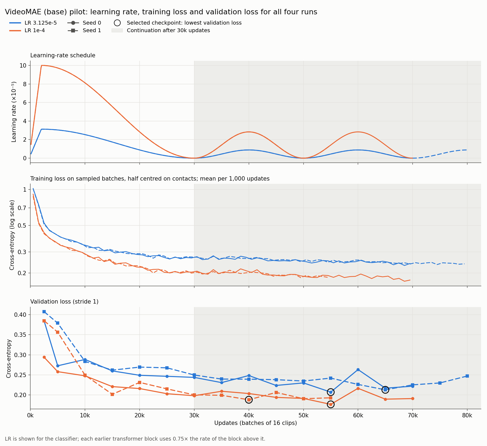
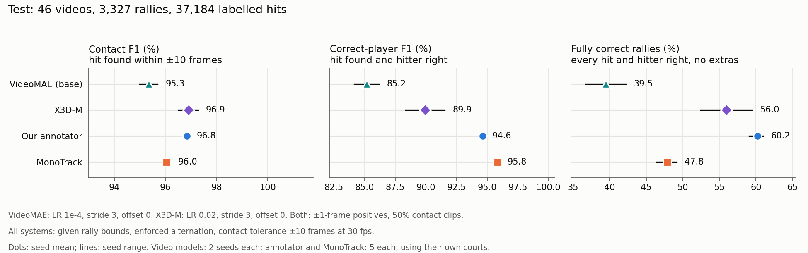
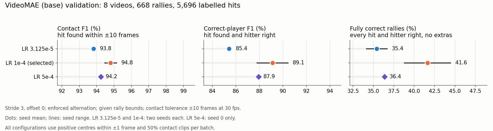

# VideoMAE (base) contact detection: validation and test results

We fine-tuned VideoMAE V1 Base to mark when each racket hit happens and which
player made it, with the rally bounds given. The pilot compares two learning
rates, each at seeds 0 and 1, on the same 8 validation videos as X3D-M: 668
rallies holding 5,696 labelled hits. Both seeds of the selected learning rate
then completed the test on 46 videos: 3,327 rallies holding 37,184
labelled hits. One further seed at a higher learning rate, 5e-4, tested
whether extra seeds could train in less time; it has validation scores only.
The [run guide](VIDEOMAE.md) describes the model, training schedule and
batch-size timing.

## Status

All four training runs, both test seeds and the learning-rate 5e-4 run are
complete. Read the [generated tables](results/videomae_stride3/tables.md)
alongside the figures below; regenerating the plots also updates those tables.

VideoMAE's test predictions use every third frame: stride 3, offset 0. We chose
this setting from the validation comparison below, before any test scoring. It
cuts model evaluations to one third while every labelled hit and rally still
counts in the scores. X3D-M also uses stride 3, offset 0; our annotator and MonoTrack use every frame.

## Outcome

**VideoMAE (base) gets 39.50% of test rallies fully correct on average at ±10
frames** (42.26% and 36.73% for the two seeds). X3D-M gets 55.95%, MonoTrack
47.83% and our annotator 60.18%. VideoMAE's better seed scores below the weaker
seed of both X3D-M and MonoTrack.

**VideoMAE finds hits nearly as well as the other systems, but names the hitter
less reliably.** Its test contact F1 of 95.35% is 0.7–1.6 points below the
others. It misses slightly more hits than X3D-M (recall 96.89% against 97.44%)
and adds slightly more extras (precision 93.86% against 96.37%). Its
correct-player F1 is 85.17%, against 89.95% for X3D-M, 94.63% for our annotator
and 95.84% for MonoTrack.

**Predicting at every third frame made 6.6–11.2 points more validation rallies
fully correct**, in every run and at every starting offset, using the reported
alternating hitters. Stride three trades a little recall for precision:
precision rose by 2.6–4.7 points while recall fell by 0.7–1.3 points. Extra
hits fell from 574–767 per run to 352–468, and a single extra hit stops a rally
counting as fully correct.

**Forcing hitters to alternate costs 8.9–10.2 points of test correct-player F1**,
yet adds 1.4–1.5 points of fully correct test rallies. Before alternation,
VideoMAE named the right hitter for 99.3–99.4% of matched test contacts.
Alternation fits one TOP/BOT pattern per rally, so a single extra or missed
contact shifts the pattern for the hits after it.

**At the same stride-three sampling, test hit finding matched validation, but
alternating hitters lost ground** ([details](#validation-and-test-at-the-same-sampling)).
From validation to test, contact F1 rose by 0.5 points and raw-hitter
correct-player F1 by 1.0 point for both seeds. The reported alternating
correct-player F1 fell by 3.6–4.2 points and fully correct rallies by 2.0–2.2.

**Learning rate 5e-4 stopped sooner but did not match 1e-4**
([details](#learning-rate-5e-4-trial)). Its seed 0 run picked its
checkpoint at 30,000 updates and stopped at 45,000, against 55,000 and 70,000
for seed 0 at 1e-4. At the same stride-three validation centres, it got 36.38%
of rallies fully correct, against 44.46%, with validation loss 0.2000 against
0.1759. It also scored below seed 1 at 1e-4 on both measures.

## Validation selection

**Learning rate `1e-4` was selected, with 33.08% of validation rallies fully
correct on average at ±10 frames** (35.33% and 30.84%). Learning rate `3.125e-5`
averages 26.72%. Both trail X3D-M's selected configuration, which got 46.7% of
the same rallies fully correct. VideoMAE's correct-player F1 is also lower:
85.09% at `1e-4` against 91.1% for X3D-M. These validation scores use dense
prediction, as every pilot run did.

Table 1. Each run at its lowest-validation-loss checkpoint, scored at ±10 frames.

| Run | Selected (updates) | Last check (updates) | Validation loss | Fully correct rallies (%) | Correct-player F1 (%) | Contact F1 (%) |
|---|---:|---:|---:|---:|---:|---:|
| LR 3.125e-5, seed 0 | 55,000 | 70,000 | 0.2072 | 29.19 | 81.26 | 92.37 |
| LR 3.125e-5, seed 1 | 65,000 | 80,000 | 0.2129 | 24.25 | 80.10 | 91.86 |
| LR 1e-4, seed 0 | 55,000 | 70,000 | 0.1767 | 35.33 | 86.70 | 93.72 |
| LR 1e-4, seed 1 | 40,000 | 55,000 | 0.1882 | 30.84 | 83.48 | 92.95 |

Table 2. Learning-rate ranking: mean fully correct rallies, then mean
correct-player F1. LR is the peak classifier learning rate; each earlier transformer block uses 0.75× the rate of the block above it.

| Rank | LR | Fully correct rallies (%), seed 0 / 1 / mean | Correct-player F1 (%), seed 0 / 1 / mean | Contact F1 (%), mean | Selected checkpoints |
|---:|---|---:|---:|---:|---|
| 1 | 1e-4 | 35.33 / 30.84 / **33.08** | 86.70 / 83.48 / **85.09** | 93.33 | 55k / 40k |
| 2 | 3.125e-5 | 29.19 / 24.25 / **26.72** | 81.26 / 80.10 / **80.68** | 92.11 | 55k / 65k |

Continuation supplied every run's best checkpoint, at 40,000–65,000 updates.
X3D-M found its best checkpoint within the first 30,000 updates in 10 of 12 runs.



Figure 1. Learning rate, training loss and validation loss for all four runs.
Training loss is the mean over sampled batches, half of each centred on a
contact. Validation loss covers every validation centre, about 10% of them within one
frame of a contact. Compare each loss with itself over time, not with the other.

## Every third frame on validation

Dense prediction uses every frame. Stride three with offset 0 uses only video
frames 0, 3, 6…; offset 1 uses 1, 4, 7…; offset 2 uses 2, 5, 8…. Each prediction
still sees 16 consecutive frames, and frame numbers continue across rally
boundaries. The offsets are three samplings of one model, not extra seeds.

“Raw” keeps each retained hit's own most likely hitter. “Alternating” is the
benchmark's reported rule. Both use the same contact frames, because duplicate
removal runs before alternation.

Table 3. Dense and stride-three validation scores (%) at ±10 frames.

| Run | Sampling | Contact recall | Contact precision | Contact F1 | Raw player F1 | Alternating player F1 | Raw fully correct | Alternating fully correct |
|---|---|---:|---:|---:|---:|---:|---:|---:|
| LR 3.125e-5, seed 0 | Dense | 96.17 | 88.86 | 92.37 | 91.38 | 81.26 | 27.69 | 29.19 |
| LR 3.125e-5, seed 0 | Stride 3, offset 0 | 94.96 | 92.86 | 93.90 | 93.00 | 85.27 | 35.33 | 36.68 |
| LR 3.125e-5, seed 0 | Stride 3, offset 1 | 94.87 | 92.72 | 93.79 | 92.88 | 86.39 | 35.48 | 36.83 |
| LR 3.125e-5, seed 0 | Stride 3, offset 2 | 94.86 | 93.09 | 93.97 | 93.01 | 86.37 | 34.73 | 36.08 |
| LR 3.125e-5, seed 1 | Dense | 96.38 | 87.74 | 91.86 | 90.82 | 80.10 | 23.65 | 24.25 |
| LR 3.125e-5, seed 1 | Stride 3, offset 0 | 95.07 | 92.44 | 93.73 | 92.82 | 85.60 | 33.23 | 34.13 |
| LR 3.125e-5, seed 1 | Stride 3, offset 1 | 95.28 | 92.06 | 93.64 | 92.68 | 86.00 | 30.69 | 31.44 |
| LR 3.125e-5, seed 1 | Stride 3, offset 2 | 95.37 | 92.15 | 93.73 | 92.81 | 85.46 | 31.89 | 32.63 |
| LR 1e-4, seed 0 | Dense | 97.07 | 90.59 | 93.72 | 92.57 | 86.70 | 33.68 | 35.33 |
| LR 1e-4, seed 0 | Stride 3, offset 0 | 96.35 | 93.97 | 95.15 | 94.16 | 90.43 | 42.66 | 44.46 |
| LR 1e-4, seed 0 | Stride 3, offset 1 | 96.23 | 93.21 | 94.70 | 93.71 | 89.15 | 39.82 | 41.92 |
| LR 1e-4, seed 0 | Stride 3, offset 2 | 96.03 | 93.62 | 94.81 | 93.92 | 90.18 | 41.32 | 42.96 |
| LR 1e-4, seed 1 | Dense | 97.21 | 89.05 | 92.95 | 91.76 | 83.48 | 30.24 | 30.84 |
| LR 1e-4, seed 1 | Stride 3, offset 0 | 96.45 | 92.54 | 94.46 | 93.32 | 87.78 | 38.47 | 38.77 |
| LR 1e-4, seed 1 | Stride 3, offset 1 | 96.42 | 92.72 | 94.53 | 93.33 | 88.05 | 40.87 | 42.07 |
| LR 1e-4, seed 1 | Stride 3, offset 2 | 96.19 | 92.43 | 94.27 | 93.17 | 87.15 | 37.87 | 38.62 |

Each run predicted 3.7–6.4% fewer hits at stride three, and 77–85% of the
dropped predictions were extras. With dense prediction, alternation costs
5.9–10.7 points of correct-player F1 and adds 0.6–1.6 points of fully correct
rallies; raw hitters are right for 98.7–98.9% of matched contacts. The ±5-frame
scores follow the same pattern; they are in
[`results/videomae_stride3/validation_scores.csv.gz`](results/videomae_stride3/validation_scores.csv.gz).

## Test comparison

All four systems receive the same rally bounds. VideoMAE (base) uses the two `1e-4`
checkpoints from Table 1 as saved: seed 0 after 55,000 updates and seed 1 after
40,000. Each seed evaluates 386,326 of the 1,158,999 test centres, those at
stride 3, offset 0. VideoMAE has no dense or other-offset test scores.
The X3D-M, annotator and MonoTrack scores are those in the
[X3D-M report](x3d_results.md#test-comparison).

Table 4. Test scores in percent: seed mean (minimum–maximum). VideoMAE (base) and X3D-M
use two seeds; our annotator and MonoTrack each use five. Ranges show observed seed
variation, not confidence intervals.

| Tolerance | System | Sampling | Contact F1 (%) | Correct-player F1 (%) | Fully correct rallies (%) |
|---|---|---|---:|---:|---:|
| ±10 frames | VideoMAE (base), LR 1e-4 | Stride 3, offset 0 | 95.35 (95.00–95.70) | 85.17 (84.15–86.19) | 39.50 (36.73–42.26) |
| ±10 frames | X3D-M, selected configuration | Stride 3, offset 0 | 96.90 (96.52–97.28) | 89.95 (88.36–91.54) | 55.95 (52.42–59.48) |
| ±10 frames | Our annotator, our courts | Dense | 96.85 (96.75–96.92) | 94.63 (94.32–94.78) | 60.18 (59.06–60.96) |
| ±10 frames | MonoTrack, its own courts | Dense | 96.04 (95.95–96.18) | 95.84 (95.69–95.99) | 47.83 (46.44–49.17) |
| ±5 frames | VideoMAE (base), LR 1e-4 | Stride 3, offset 0 | 93.97 (93.61–94.33) | 84.01 (83.00–85.01) | 33.81 (31.71–35.92) |
| ±5 frames | X3D-M, selected configuration | Stride 3, offset 0 | 95.72 (95.19–96.26) | 88.96 (87.27–90.65) | 49.46 (45.60–53.32) |
| ±5 frames | Our annotator, our courts | Dense | 95.59 (95.51–95.64) | 93.50 (93.19–93.63) | 52.47 (51.67–52.90) |
| ±5 frames | MonoTrack, its own courts | Dense | 94.86 (94.75–95.06) | 94.75 (94.59–94.97) | 40.26 (38.71–41.93) |



Figure 2. Test comparison at ±10 frames, with enforced alternation. Both video models use stride 3, offset 0. Dots show seed means; black lines span the seeds.

Table 5. VideoMAE (base) test scores (%) at ±10 frames, stride 3, offset 0.

| Run | Contact recall | Contact precision | Contact F1 | Raw player F1 | Alternating player F1 | Raw fully correct | Alternating fully correct |
|---|---:|---:|---:|---:|---:|---:|---:|
| LR 1e-4, seed 0 (55k) | 96.86 | 94.57 | 95.70 | 95.13 | 86.19 | 40.79 | 42.26 |
| LR 1e-4, seed 1 (40k) | 96.92 | 93.15 | 95.00 | 94.31 | 84.15 | 35.29 | 36.73 |

Raw hitters give 94.72% correct-player F1 on average, 9.55 points above the
reported alternating rule. Alternation still makes 49 and 48 more test rallies
fully correct for seeds 0 and 1. Both rules use the same hit times, so this gain
comes from rallies with every hit found and no extras, where alternation fixed
the hitters of more rallies than it broke. The two seeds find almost the same
share of hits (96.86% and 96.92%); seed 1 adds 581 more extra hits, which lowers
its precision by 1.4 points. The ±5-frame test scores are in
[`results/videomae_stride3/test_scores.csv.gz`](results/videomae_stride3/test_scores.csv.gz).

### Validation and test at the same sampling

Stride 3, offset 0 is the one sampling with both validation and test scores for
the same two checkpoints, so it gives the cleanest view of how VideoMAE carried
over to new videos.

Hit finding held up on test: contact F1 rose by about 0.55 points for both seeds.
Raw hitters held up too, with correct-player F1 up by 1.0 point. The loss came
from alternation. The reported alternating correct-player F1 fell by 4.2 and
3.6 points (seeds 0 and 1), and fully correct rallies by 2.2 and 2.0 points.
Test rallies are longer, 11.2 labelled hits on average against 8.5 on
validation. That gives each rally more chances for one missed or extra hit to
shift the alternating pattern, which may explain part of the drop.

## Learning rate 5e-4 trial

**Learning rate 5e-4 found its best checkpoint 25,000 updates sooner than
1e-4, but that checkpoint scores lower on validation.** We trained one extra
seed 0 run at 5e-4 to see whether further seeds could train in less time.
Everything else followed the pilot: batch 16, 2,000 warm-up updates, cosine
decay to 30,000 updates, then continuation checks every 5,000 updates until
three in a row failed to lower validation loss, capped at 60,000 updates. It
validated at stride 3, offset 0 and has no test run. It took no part in the
learning-rate selection, so the test results above are unchanged.

The pilot runs validated every centre and kept predictions only at their
selected checkpoints. We rescored those predictions at stride 3, offset 0, so
Table 6 compares all five runs on the same centres. Validation loss skips the
centres two frames from a hit, as training does.

Table 6. Validation at stride 3, offset 0, each run at its lowest-validation-loss
checkpoint, scored at ±10 frames. Scores other than validation loss are in
percent; fully correct rallies use alternating hitters.

| Run | Selected (updates) | Validation loss | Contact recall | Contact precision | Contact F1 | Raw player F1 | Alternating player F1 | Fully correct rallies |
|---|---:|---:|---:|---:|---:|---:|---:|---:|
| LR 3.125e-5, seed 0 | 55,000 | 0.2053 | 94.96 | 92.86 | 93.90 | 93.00 | 85.27 | 36.68 |
| LR 3.125e-5, seed 1 | 65,000 | 0.2101 | 95.07 | 92.44 | 93.73 | 92.82 | 85.60 | 34.13 |
| LR 1e-4, seed 0 | 55,000 | 0.1759 | 96.35 | 93.97 | 95.15 | 94.16 | 90.43 | 44.46 |
| LR 1e-4, seed 1 | 40,000 | 0.1874 | 96.45 | 92.54 | 94.46 | 93.32 | 87.78 | 38.77 |
| LR 5e-4, seed 0 | 30,000 | 0.2000 | 96.31 | 92.26 | 94.24 | 93.13 | 87.94 | 36.38 |



Figure 3. All learning rates at stride 3, offset 0, with enforced alternation.
Dots show seed means and black lines span the seeds. LR 5e-4 has one seed;
the original learning rates each have two.

Seed 0 at 5e-4 got 243 of 668 rallies fully correct, against 297 for seed 0 at
1e-4. It found as many hits (recall 96.31% against 96.35%) but added 108 more
extra hits (460 against 352), which cut precision by 1.7 points. Its
correct-player F1 was 87.94%, against 90.43%. The two 1e-4 seeds differ by 5.7
points of fully correct rallies themselves, so one seed cannot pin down the
learning rate's effect. Even so, 5e-4 has a higher validation loss than both
1e-4 seeds and fewer fully correct rallies than either. On those two measures it
sits nearer the 3.125e-5 runs; its correct-player F1 matches seed 1 at 1e-4.

At 30,000 updates the two seed 0 runs had about the same validation loss:
0.2000 at stride 3 for 5e-4 and 0.1982 over every centre for 1e-4. These two
measures are close but not identical; at the four pilot checkpoints, stride 3,
offset 0 gave 0.0007–0.0028 lower loss than every centre. The 1e-4 run then
kept improving during continuation, to 0.1767 at 55,000 updates. The 5e-4 run
never beat its 30,000-update loss in the next three checks, although its
training loss stayed slightly lower: 0.190 against 0.199 over updates
40,000–45,000. Validation loss rose to 0.467 at 5,000 updates, soon after warm-up reached the peak rate,
then recovered by 15,000.

Table 7. Training time. Recorded hours cover training, validation and event
scoring at each check, but not start-up.

| Run | Validation | Selected (updates) | Last check (updates) | Hours to selected | Hours to last check | Training updates per second | Validation minutes per check |
|---|---|---:|---:|---:|---:|---:|---:|
| LR 1e-4, seed 0 | Every centre | 55,000 | 70,000 | 7.55 | 9.55 | 3.60 | 16.6 |
| LR 1e-4, seed 1 | Every centre | 40,000 | 55,000 | 5.59 | 7.58 | 3.60 | 16.6 |
| LR 5e-4, seed 0 | Stride 3, offset 0 | 30,000 | 45,000 | 2.94 | 4.37 | 3.63 | 5.6 |

Both learning rates trained at the same speed, so the 25,000 fewer updates
saved about 2 hours of training against seed 0 at 1e-4. Most of the gap in
recorded time comes from validation instead: each stride-three check took about
a third as long as a check over every centre. New runs validate at stride 3 by
default, so a 1e-4 run would now get that saving too.

## Method

Each run keeps the checkpoint with the lowest validation cross-entropy, the
earliest on a tie. The four pilot runs measure it over every validation centre;
the 5e-4 run measures it at stride 3, offset 0. Mean fully correct validation
rallies select the learning rate, with mean correct-player F1 breaking ties.
Test scores select nothing.

Decoding and scoring match the X3D-M benchmark. Each frame takes its most
likely class; the strongest predicted hit within 6 frames is kept. A predicted
hit matches a labelled hit within ±5 or ±10 frames at 30 fps, scaled for other
frame rates. A fully correct rally has every hit found, no extra hits and every
hitter right. One test contact has an unknown hitter: it stays in the contact
count, earns no correct-player credit and stops its rally from counting as
fully correct. The validation set has no unknown hitters.

At stride three, each skipped frame gets a no-contact probability, so it can
never become a predicted hit. Test frame loss and confusion matrices cover the
evaluated centres only.

Stride three on validation reuses the saved dense probabilities, so it needs no
new GPU inference. Rescoring every frame reproduces the saved contact, hitter
and rally counts for all four runs at both tolerances, which confirms that the
probability rows line up with the rallies. Rescoring each test seed at stride 3,
offset 0 likewise reproduces its saved test counts. Run on X3D-M's saved test
probabilities, the same code reproduces X3D-M's published test counts.

The stride-three losses in Table 6 come from the same saved probabilities and
frame labels. Positive labels cover the frames within one frame of a hit; frames
exactly two away are left out of the loss unless another hit makes them positive.
Recomputing each run's loss at its own validation sampling reproduces the loss
and confusion matrix recorded during training: every centre for the pilot runs
and stride 3, offset 0 for the 5e-4 run. Validation minutes per check in Table 7
are estimates: recorded time minus the time the run's training speed implies
for its updates, divided by the number of checks.

## Evidence and figures

Settings, validation histories, continuation schedules and training-loss
readings for all four runs are in [`results/videomae_pilot/`](results/videomae_pilot/),
with the learning-rate ranking in `selection.json.gz`. Test event predictions and
frame metrics for both seeds are in [`results/videomae_test/`](results/videomae_test/).
Dense and stride-three scores are in [`results/videomae_stride3/`](results/videomae_stride3/).
The 5e-4 run's records, its event scores and the stride-three losses of all five
runs are in [`results/videomae_lr5e4/`](results/videomae_lr5e4/).
The [results index](results/README.md) lists the files.

## Regenerating the results

Copy the queue directory from the training machine, leaving out `last.pt` and
`best.pt`. Copy the `index.json.gz` files of the development and test RGB caches
too, plus the 5e-4 run's directory. Then run from the repository root:

```bash
PYTHONPATH=src:. python experiments/annotator/video_models_benchmark/writeup_scripts/rescore_videomae.py \
  --runs /path/to/videomae-runs \
  --validation-index /path/to/rgb256-cache/index.json.gz \
  --test-index /path/to/test-rgb256-cache/index.json.gz
PYTHONPATH=src:. python experiments/annotator/video_models_benchmark/writeup_scripts/compare_videomae_lr5e4.py \
  --trial /path/to/lr5e-4-run \
  --runs /path/to/videomae-runs \
  --validation-index /path/to/rgb256-cache/index.json.gz
PYTHONPATH=src:. python experiments/annotator/video_models_benchmark/writeup_scripts/make_videomae_figures.py \
  --monotrack-summary experiments/annotator/monotrack_benchmark/benchmark_results/hp_search/primary/contact_summary.json.gz \
  > experiments/annotator/video_models_benchmark/results/videomae_stride3/tables.md
```

The first script copies the compact records into `results/`, rescores the
probabilities and stops if rescoring at the evaluated sampling disagrees with
the saved counts. The second does the same for the 5e-4 run and computes the
stride-three losses, stopping if a recomputed loss or confusion matrix disagrees
with training's record. The third redraws Figures 1–3 and writes the source rows
for Tables 1–7.
