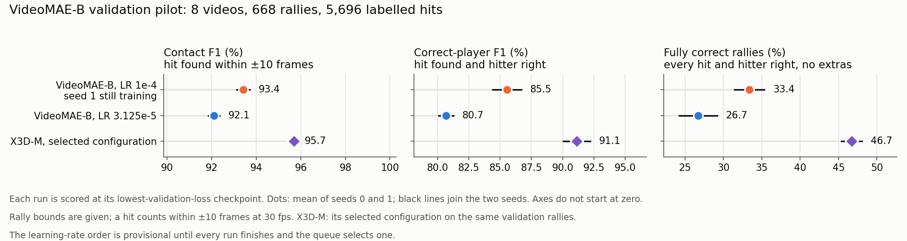
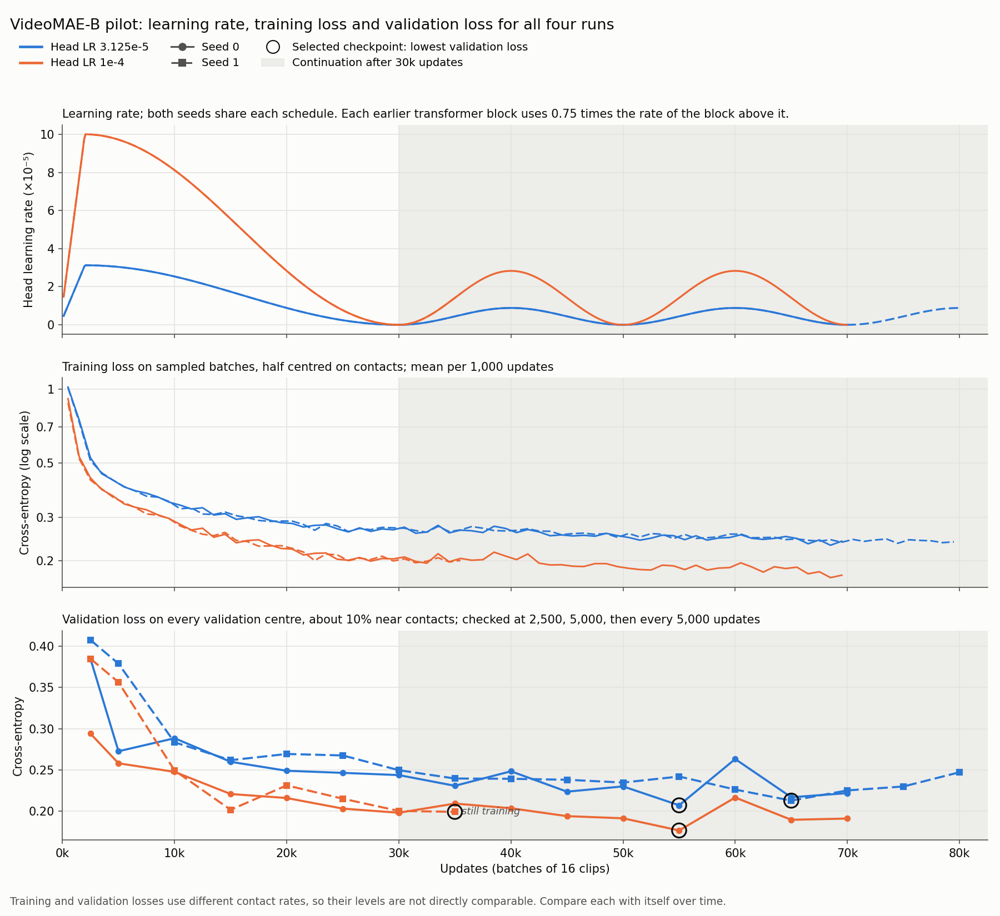
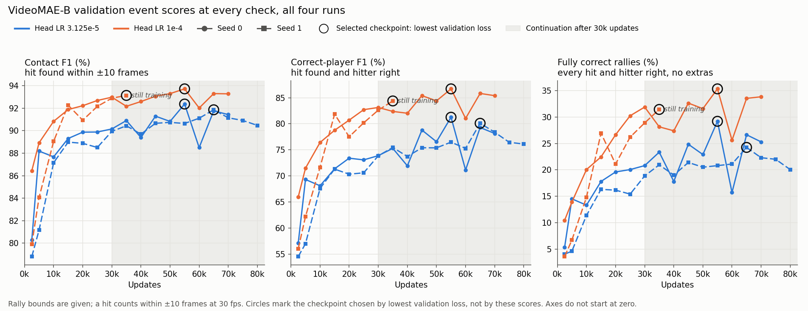
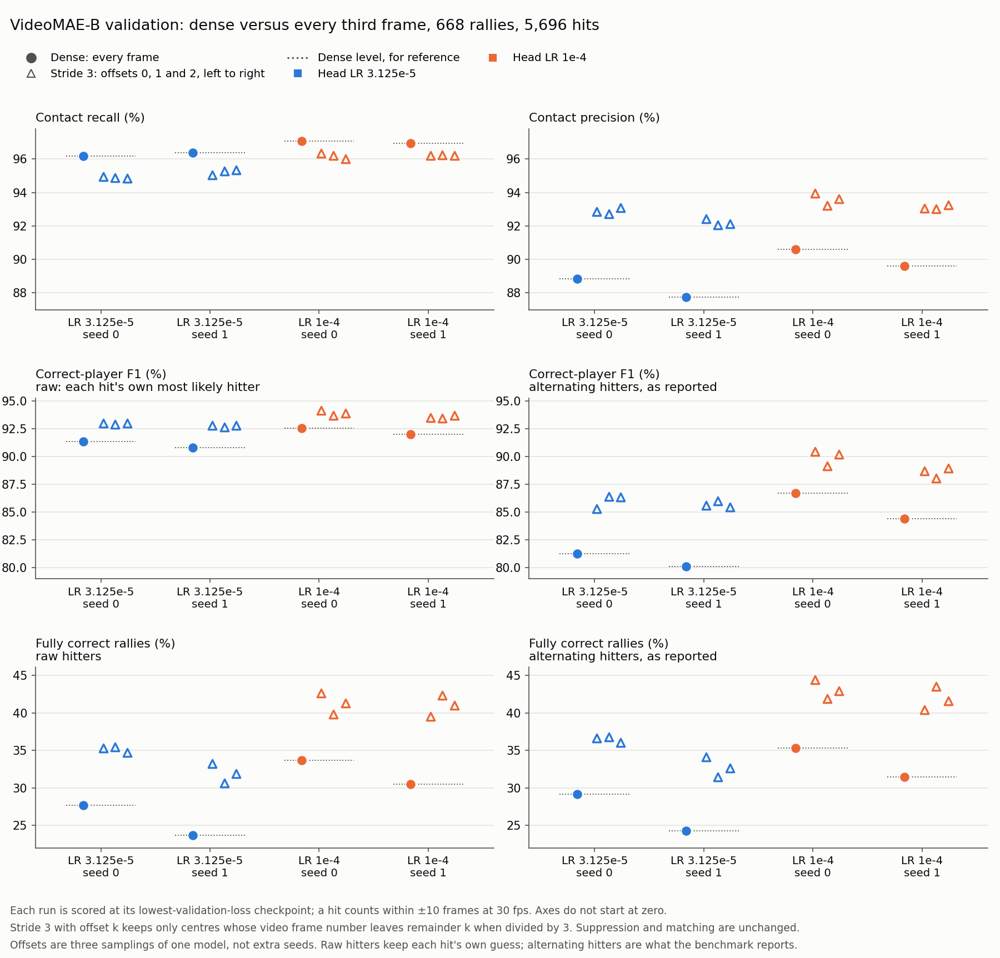

# VideoMAE-B contact detection: validation results

We fine-tuned VideoMAE V1 Base to mark when each racket hit happens and which
player made it, with the rally bounds given. The pilot compares two peak learning
rates, each at seeds 0 and 1, on the same 8 validation videos as X3D-M: 668
rallies holding 5,696 labelled hits. The [run guide](VIDEOMAE.md) describes the
model, training schedule and batch-size timing.

## Status

Read the [latest generated tables](results/videomae_stride3/tables.md) alongside
the figures below. Regenerating the plots also updates those tables.

These results come from run records copied on 5 November 2026 at 06:47 AEDT.
Three runs have finished. Seed 1 at learning rate `1e-4` is still training; its
best checkpoint so far is at 35,000 updates, and it has at least three more
checks to go. The learning-rate ranking below is therefore provisional.

After the last run finishes, the queue picks the learning rate from validation
and tests both of its seeds once on the held-out set. **Test results are pending.**
Test inference will use stride 3, offset 0, chosen from the validation comparison
below. This reduces the number of model evaluations to about one third while
retaining all labelled contacts and rallies for event scoring.
[Regenerating the results](#regenerating-the-results) explains how to add them.

## Outcome so far

**Learning rate `1e-4` leads, with 33.4% of validation rallies fully correct on
average at ±10 frames** (35.3% and 31.4%). Learning rate `3.125e-5` averages
26.7%. Both trail X3D-M's selected configuration, which got 46.7% of the same
rallies fully correct. VideoMAE's correct-player F1 is also lower: 85.5% at
`1e-4` against 91.1% for X3D-M.

**Predicting at every third frame made 6.6–12.1 percentage points more rallies
fully correct**, in every run and at every starting offset, using the reported
alternating hitters. Stride three trades a little recall for precision:
precision rose by 2.6–4.7 points while recall fell by 0.7–1.3 points.

**Forcing hitters to alternate costs VideoMAE 5.9–10.7 points of correct-player
F1** with dense prediction, yet adds 0.6–1.7 points of fully correct rallies.
Before alternation, VideoMAE named the right hitter for 98.8–98.9% of matched
contacts. Alternation fits one TOP/BOT pattern per rally, so a single extra or
missed contact shifts the pattern for the hits after it.

The validation stride comparison uses saved dense predictions. Stride 3, offset 0
was then selected for test inference; raw hitters remain a diagnostic alongside
the reported alternating hitters. Checkpoint and learning-rate selection are unchanged.

## Validation selection

Table 1. Each run at its lowest-validation-loss checkpoint, scored at ±10 frames.

| Run | Status | Selected (updates) | Last check (updates) | Validation loss | Fully correct rallies (%) | Correct-player F1 (%) | Contact F1 (%) |
|---|---|---:|---:|---:|---:|---:|---:|
| LR 3.125e-5, seed 0 | complete | 55,000 | 70,000 | 0.2072 | 29.19 | 81.26 | 92.37 |
| LR 3.125e-5, seed 1 | complete | 65,000 | 80,000 | 0.2129 | 24.25 | 80.10 | 91.86 |
| LR 1e-4, seed 0 | complete | 55,000 | 70,000 | 0.1767 | 35.33 | 86.70 | 93.72 |
| LR 1e-4, seed 1 | still training | 35,000 | 35,000 | 0.1993 | 31.44 | 84.38 | 93.14 |

Table 2. Provisional learning-rate ranking: mean fully correct rallies, then mean
correct-player F1.

| Rank | Peak LR | Fully correct rallies (%), seed 0 / 1 / mean | Correct-player F1 (%), seed 0 / 1 / mean | Contact F1 (%), mean | Selected checkpoints |
|---:|---|---:|---:|---:|---|
| 1 | 1e-4 | 35.33 / 31.44 / **33.38** | 86.70 / 84.38 / **85.54** | 93.43 | 55k / 35k |
| 2 | 3.125e-5 | 29.19 / 24.25 / **26.72** | 81.26 / 80.10 / **80.68** | 92.11 | 55k / 65k |



Figure 1. Validation scores at each run's lowest-loss checkpoint. Dots are the
mean of seeds 0 and 1; black lines join the two seeds. Axes do not start at zero.

Continuation supplied every run's best checkpoint so far, at 35,000–65,000
updates. X3D-M found its best checkpoint within the first 30,000 updates in
10 of 12 runs.



Figure 2. Learning rate, training loss and validation loss for all four runs.
Training loss is the mean over sampled batches, half of each centred on a
contact. Validation loss covers every validation centre, about 10% of them within one
frame of a contact. Compare each loss with itself over time, not with the other.



Figure 3. Event scores at every validation check. Circles mark the checkpoints
chosen by lowest validation loss.

## Every third frame on validation

Dense prediction uses every frame. Stride three with offset 0 uses only video
frames 0, 3, 6…; offset 1 uses 1, 4, 7…; offset 2 uses 2, 5, 8…. Each prediction
still sees 16 consecutive frames, and frame numbers continue across rally
boundaries. The offsets are three samplings of one model, not extra seeds.

“Raw” keeps each retained hit's own most likely hitter. “Alternating” is the
benchmark's reported rule. Both use the same contact frames, because duplicate
removal runs before alternation.

Table 3. Dense and stride-three validation scores (%) at ±10 frames.

| Run | Sampling | Contact recall | Contact precision | Contact F1 | Raw player F1 | Alternating player F1 | Raw fully correct | Alternating fully correct |
|---|---|---:|---:|---:|---:|---:|---:|---:|
| LR 3.125e-5, seed 0 | Dense | 96.17 | 88.86 | 92.37 | 91.38 | 81.26 | 27.69 | 29.19 |
| LR 3.125e-5, seed 0 | Stride 3, offset 0 | 94.96 | 92.86 | 93.90 | 93.00 | 85.27 | 35.33 | 36.68 |
| LR 3.125e-5, seed 0 | Stride 3, offset 1 | 94.87 | 92.72 | 93.79 | 92.88 | 86.39 | 35.48 | 36.83 |
| LR 3.125e-5, seed 0 | Stride 3, offset 2 | 94.86 | 93.09 | 93.97 | 93.01 | 86.37 | 34.73 | 36.08 |
| LR 3.125e-5, seed 1 | Dense | 96.38 | 87.74 | 91.86 | 90.82 | 80.10 | 23.65 | 24.25 |
| LR 3.125e-5, seed 1 | Stride 3, offset 0 | 95.07 | 92.44 | 93.73 | 92.82 | 85.60 | 33.23 | 34.13 |
| LR 3.125e-5, seed 1 | Stride 3, offset 1 | 95.28 | 92.06 | 93.64 | 92.68 | 86.00 | 30.69 | 31.44 |
| LR 3.125e-5, seed 1 | Stride 3, offset 2 | 95.37 | 92.15 | 93.73 | 92.81 | 85.46 | 31.89 | 32.63 |
| LR 1e-4, seed 0 | Dense | 97.07 | 90.59 | 93.72 | 92.57 | 86.70 | 33.68 | 35.33 |
| LR 1e-4, seed 0 | Stride 3, offset 0 | 96.35 | 93.97 | 95.15 | 94.16 | 90.43 | 42.66 | 44.46 |
| LR 1e-4, seed 0 | Stride 3, offset 1 | 96.23 | 93.21 | 94.70 | 93.71 | 89.15 | 39.82 | 41.92 |
| LR 1e-4, seed 0 | Stride 3, offset 2 | 96.03 | 93.62 | 94.81 | 93.92 | 90.18 | 41.32 | 42.96 |
| LR 1e-4, seed 1 | Dense | 96.96 | 89.60 | 93.14 | 92.02 | 84.38 | 30.54 | 31.44 |
| LR 1e-4, seed 1 | Stride 3, offset 0 | 96.23 | 93.06 | 94.61 | 93.51 | 88.69 | 39.52 | 40.42 |
| LR 1e-4, seed 1 | Stride 3, offset 1 | 96.24 | 93.03 | 94.61 | 93.47 | 88.07 | 42.37 | 43.56 |
| LR 1e-4, seed 1 | Stride 3, offset 2 | 96.23 | 93.25 | 94.71 | 93.69 | 88.96 | 41.02 | 41.62 |



Figure 4. Dense prediction beside the three stride-three offsets for each run.
Raw and alternating hitters share each row's axis. Axes do not start at zero.

The ±5-frame scores follow the same pattern; they are in
[`results/videomae_stride3/validation_scores.csv.gz`](results/videomae_stride3/validation_scores.csv.gz).

## Method

Each run keeps the checkpoint with the lowest cross-entropy over every
validation centre, the earliest on a tie. Mean fully correct validation rallies
select the learning rate, with mean correct-player F1 breaking ties. Test scores
select nothing.

Decoding and scoring match the X3D-M benchmark. Each frame takes its most
likely class; the strongest predicted hit within 6 frames is kept. A predicted
hit matches a labelled hit within ±5 or ±10 frames at 30 fps, scaled for other
frame rates. A fully correct rally has every hit found, no extra hits and every
hitter right. One test contact has an unknown hitter: it stays in the contact
count, earns no correct-player credit and stops its rally from counting as
fully correct. The validation set has no unknown hitters.

Stride three reuses the saved validation probabilities, so it needs no new GPU
inference. Rescoring every frame reproduces the saved contact, hitter and rally
counts for all four runs at both tolerances, which confirms that the probability
rows line up with the rallies. Run on X3D-M's saved test probabilities, the same
code reproduces X3D-M's published test counts.

## Evidence and figures

Settings, validation histories, continuation schedules and training-loss
readings for all four runs are in [`results/videomae_pilot/`](results/videomae_pilot/).
Dense and stride-three scores are in [`results/videomae_stride3/`](results/videomae_stride3/).
The [results index](results/README.md) lists the files.

## Regenerating the results

Copy the queue directory from the training machine, leaving out `last.pt` and
`best.pt`. Copy the `index.json.gz` files of the development and test RGB caches
too. Then run from the repository root:

```bash
PYTHONPATH=src:. python experiments/annotator/video_models_benchmark/writeup_scripts/rescore_videomae.py \
  --runs /path/to/videomae-runs \
  --validation-index /path/to/rgb256-cache/index.json.gz \
  --test-index /path/to/test-rgb256-cache/index.json.gz
PYTHONPATH=src:. python experiments/annotator/video_models_benchmark/writeup_scripts/make_videomae_figures.py
```

Leave out `--test-index` until `selection.json.gz` and both test seeds are
complete. The first script copies the compact records into `results/`, rescores
the probabilities and stops if dense rescoring disagrees with the saved counts.
The second redraws Figures 1–4 and prints Tables 1–3. Once `results/videomae_test/`
exists, it also draws the test comparison with X3D-M, our annotator and MonoTrack,
plus the test stride-three figure.
