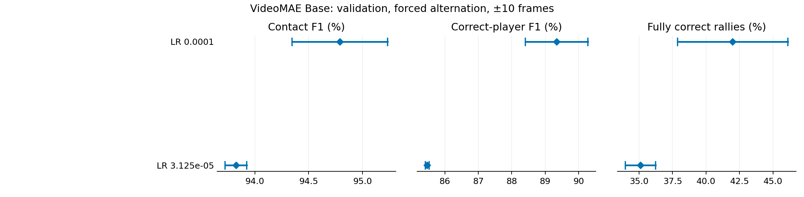
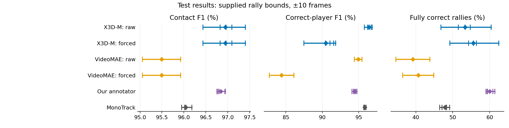
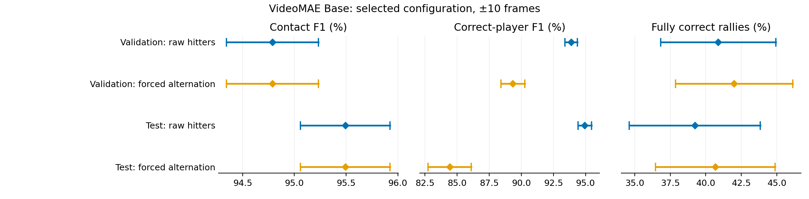

# VideoMAE (base) contact detection: validation and test results

**VideoMAE gets 40.67% of test rallies fully correct with forced alternation,
compared with 55.58% for X3D-M, 47.83% for MonoTrack and 59.99% for our
annotator.** Keeping VideoMAE's raw hitter labels raises correct-player F1 from
84.41% to 94.93%, but reduces fully correct rallies to 39.22%. Contact F1
stays at 95.49%. These are two-seed VideoMAE means at ±10-frame tolerance;
the other systems use five seeds.

We fine-tuned VideoMAE V1 Base to find racket hits and name the hitter, with
rally bounds supplied. Validation uses 8 videos, 668 rallies and 5,696 labelled
hits. Test uses 46 videos, 3,327 rallies and 37,184 labelled hits. The
[run guide](VIDEOMAE.md) describes the model and training settings.

## Validation selection

**Learning rate 1e-4 won the two-rate comparison.** Both rates use positives
within ±1 frame and 50% contact clips per batch, with seeds 0 and 1. Centres
exactly two frames from a hit are excluded from the training loss unless
another hit makes them positive.

Each run keeps its lowest-validation-cross-entropy checkpoint, earliest on a
tie. Mean fully correct validation rallies at ±10 frames with forced alternation
select the learning rate; mean correct-player F1 breaks ties. All validation
checks use stride 3, offset 0. Test scores select nothing.

Table 1. Validation selection. Rally scores show seed 0 / seed 1 / mean.
Checkpoints show training updates for seed 0 / seed 1.

| Learning rate | Fully correct rallies (%) | Correct-player F1 (%), mean | Checkpoints |
|---|---:|---:|---:|
| 0.0001 | 37.87 / 46.11 / **41.99** | 89.34 | 30,000 / 65,000 |
| 3.125e-05 | 36.23 / 33.98 / **35.10** | 85.47 | 55,000 / 65,000 |



Figure 1. Validation at ±10 frames with forced alternation. Diamonds show means,
ticks show individual seeds and lines span the seeds.

## Test results

Table 2. Selected checkpoints at ±10 frames with forced alternation.

| Seed | Checkpoint (updates) | Contact F1 (%) | Correct-player F1 (%) | Fully correct rallies (%) |
|---:|---:|---:|---:|---:|
| 0 | 30,000 | 95.06 | 82.72 | 36.46 |
| 1 | 65,000 | 95.92 | 86.10 | 44.88 |

Table 3. Test comparison at ±10 frames. Values are seed means (minimum–maximum).
All systems receive rally bounds; our annotator and MonoTrack use their own
court detections and evaluate every frame. The video models use stride 3.

| System | Seeds | Contact F1 (%) | Correct-player F1 (%) | Fully correct rallies (%) |
|---|---:|---:|---:|---:|
| X3D-M, raw hitters | 5 | 96.94 (96.44–97.40) | 96.39 (95.77–96.83) | 53.35 (46.80–60.38) |
| X3D-M, forced alternation | 5 | 96.94 (96.44–97.40) | 90.48 (87.48–91.84) | 55.58 (49.20–62.46) |
| VideoMAE, raw hitters | 2 | 95.49 (95.06–95.92) | 94.93 (94.41–95.46) | 39.22 (34.63–43.82) |
| VideoMAE, forced alternation | 2 | 95.49 (95.06–95.92) | 84.41 (82.72–86.10) | 40.67 (36.46–44.88) |
| Our annotator, own courts | 5 | 96.84 (96.75–96.94) | 94.42 (94.07–94.76) | 59.99 (58.97–61.41) |
| MonoTrack, own courts | 5 | 96.04 (95.95–96.18) | 95.84 (95.69–95.99) | 47.83 (46.44–49.17) |



Figure 2. Test seed means, individual seeds and ranges at ±10 frames.

## Raw hitters and forced alternation

Forcing alternation adds 1.44 percentage points of fully correct test rallies,
but costs 10.52 points of correct-player F1. It repairs some complete rallies
while assigning the wrong hitter to more individual hits elsewhere. VideoMAE
finds hits more reliably than the forced-alternation player score suggests:
its raw correct-player F1 is only 0.56 points below its contact F1.

Table 4. Selected-configuration seed means on validation and test.

| Split | Tolerance | Hitter rule | Contact F1 (%) | Correct-player F1 (%) | Fully correct rallies (%) |
|---|---|---|---:|---:|---:|
| Validation | ±10 frames | Raw | 94.79 | 93.89 | 40.87 |
| Validation | ±10 frames | Forced alternation | 94.79 | 89.34 | 41.99 |
| Validation | ±5 frames | Raw | 93.36 | 92.65 | 36.00 |
| Validation | ±5 frames | Forced alternation | 93.36 | 88.04 | 36.68 |
| Test | ±10 frames | Raw | 95.49 | 94.93 | 39.22 |
| Test | ±10 frames | Forced alternation | 95.49 | 84.41 | 40.67 |
| Test | ±5 frames | Raw | 94.11 | 93.75 | 34.04 |
| Test | ±5 frames | Forced alternation | 94.11 | 83.24 | 34.82 |



Figure 3. The same selected checkpoints under both hitter rules. Diamonds show
means, ticks show individual seeds and lines span the seeds.

## Method

The model predicts no contact, TOP hitter or BOT hitter for each evaluated clip
centre. Validation and test use every third video frame, starting at offset 0.
Skipped centres cannot produce hits; every labelled hit and rally still counts.
After choosing each centre's most likely class, we keep the strongest hit among
predictions within 6 frames at 30 fps, scaled for other frame rates.

Raw hitters keep the model's player labels. Forced alternation assigns a single
TOP/BOT alternating pattern to each rally by majority vote, using the predicted
probabilities to break tied votes. Contact times stay the same. A missed or extra
hit can put the alternating pattern out of step with the remaining hits.

A predicted hit matches a labelled hit within ±5 or ±10 frames at 30 fps, scaled
for other frame rates. Contact F1 is twice the number of matched hits divided by
the total number of labelled and predicted hits. Correct-player F1 uses only
matches with the right hitter in the numerator. These scores pool hits across
videos, so long rallies contribute more hits. Fully correct rallies have every
hit found, no extra hits and every hitter right; each rally counts equally.
We calculate each seed's score first, then take the mean across seeds. Ranges
are the lowest and highest observed seed scores.

Validation includes rallies marked as flawed in the source labels; test excludes
them. One test hit has an unknown hitter. It counts for contact scoring, earns no
correct-player credit and prevents its rally from being fully correct.

## Results and figures

The completed run records are in [results/stride3_20261105/](results/stride3_20261105/):

- [runs.json.gz](results/stride3_20261105/runs.json.gz): settings and all 240 validation checks across 23 runs.
- [selection.json.gz](results/stride3_20261105/selection.json.gz): configuration rankings from validation seeds 0 and 1.
- [scores.csv.gz](results/stride3_20261105/scores.csv.gz): selected checkpoints, both hitter rules, both splits and both tolerances.
- [data.json.gz](results/stride3_20261105/data.json.gz) and [predictions/](results/stride3_20261105/predictions/): rally labels and saved contact predictions.

Download the selected checkpoints through the [weights index](weights/README.md).
The comparison systems use the [MonoTrack benchmark summary](../post_split_correction/benchmark/contact_summary.json.gz).

Regenerate the figures from the repository root:

```bash
python3 experiments/annotator/video_models_benchmark/writeup_scripts/make_stride3_figures.py
```
