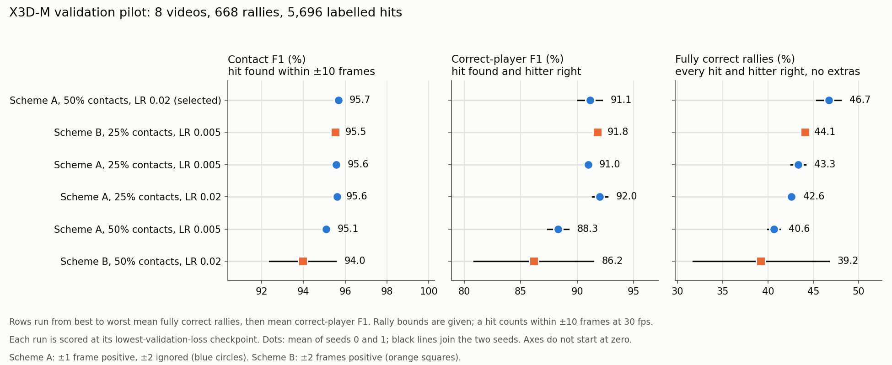
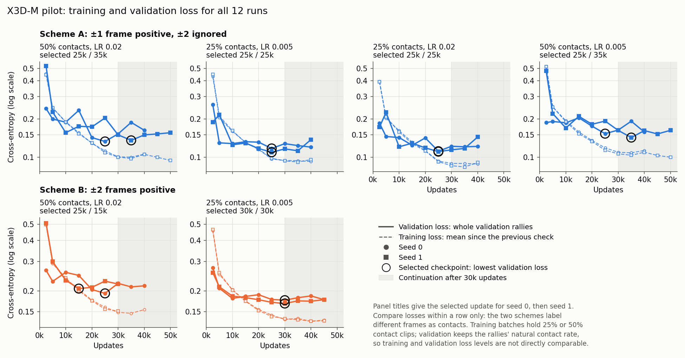
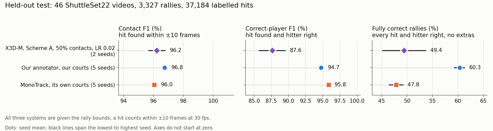

# X3D-M contact detection: validation and test results

We fine-tuned a Kinetics-400 X3D-M video model to mark when each racket hit
happens and which player made it, with the rally bounds given. The validation
pilot chose the training configuration on 8 videos: 668 rallies holding
5,696 labelled hits. The two selected seeds then completed the held-out test
on 46 videos: 3,327 rallies holding 37,184 labelled hits.

## Outcome

**X3D-M gets 49.40% of test rallies fully correct on average at ±10 frames,**
compared with 60.34% for our annotator and 47.83% for MonoTrack. Its correct-player
F1 is 87.63%, below both systems. The two X3D seeds span 45.15–53.65% fully
correct rallies; the comparison systems each use five seeds.

## Validation selection

**Positives within ±1 frame, 50% contact clips per batch and learning rate 0.02
were selected.** This label rule is called scheme A in the pilot below.
The selected configuration's two seeds get 46.7% of validation rallies fully correct on average
(48.1% and 45.4%), with 91.1% correct-player F1 and 95.7% contact F1.
The next-best configuration averages 44.1% fully correct rallies.

The held-out test evaluation used these two [checkpoints](weights/README.md)
as saved: seed 0 after 25,000 updates and seed 1 after 35,000. Settings and
checkpoints were fixed before testing. Each checkpoint minimised validation
cross-entropy; mean fully correct validation rallies selected the configuration,
with correct-player F1 breaking ties.

Table 1. All six configurations at ±10 frames, ranked by mean fully correct
rallies, then mean correct-player F1. Each run is scored at its
lowest-validation-loss checkpoint.

| Rank | Configuration | Fully correct rallies (%), seed 0 / 1 / mean | Correct-player F1 (%), seed 0 / 1 / mean | Contact F1 (%), mean | Selected checkpoints |
|---:|---|---:|---:|---:|---|
| 1 | Scheme A, 50% contacts, LR 0.02 | 48.1 / 45.4 / **46.7** | 92.2 / 90.1 / **91.1** | 95.7 | 25k / 35k |
| 2 | Scheme B, 25% contacts, LR 0.005 | 44.0 / 44.2 / **44.1** | 91.9 / 91.7 / **91.8** | 95.5 | 30k / 30k |
| 3 | Scheme A, 25% contacts, LR 0.005 | 42.5 / 44.2 / **43.3** | 90.8 / 91.2 / **91.0** | 95.6 | 25k / 25k |
| 4 | Scheme A, 25% contacts, LR 0.02 | 43.0 / 42.2 / **42.6** | 91.3 / 92.7 / **92.0** | 95.6 | 25k / 25k |
| 5 | Scheme A, 50% contacts, LR 0.005 | 41.3 / 40.0 / **40.6** | 87.4 / 89.2 / **88.3** | 95.1 | 25k / 35k |
| 6 | Scheme B, 50% contacts, LR 0.02 | 46.7 / 31.7 / **39.2** | 91.4 / 80.9 / **86.2** | 94.0 | 25k / 15k |



Figure 1. The three scores for each configuration. Dots are the mean of seeds 0
and 1; black lines join the two seeds. Axes do not start at zero.

Continuation supplied the selected checkpoint in 2 of 12 runs, including
seed 1 of the winning configuration. The other ten were selected within
the original 30,000 updates.



Figure 2. Loss at each validation check for all 12 runs, including
continuation. Circles mark the selected checkpoints. Loss compares within a
row only, because the two schemes label different frames as contacts.

## Held-out test comparison

All three systems receive the same rally bounds. Our annotator and MonoTrack
each use their own court estimates, corresponding to `annotator_our_courts`
and `monotrack_own_courts` in the
[comparison scores](../monotrack_benchmark/benchmark_results/discovery_context/primary/contact_summary.json.gz).
X3D uses RGB clips. Timing tolerances are ±5 and ±10 frames at 30 fps, scaled
to each video's frame rate.

Table 2. Test scores in percent: seed mean (minimum–maximum). X3D uses two
seeds; our annotator and MonoTrack each use five. Ranges show observed seed
variation, not confidence intervals.

| Tolerance | System | Contact F1 (%) | Correct-player F1 (%) | Fully correct rallies (%) |
|---|---|---:|---:|---:|
| ±10 frames | X3D-M | 96.23 (95.67–96.78) | 87.63 (85.73–89.52) | 49.40 (45.15–53.65) |
| ±10 frames | Our annotator, our courts | 96.75 (96.67–96.88) | 94.75 (94.48–95.02) | 60.34 (59.30–61.29) |
| ±10 frames | MonoTrack, its own courts | 96.04 (95.95–96.18) | 95.84 (95.69–95.99) | 47.83 (46.44–49.17) |
| ±5 frames | X3D-M | 95.19 (94.52–95.86) | 86.77 (84.80–88.74) | 43.99 (39.74–48.24) |
| ±5 frames | Our annotator, our courts | 95.01 (94.81–95.21) | 93.16 (92.99–93.30) | 50.08 (49.05–51.73) |
| ±5 frames | MonoTrack, its own courts | 94.86 (94.75–95.06) | 94.75 (94.59–94.97) | 40.26 (38.71–41.93) |



Figure 3. Test comparison at ±10 frames. Dots show seed means; black lines
span the lowest to highest seed. Axes do not start at zero.

X3D's contact F1 is close to both comparison systems, but assigning the hitter
remains a larger source of error. Our annotator has the highest mean share of
fully correct rallies at both tolerances. X3D's mean rally score exceeds
MonoTrack's, but their seed ranges overlap at both tolerances. With only two
X3D seeds, that difference needs caution.

The existing
[MonoTrack report](../monotrack_benchmark/annotator_monotrack_own_weights_compared_writeup_v7.md)
contains the test-population details, rally-discovery results and court-detector
comparison.

## Method

The model sees 16 frames around a centre frame and predicts one of three
classes for that frame: no contact, bottom-player contact or top-player
contact. Scheme A labels frames within one frame of a labelled hit as contacts
and leaves frames exactly two away out of the loss. Scheme B labels frames
within two frames as contacts. Contact share is the number of each batch's 16
clips centred on a contact: 4 at 25%, 8 at 50%.

The scheme A grid crossed contact shares of 25% and 50% with learning rates of
0.005 and 0.02, on seeds 0 and 1. Scheme B then reran the two best scheme A
configurations on the same seeds, from fresh Kinetics-400 weights. Every run
trained the whole network with SGD for 30,000 updates (batch 16, 2,000 warm-up
updates, then cosine decay). Continuation followed on a repeating
learning-rate cycle, checking every 5,000 updates, and stopped after three
checks in a row without a lower validation loss, counting from the original
phase. Each run keeps the checkpoint with the lowest cross-entropy on the whole
validation set, the earliest on a tie.

Rally bounds run from 1 second before each rally's first labelled hit to 1
second after its last. Each frame takes its most likely class. Fixed rules then
keep the strongest predicted hit within 6 frames and make hitters alternate,
with no threshold search. A predicted hit matches a labelled hit within ±10
frames at 30 fps (one third of a second), scaled for other frame rates.

- **Contact F1** combines the share of predicted hits that match a labelled hit
  with the share of labelled hits found.
- **Correct-player F1** also needs the right hitter.
- **A fully correct rally** has every hit found, no extra hits and every hitter
  right.

See the [benchmark README](README.md) for the full method and commands.

## Evidence and figures

Settings and full validation histories for all 12 runs are in
[`results/x3d_pilot/`](results/x3d_pilot/), with an [index](results/README.md)
of the files and each run's selected checkpoint. Test event predictions and
scores for both seeds are in [`results/x3d_test/`](results/x3d_test/).
To redraw all three figures and print Table 1, run this from the repository root
in an environment with matplotlib, NumPy and pandas:

```bash
python experiments/annotator/video_models_benchmark/writeup_scripts/make_x3d_figures.py \
  --test-events experiments/annotator/video_models_benchmark/results/x3d_test \
  --monotrack-summary experiments/annotator/monotrack_benchmark/benchmark_results/discovery_context/primary/contact_summary.json.gz
```
