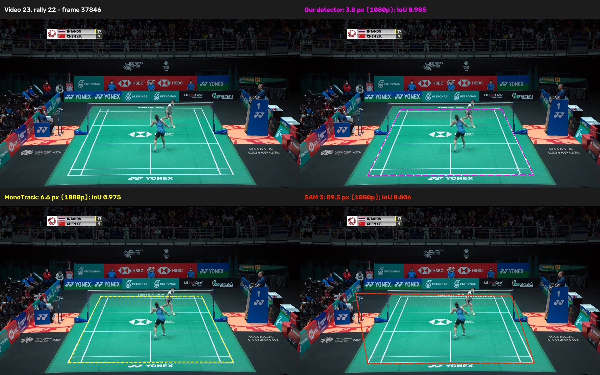
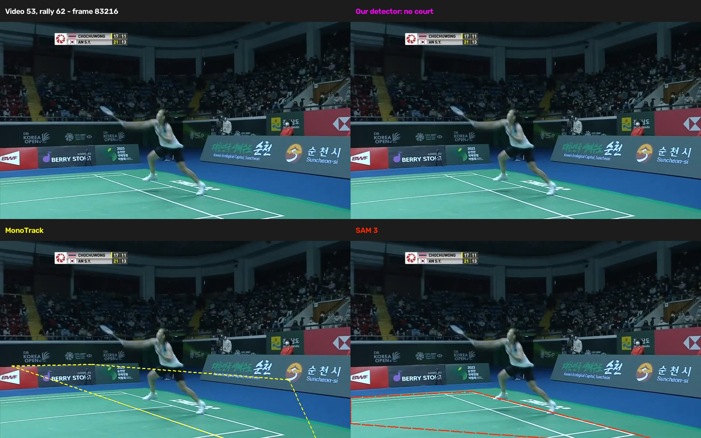
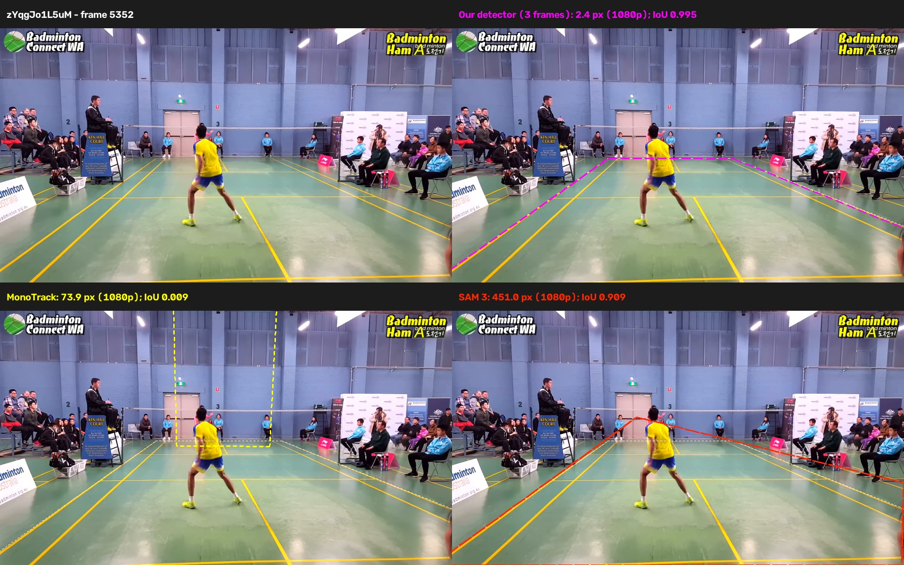
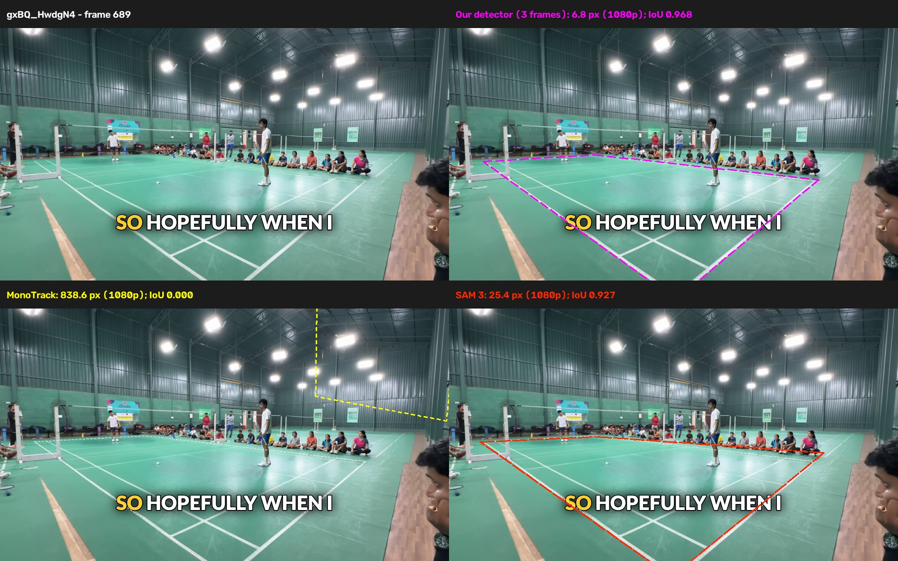

# How our court detector compares with MonoTrack and SAM 3

Our [court detector](../../../docs/court_detector/README.md) is the most
accurate of the three on broadcast rallies: median corner error **3.8 px**,
against **6.5 px for MonoTrack** and **6.6 px for SAM 3**. It returns no court
slightly more often (14 of 3,327 rallies, against 9 and 1).

On amateur footage the gap is much larger. Using players and three nearby
frames, ours found the court in all 27 labelled frames at a **3.1 px** median.
MonoTrack and SAM 3, given one image each, missed 3 frames each and had medians
of **104.6 px** and **67.3 px**. This makes ours the stronger option for
annotating these amateur clips, where single-image detectors sometimes outline
a wall instead of the court.

## Scoring

- **Corner error:** mean distance to reference corners inside the image,
  using the best cyclic ordering and direction. Errors include returned courts
  only and use 1080p-equivalent pixels: distance × 1080 / image height, preserving
  aspect ratio. ShuttleSet22 is already 1920×1080 throughout.
- **IoU:** overlap area over union area, after clipping both outlines to the
  image. A missing court scores zero.

SAM 3 uses [fixed settings](sam3/README.md#method): prompt
`court markings`, scores above 0.5 and an enclosing four-sided fit around the
outer perimeter of the markings. Figures
show ours in fluorescent pink, MonoTrack in yellow, SAM 3 in red and the
reference in white.

## Broadcast rallies (ShuttleSet22)

We scored all 3,327 rallies from 46 videos against ShuttleSet22's main-camera
corners, including midpoints showing another view. All methods use the same
reference, even for those alternate views. Ours uses rally video mode
with its player check; MonoTrack and SAM 3 see each rally's middle frame.

Table 1. "Within 5 px" is a share of all 3,327 rallies.

| Detector | No court | Median error | 90th percentile | Within 5 px | Mean IoU |
|---|---:|---:|---:|---:|---:|
| Ours | 14 | 3.8 px | 6.7 px | 85.8% | 0.978 |
| MonoTrack | 9 | 6.5 px | 9.0 px | 17.2% | 0.969 |
| SAM 3 | 1 | 6.6 px | 29.9 px | 40.5% | 0.961 |

Our per-video median beats MonoTrack's in 44 of 46 videos and SAM 3's in 34.
All 27 of our errors above 15 px are in video 17, whose reference doesn't follow
a camera change. In [rally 52](examples/video17_rally052.jpg), ours and
MonoTrack follow the painted court while the reference sits outside it.

Figure 1. A large SAM 3 error: video 23, rally 22. Ours (3.8 px) and MonoTrack (6.6 px) sit on the
outer court lines. SAM 3 (89.5 px) reaches past both far corners, more on the
left.

Figure 2. Video 53, rally 62, a side camera with no matching reference, so we
omit the reference and scores. Ours returns no court. MonoTrack runs up onto the advertising boards.
SAM 3 outlines only the markings in view.

## Amateur footage

The manual set has 27 labelled frames from eight amateur videos at three
resolutions; seven frames come from one training hall. Seven
of the eight videos supplied images used while choosing SAM 3's settings, so
this is a small diagnostic set, not a held-out test.

Ours fits three distinct images within a three-second window and checks players
using 31 pose samples. It keeps the better of the aligned refit and the best
individual fit. The window shifts forward near a video start
([details](README.md#manually-annotated-courts)). MonoTrack and SAM 3 use only
the target image.

To compare midpoint sampling, we also score each static video's middle frame.
Three clips reuse exact labels from the 27. Four use the mean of the video's
labelled corners: **to update with annotation of exact middle frame**. C1jR4vZmrkI's camera moves, so we defer
its midpoint but keep its three labelled frames. The groups overlap and are not
independent.

Table 2. Amateur frames.

| Frames | Detector | No court | Median error | Mean IoU |
|---|---|---:|---:|---:|
| 27 labelled | Ours | 0 | 3.1 px | 0.974 |
| 27 labelled | MonoTrack | 3 | 104.6 px | 0.443 |
| 27 labelled | SAM 3 | 3 | 67.3 px | 0.773 |
| 7 midpoints | Ours | 0 | 3.4 px | 0.988 |
| 7 midpoints | MonoTrack | 1 | 65.2 px | 0.508 |
| 7 midpoints | SAM 3 | 1 | 246.2 px | 0.715 |

Our detector places the near baseline below the picture in two E8WW8DFCnwk frames
([example](examples/E8WW8DFCnwk_sample_f156.jpg)). Only their far corners are
in frame, giving errors of 7.6 and 10.6 px; IoU exposes the larger outline error
(0.813 and 0.835).

Figure 3. Club tournament, frame 5352. Ours follows the court (2.4 px,
IoU 0.995). MonoTrack folds its outline up the wall (IoU 0.009). SAM 3's far
edge rises towards the player's head, and its far-right corner reaches the
image edge. Its 451.0 px corner error contrasts with a high IoU of 0.909.

Figure 4. gxBQ_HwdgN4, frame 689, the training hall. Ours follows the court
(6.8 px, IoU 0.968). MonoTrack outlines part of the wall (838.6 px, IoU 0).
SAM 3 follows the court less closely (25.4 px, IoU 0.927).

Without players or extra frames, our single-image mode scores a 4.1 px median
but misses one frame and outlines the wall in four training-hall frames (mean
IoU 0.778; [example](examples/image_only/gxBQ_HwdgN4_f689.jpg)).

## Results and reproduction

- Broadcast: [summary](results/sset22/comparison_summary.json.gz),
  [per rally](results/sset22/comparison_rallies.json.gz),
  [SAM 3 settings and versions](results/sset22/summary.json.gz)
- Amateur: [summary](results/manual/comparison_summary.json.gz),
  [per frame](results/manual/comparison_frames.json.gz),
  [single-image summary](results/manual/image_only_summary.json.gz),
  [single-image per frame](results/manual/image_only_frames.json.gz)
- Setup and commands: [benchmark README](README.md),
  [SAM 3 guide](sam3/README.md)
